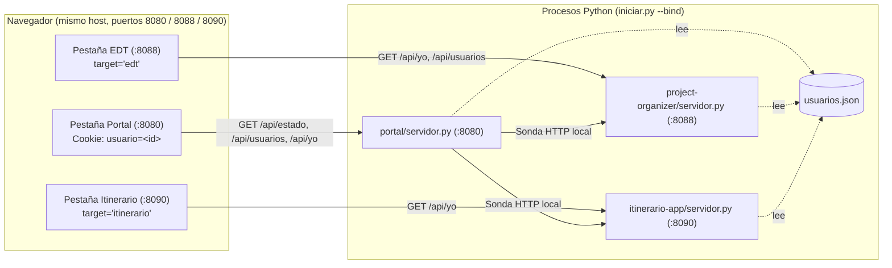
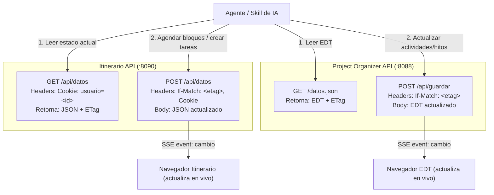

# Arquitectura del Sistema (`~/apps`)

## Visión general

El espacio de trabajo `~/apps` integra tres piezas independientes que comparten identidad de usuario en el navegador mediante cookies de nivel de host y un archivo común `~/apps/usuarios.json`:

1. **Portal (`~/apps/portal/`, puerto `8080`)**: punto de entrada único servido por `iniciar.py`. Permite elegir el usuario activo, muestra el estado en línea/caído de cada servidor y abre cada herramienta en su propia pestaña con nombre (`target="edt"` y `target="itinerario"`).
2. **Project Organizer / EDT (`~/apps/project-organizer/`, puerto `8088`)**: aplicación de desglose de actividades, diagrama de Gantt, tabla e hitos.
3. **Itinerario (`~/apps/itinerario-app/`, puerto `8090`)**: aplicación de horario diario/semanal, entregas pendientes y planificador automático.



---

## Cómo se comunican las tres piezas

### 1. Lanzamiento y ciclo de vida (`iniciar.py`)
- `iniciar.py` valida primero `~/apps/usuarios.json` (`validar_usuarios`) y verifica con sockets TCP que los puertos `8080`, `8088` y `8090` estén libres en la dirección indicada por `--bind` (por defecto `127.0.0.1`).
- Si algún puerto está ocupado, informa qué servicio y puerto están en uso y termina con código `1` antes de lanzar subprocesos.
- Si los tres puertos están disponibles, lanza `project-organizer/servidor.py` (`8088`) e `itinerario-app/servidor.py` (`8090`) como subprocesos hijos y levanta `ManejadorPortal` en el puerto `8080`.
- Al recibir `SIGINT` (`Ctrl+C`) o `SIGTERM`, cierra el servidor del portal y termina ambos subprocesos esperando su salida para no dejar procesos huérfanos.

### 2. Resolución de rutas y reutilización de pestañas
- El portal publica cada aplicación bajo su propio prefijo en el mismo hostname: `/edt/` hacia el puerto `8088` y `/itinerario/` hacia el `8090`. El servidor del portal reenvía la petición quitando el prefijo, de modo que las apps siguen escuchando en `127.0.0.1` y no hay que abrir nada más.
- Las apps piden su API con rutas **relativas** (`api/datos`, no `/api/datos`), así funcionan igual servidas bajo el prefijo o abiertas por separado en su propio puerto.
- Cada tarjeta usa un atributo `target` con nombre fijo (`target="edt"` y `target="itinerario"`), de modo que el portal permanece abierto en su pestaña y los clics posteriores reutilizan la pestaña de la aplicación correspondiente.
- El flujo SSE (`/api/eventos`) se reenvía por trozos con `flush`, sin acumular la respuesta, para que los cambios lleguen en vivo también a través del túnel.

### 3. Verificación de estado sin CORS (`GET /api/estado`)
- Para mostrar si cada servidor está **En línea** o **Caído** sin depender de cabeceras CORS entre puertos distintos, el cliente del portal consulta su propio endpoint `GET /api/estado` en el puerto `8080`.
- `portal/servidor.py` realiza la sonda del lado del servidor hacia los puertos `8088` y `8090` y responde:
  ```json
  {
    "edt": { "puerto": 8088, "enLinea": true },
    "itinerario": { "puerto": 8090, "enLinea": true }
  }
  ```

### 4. Identidad compartida por cookie y `quien_es(peticion)`
- Según el estándar RFC 6265, las cookies HTTP tienen alcance por **host** (dominio o dirección IP) y **no se aíslan por puerto**.
- Cuando el usuario elige su perfil en el portal (`8080`), el navegador guarda:
  ```
  usuario=<id>; Path=/; SameSite=Lax
  ```
- Automáticamente, el navegador envía esa misma cookie `usuario=<id>` en todas las peticiones a los puertos `8080`, `8088` y `8090` del mismo host.
- Cada `servidor.py` implementa la función aislada `quien_es(peticion)` y expone `GET /api/yo`:
  1. Si viene el encabezado `Cf-Access-Authenticated-User-Email` (Cloudflare Access), **es la única fuente válida**: busca coincidencia por `correo` en `usuarios.json` y, si no la hay, devuelve `null`. La cookie se ignora, así nadie puede suplantar a otro escribiendo `usuario=<otro-id>`.
  2. Solo si **no** viene ese encabezado (uso local, sin túnel) lee la cookie `usuario` y busca coincidencia por `id` en `usuarios.json`.
  3. Devuelve `{ "id", "nombre", "rol" }` o `null` si no hay identidad válida.
  4. Detrás de Access, `GET /api/usuarios` no expone la lista completa: el portal y el Itinerario devuelven solo la ficha del usuario activo, y el EDT devuelve id/nombre/rol sin correos. En el Itinerario, un correo autorizado por Access pero ausente de `usuarios.json` recibe `403` en lugar del archivo compartido por defecto.
- En el EDT (`project-organizer`), además de mostrar el usuario activo en la barra superior, el servidor expone `GET /api/usuarios` para que el selector de responsable (`#po-editor-responsable`) ofrezca los nombres de `usuarios.json` junto con los miembros del equipo del proyecto, manteniendo intacto el esquema de `datos.json` (el responsable sigue guardándose como texto con el nombre).
- En el Itinerario (`itinerario-app`), la identidad activa determina qué archivo en `itinerario-app/usuarios/<id>.json` se carga y se edita. Para `jesus-aragon` y `jysusman` se entrega el itinerario con las materias y tareas de Jesús Aragón; para los demás usuarios (`paola-bello`, `maria-jose`, `santiago-benavides`, etc.) se crea y entrega un archivo en blanco. Cada guardado (`POST /api/datos`) escribe exclusivamente en el archivo de ese usuario y genera respaldos en `respaldos/datos_<id>_<timestamp>.json`.
- **Autenticación sin contraseñas locales:** en desarrollo y red local no se exige contraseña; la selección es libre mediante el selector de usuario en la cabecera o el portal. En producción, el acceso se delega al túnel de Cloudflare Access mediante autenticación por correo o Google Workspace (One-Time PIN).

### 5. Modo autónomo
- Si `project-organizer/servidor.py` o `itinerario-app/servidor.py` se ejecutan solos desde su carpeta y no existe `usuarios.json` o no hay cookie activa, `GET /api/yo` devuelve `null` y la barra superior simplemente omite el indicador de usuario. En Itinerario se utiliza `datos.json` por defecto.

---

## 🤖 Integración con Skills de IA y Uso vía API

Ambos sistemas fueron diseñados con APIs REST minimalistas en JSON puro y control de concurrencia optimista (`ETag` / `If-Match`), lo que facilita conectarlos a agentes de IA (como Antigravity Skills, MCP Tools o scripts automatizados):



### Contrato de uso para Skills de IA:
1. **Identidad del usuario:** La skill solo debe incluir el encabezado `Cookie: usuario=<id>` en cada petición HTTP hacia el puerto `8090` (ejemplo: `usuario=paola-bello`).
2. **Lectura segura:** `GET /api/datos` retorna el estado completo y la cabecera `ETag`.
3. **Escritura atómica:** `POST /api/datos` requiere `If-Match: "<etag>"`. Si un usuario estaba editando a la vez en su navegador, el servidor responde `409 Conflict`, permitiendo a la skill reintentar o reconciliar sin sobreescribir destructivamente.
4. **Sincronización instantánea:** Cuando la skill guarda un cambio, el servidor emite Server-Sent Events (`/api/eventos`), provocando que la interfaz web abierta en la pantalla del usuario se actualice automáticamente sin necesidad de recargar la página.
