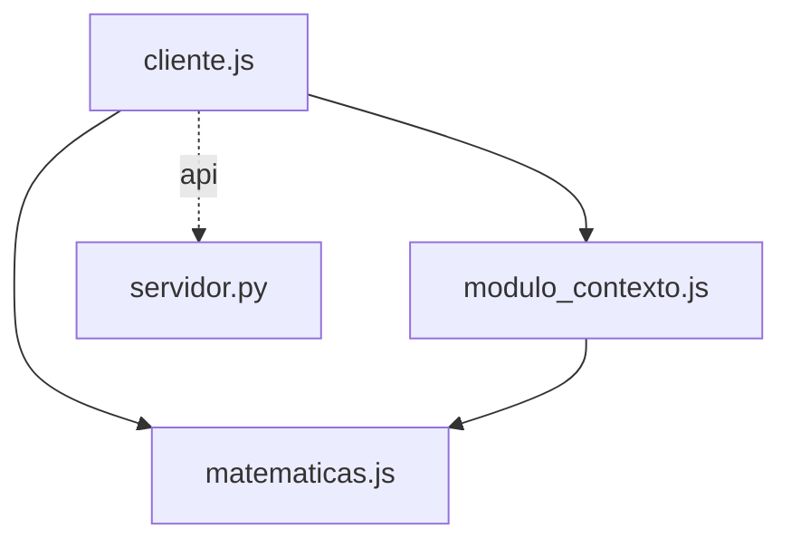

# Grafo de Código — mini-proyecto

Generado automáticamente por `herramientas/grafo.mjs`.

## Resumen

- **Nodos:** 9 (funciones y métodos)
- **Aristas totales:** 17
  - **Resueltas:** 11
  - **Dudosas:** 3 (21.4%)
  - **Externas (nativas/DOM/D3):** 3

## Diagrama de Módulos

## Módulos y Funciones

### `cliente.js`

| Función / Método | Archivo:Línea | Llamada por | Llama a |
|---|---|---|---|
| `accionInterna` | `cliente.js:4` | `procesarDatos` (cliente.js) (L18) | — |
| `procesarDatos` | `cliente.js:8` | — | `ManejadorServidor.manejar_saludo_get` (servidor.py) (L24) *(API GET /api/saludo)* `ManejadorServidor.manejar_saludo_post` (servidor.py) (L27) *(API POST /api/saludo)* `sumar` (matematicas.js) (L10) `matematicas.js:Calculadora` (L13) *(dudosa)* `calc.acumular` (L14) *(dudosa)* `accionInterna` (cliente.js) (L18) `ejecutarOperacion` (modulo_contexto.js) (L21) `llamadaMisteriosa` (L33) *(dudosa)* |

### `matematicas.js`

| Función / Método | Archivo:Línea | Llamada por | Llama a |
|---|---|---|---|
| `Calculadora.acumular` | `matematicas.js:10` | — | `sumar` (matematicas.js) (L11) |
| `sumar` | `matematicas.js:1` | `procesarDatos` (cliente.js) (L10) `Calculadora.acumular` (matematicas.js) (L11) `ejecutarOperacion` (modulo_contexto.js) (L2) | — |

### `modulo_contexto.js`

| Función / Método | Archivo:Línea | Llamada por | Llama a |
|---|---|---|---|
| `ejecutarOperacion` | `modulo_contexto.js:1` | `procesarDatos` (cliente.js) (L21) | `sumar` (matematicas.js) (L2) |

### `servidor.py`

| Función / Método | Archivo:Línea | Llamada por | Llama a |
|---|---|---|---|
| `ManejadorServidor.do_GET` | `servidor.py:5` | — | `ManejadorServidor.manejar_saludo_get` (servidor.py) (L7) |
| `ManejadorServidor.do_POST` | `servidor.py:10` | — | `ManejadorServidor.manejar_saludo_post` (servidor.py) (L12) |
| `ManejadorServidor.manejar_saludo_get` | `servidor.py:15` | `ManejadorServidor.do_GET` (servidor.py) (L7) `procesarDatos` (cliente.js) (L24) | — |
| `ManejadorServidor.manejar_saludo_post` | `servidor.py:20` | `ManejadorServidor.do_POST` (servidor.py) (L12) `procesarDatos` (cliente.js) (L27) | — |

