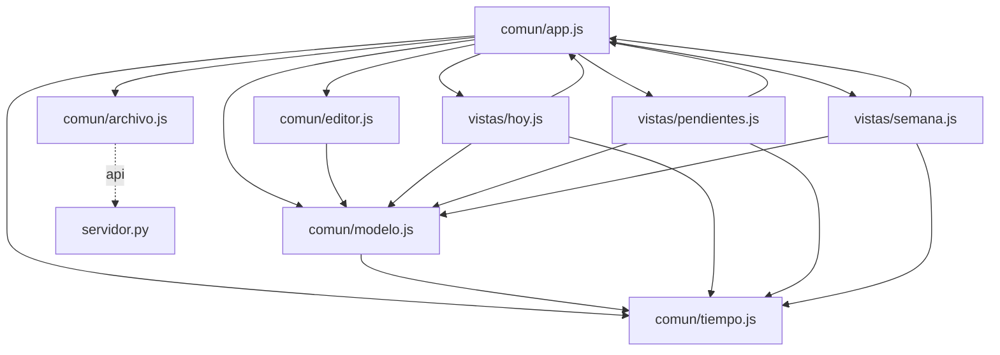

# Grafo de Código — itinerario-app

Generado automáticamente por `herramientas/grafo.mjs`.

## Resumen

- **Nodos:** 112 (funciones y métodos)
- **Aristas totales:** 1219
  - **Resueltas:** 415
  - **Dudosas:** 32 (7.2%)
  - **Externas (nativas/DOM/D3):** 772

## Diagrama de Módulos

## Módulos y Funciones

### `comun/app.js`

| Función / Método | Archivo:Línea | Llamada por | Llama a |
|---|---|---|---|
| `AplicacionItinerario.inicializarDom` | `comun/app.js:67` | — | `AplicacionItinerario.cambiarVista` (comun/app.js) (L87) `AplicacionItinerario.deshacer` (comun/app.js) (L90) `AplicacionItinerario.rehacer` (comun/app.js) (L91) `Editor.abrir` (comun/editor.js) (L93) |
| `AplicacionItinerario.inicializarEditor` | `comun/app.js:97` | — | `comun/editor.js:Editor` (L98) *(dudosa)* `AplicacionItinerario.aplicarModificacion` (comun/app.js) (L101) `clonar` (comun/modelo.js) (L102) `AplicacionItinerario.mostrarAviso` (comun/app.js) (L106) `AplicacionItinerario.aplicarModificacion` (comun/app.js) (L110) `crearTarea` (comun/modelo.js) (L110) `AplicacionItinerario.aplicarModificacion` (comun/app.js) (L111) `crearBloque` (comun/modelo.js) (L111) `AplicacionItinerario.aplicarModificacion` (comun/app.js) (L112) `crearFijo` (comun/modelo.js) (L112) `AplicacionItinerario.aplicarModificacion` (comun/app.js) (L114) `actualizarTarea` (comun/modelo.js) (L114) `AplicacionItinerario.aplicarModificacion` (comun/app.js) (L115) `actualizarBloque` (comun/modelo.js) (L115) `AplicacionItinerario.aplicarModificacion` (comun/app.js) (L116) `actualizarFijo` (comun/modelo.js) (L116) `AplicacionItinerario.aplicarModificacion` (comun/app.js) (L120) `eliminarTarea` (comun/modelo.js) (L120) `AplicacionItinerario.aplicarModificacion` (comun/app.js) (L121) `eliminarBloque` (comun/modelo.js) (L121) `AplicacionItinerario.aplicarModificacion` (comun/app.js) (L122) `eliminarFijo` (comun/modelo.js) (L122) `AplicacionItinerario.duplicarElemento` (comun/app.js) (L125) |
| `AplicacionItinerario.inicializarVistas` | `comun/app.js:133` | — | `vistas/hoy.js:VistaHoy` (L134) *(dudosa)* `AplicacionItinerario.abrirEditor` (comun/app.js) (L135) `AplicacionItinerario.renderizarVistaActual` (comun/app.js) (L138) `AplicacionItinerario.aplicarModificacion` (comun/app.js) (L141) `marcarBloqueHecho` (comun/modelo.js) (L141) `AplicacionItinerario.aplicarModificacion` (comun/app.js) (L144) `actualizarBloque` (comun/modelo.js) (L144) `AplicacionItinerario.aplicarModificacion` (comun/app.js) (L147) `actualizarBloque` (comun/modelo.js) (L147) `AplicacionItinerario.aplicarModificacion` (comun/app.js) (L150) `eliminarBloque` (comun/modelo.js) (L150) `AplicacionItinerario.ejecutarPlanificador` (comun/app.js) (L153) `AplicacionItinerario.aplicarModificacion` (comun/app.js) (L156) `AplicacionItinerario.mostrarAviso` (comun/app.js) (L160) `AplicacionItinerario.aplicarModificacion` (comun/app.js) (L163) `AplicacionItinerario.mostrarAviso` (comun/app.js) (L167) `AplicacionItinerario.abrirEditorNuevo` (comun/app.js) (L170) `AplicacionItinerario.abrirEditorNuevo` (comun/app.js) (L173) `vistas/semana.js:VistaSemana` (L186) *(dudosa)* `AplicacionItinerario.abrirEditor` (comun/app.js) (L187) `AplicacionItinerario.renderizarVistaActual` (comun/app.js) (L190) `AplicacionItinerario.abrirEditorNuevo` (comun/app.js) (L193) `AplicacionItinerario.abrirEditorNuevo` (comun/app.js) (L196) `vistas/pendientes.js:VistaPendientes` (L209) *(dudosa)* `AplicacionItinerario.abrirEditor` (comun/app.js) (L210) `AplicacionItinerario.abrirEditorNuevo` (comun/app.js) (L212) `AplicacionItinerario.aplicarModificacion` (comun/app.js) (L219) `crearTarea` (comun/modelo.js) (L219) `AplicacionItinerario.aplicarModificacion` (comun/app.js) (L229) `marcarTareaHecha` (comun/modelo.js) (L229) `AplicacionItinerario.renderizarVistaActual` (comun/app.js) (L233) `AplicacionItinerario.renderizarVistaActual` (comun/app.js) (L237) `AplicacionItinerario.renderizarVistaActual` (comun/app.js) (L240) |
| `AplicacionItinerario.iniciar` | `comun/app.js:245` | `AplicacionItinerario.iniciar` (comun/app.js) (L280) `AplicacionItinerario.cambiarUsuario` (comun/app.js) (L341) `AplicacionItinerario.mostrarBannerConflicto` (comun/app.js) (L477) | `AplicacionItinerario.actualizarEstadoGuardado` (comun/app.js) (L247) `cargarDatos` (comun/archivo.js) (L249) `cargarUsuarioActual` (comun/archivo.js) (L250) `cargarListaUsuarios` (comun/archivo.js) (L251) `AplicacionItinerario.actualizarIndicadorUsuario` (comun/app.js) (L255) `validarDatos` (comun/modelo.js) (L257) `AplicacionItinerario.mostrarAviso` (comun/app.js) (L265) `AplicacionItinerario.actualizarEstadoGuardado` (comun/app.js) (L268) `AplicacionItinerario.actualizarBotonesHistorial` (comun/app.js) (L269) `AplicacionItinerario.renderizarVistaActual` (comun/app.js) (L270) `AplicacionItinerario.conectarEventosServidor` (comun/app.js) (L271) `cargarUsuarioActual` (comun/archivo.js) (L276) `AplicacionItinerario.iniciar` (comun/app.js) (L280) `AplicacionItinerario.actualizarEstadoGuardado` (comun/app.js) (L286) `AplicacionItinerario.mostrarAviso` (comun/app.js) (L287) |
| `AplicacionItinerario.actualizarIndicadorUsuario` | `comun/app.js:291` | `AplicacionItinerario.iniciar` (comun/app.js) (L255) | `AplicacionItinerario.cambiarUsuario` (comun/app.js) (L321) |
| `AplicacionItinerario.cambiarUsuario` | `comun/app.js:338` | `AplicacionItinerario.actualizarIndicadorUsuario` (comun/app.js) (L321) | `guardarCookieUsuario` (comun/archivo.js) (L339) `cerrar` (L340) *(dudosa)* `AplicacionItinerario.iniciar` (comun/app.js) (L341) `AplicacionItinerario.mostrarAviso` (comun/app.js) (L343) |
| `AplicacionItinerario.conectarEventosServidor` | `comun/app.js:347` | `AplicacionItinerario.iniciar` (comun/app.js) (L271) | `cargarDatos` (comun/archivo.js) (L369) `esEcoPropio` (comun/modelo.js) (L370) `AplicacionItinerario.manejarCambioExterno` (comun/app.js) (L371) `esEcoPropio` (comun/modelo.js) (L387) `AplicacionItinerario.manejarCambioExterno` (comun/app.js) (L391) |
| `AplicacionItinerario.manejarCambioExterno` | `comun/app.js:403` | `AplicacionItinerario.conectarEventosServidor` (comun/app.js) (L371) `AplicacionItinerario.conectarEventosServidor` (comun/app.js) (L391) | `esEcoPropio` (comun/modelo.js) (L404) `cargarDatos` (comun/archivo.js) (L414) `esEcoPropio` (comun/modelo.js) (L419) `validarDatos` (comun/modelo.js) (L423) `AplicacionItinerario.renderizarVistaActual` (comun/app.js) (L426) `Editor.cerrar` (comun/editor.js) (L441) `AplicacionItinerario.mostrarAviso` (comun/app.js) (L442) `AplicacionItinerario.mostrarAviso` (comun/app.js) (L446) `AplicacionItinerario.mostrarBannerConflicto` (comun/app.js) (L452) |
| `AplicacionItinerario.mostrarBannerConflicto` | `comun/app.js:456` | `AplicacionItinerario.manejarCambioExterno` (comun/app.js) (L452) `AplicacionItinerario.guardarInmediato` (comun/app.js) (L672) | `servidor:/api/datos` (L487) *(dudosa)* `AplicacionItinerario.iniciar` (comun/app.js) (L477) `AplicacionItinerario.mostrarAviso` (comun/app.js) (L478) `AplicacionItinerario.guardarInmediato` (comun/app.js) (L492) |
| `AplicacionItinerario.cambiarVista` | `comun/app.js:496` | `AplicacionItinerario.inicializarDom` (comun/app.js) (L87) | `AplicacionItinerario.renderizarVistaActual` (comun/app.js) (L501) |
| `AplicacionItinerario.renderizarVistaActual` | `comun/app.js:504` | `AplicacionItinerario.inicializarVistas` (comun/app.js) (L138) `AplicacionItinerario.inicializarVistas` (comun/app.js) (L190) `AplicacionItinerario.inicializarVistas` (comun/app.js) (L233) `AplicacionItinerario.inicializarVistas` (comun/app.js) (L237) `AplicacionItinerario.inicializarVistas` (comun/app.js) (L240) `AplicacionItinerario.iniciar` (comun/app.js) (L270) `AplicacionItinerario.manejarCambioExterno` (comun/app.js) (L426) `AplicacionItinerario.cambiarVista` (comun/app.js) (L501) `AplicacionItinerario.aplicarModificacion` (comun/app.js) (L602) `AplicacionItinerario.deshacer` (comun/app.js) (L620) `AplicacionItinerario.rehacer` (comun/app.js) (L634) `VistaHoy.conectarEventos` (vistas/hoy.js) (L347) `VistaHoy.conectarEventos` (vistas/hoy.js) (L351) `VistaHoy.conectarEventos` (vistas/hoy.js) (L355) `VistaPendientes.conectarEventos` (vistas/pendientes.js) (L236) `VistaPendientes.conectarEventos` (vistas/pendientes.js) (L242) `VistaSemana.conectarEventos` (vistas/semana.js) (L269) `VistaSemana.conectarEventos` (vistas/semana.js) (L273) `VistaSemana.conectarEventos` (vistas/semana.js) (L277) | `AplicacionItinerario.actualizarAvisosNoAlcanza` (comun/app.js) (L506) `instanciaVistaHoy.renderizar` (L508) *(dudosa)* `instanciaVistaSemana.renderizar` (L510) *(dudosa)* `instanciaVistaPendientes.renderizar` (L512) *(dudosa)* |
| `AplicacionItinerario.actualizarAvisosNoAlcanza` | `comun/app.js:516` | `AplicacionItinerario.renderizarVistaActual` (comun/app.js) (L506) | `aFechaIso` (comun/tiempo.js) (L519) `aHoraIso` (comun/tiempo.js) (L519) `planificar` (comun/modelo.js) (L520) |
| `AplicacionItinerario.ejecutarPlanificador` | `comun/app.js:525` | `AplicacionItinerario.inicializarVistas` (comun/app.js) (L153) `VistaHoy.conectarEventos` (vistas/hoy.js) (L335) | `aFechaIso` (comun/tiempo.js) (L527) `aHoraIso` (comun/tiempo.js) (L527) `planificar` (comun/modelo.js) (L533) `AplicacionItinerario.aplicarModificacion` (comun/app.js) (L538) `AplicacionItinerario.mostrarAviso` (comun/app.js) (L548) `AplicacionItinerario.mostrarAviso` (comun/app.js) (L550) |
| `AplicacionItinerario.abrirEditor` | `comun/app.js:554` | `AplicacionItinerario.inicializarVistas` (comun/app.js) (L135) `AplicacionItinerario.inicializarVistas` (comun/app.js) (L187) `AplicacionItinerario.inicializarVistas` (comun/app.js) (L210) | `Editor.abrir` (comun/editor.js) (L556) |
| `AplicacionItinerario.abrirEditorNuevo` | `comun/app.js:559` | `AplicacionItinerario.inicializarVistas` (comun/app.js) (L170) `AplicacionItinerario.inicializarVistas` (comun/app.js) (L173) `AplicacionItinerario.inicializarVistas` (comun/app.js) (L193) `AplicacionItinerario.inicializarVistas` (comun/app.js) (L196) `AplicacionItinerario.inicializarVistas` (comun/app.js) (L212) `VistaHoy.conectarEventos` (vistas/hoy.js) (L368) `VistaPendientes.conectarEventos` (vistas/pendientes.js) (L247) `VistaSemana.conectarEventos` (vistas/semana.js) (L290) | `generarId` (comun/modelo.js) (L560) `Editor.abrir` (comun/editor.js) (L562) |
| `AplicacionItinerario.duplicarElemento` | `comun/app.js:565` | `AplicacionItinerario.inicializarEditor` (comun/app.js) (L125) | `clonar` (comun/modelo.js) (L569) `generarId` (comun/modelo.js) (L570) `AplicacionItinerario.aplicarModificacion` (comun/app.js) (L574) `crearTarea` (comun/modelo.js) (L574) `clonar` (comun/modelo.js) (L579) `generarId` (comun/modelo.js) (L580) `AplicacionItinerario.aplicarModificacion` (comun/app.js) (L583) `crearBloque` (comun/modelo.js) (L583) |
| `AplicacionItinerario.aplicarModificacion` | `comun/app.js:588` | `AplicacionItinerario.inicializarEditor` (comun/app.js) (L101) `AplicacionItinerario.inicializarEditor` (comun/app.js) (L110) `AplicacionItinerario.inicializarEditor` (comun/app.js) (L111) `AplicacionItinerario.inicializarEditor` (comun/app.js) (L112) `AplicacionItinerario.inicializarEditor` (comun/app.js) (L114) `AplicacionItinerario.inicializarEditor` (comun/app.js) (L115) `AplicacionItinerario.inicializarEditor` (comun/app.js) (L116) `AplicacionItinerario.inicializarEditor` (comun/app.js) (L120) `AplicacionItinerario.inicializarEditor` (comun/app.js) (L121) `AplicacionItinerario.inicializarEditor` (comun/app.js) (L122) `AplicacionItinerario.inicializarVistas` (comun/app.js) (L141) `AplicacionItinerario.inicializarVistas` (comun/app.js) (L144) `AplicacionItinerario.inicializarVistas` (comun/app.js) (L147) `AplicacionItinerario.inicializarVistas` (comun/app.js) (L150) `AplicacionItinerario.inicializarVistas` (comun/app.js) (L156) `AplicacionItinerario.inicializarVistas` (comun/app.js) (L163) `AplicacionItinerario.inicializarVistas` (comun/app.js) (L219) `AplicacionItinerario.inicializarVistas` (comun/app.js) (L229) `AplicacionItinerario.ejecutarPlanificador` (comun/app.js) (L538) `AplicacionItinerario.duplicarElemento` (comun/app.js) (L574) `AplicacionItinerario.duplicarElemento` (comun/app.js) (L583) `VistaHoy.conectarEventos` (vistas/hoy.js) (L339) `VistaHoy.conectarEventos` (vistas/hoy.js) (L343) `VistaHoy.conectarEventos` (vistas/hoy.js) (L396) `VistaHoy.conectarEventos` (vistas/hoy.js) (L406) | `clonar` (comun/modelo.js) (L590) `transformacionFn` (L597) *(dudosa)* `AplicacionItinerario.actualizarEstadoGuardado` (comun/app.js) (L599) `AplicacionItinerario.actualizarBotonesHistorial` (comun/app.js) (L600) `AplicacionItinerario.renderizarVistaActual` (comun/app.js) (L602) `Editor.abrir` (comun/editor.js) (L606) `AplicacionItinerario.programarAutoguardado` (comun/app.js) (L610) |
| `AplicacionItinerario.deshacer` | `comun/app.js:613` | `AplicacionItinerario.inicializarDom` (comun/app.js) (L90) `AplicacionItinerario.conectarAtajosTeclado` (comun/app.js) (L722) | `clonar` (comun/modelo.js) (L615) `AplicacionItinerario.actualizarEstadoGuardado` (comun/app.js) (L618) `AplicacionItinerario.actualizarBotonesHistorial` (comun/app.js) (L619) `AplicacionItinerario.renderizarVistaActual` (comun/app.js) (L620) `Editor.abrir` (comun/editor.js) (L622) `AplicacionItinerario.programarAutoguardado` (comun/app.js) (L624) |
| `AplicacionItinerario.rehacer` | `comun/app.js:627` | `AplicacionItinerario.inicializarDom` (comun/app.js) (L91) `AplicacionItinerario.conectarAtajosTeclado` (comun/app.js) (L720) `AplicacionItinerario.conectarAtajosTeclado` (comun/app.js) (L730) | `clonar` (comun/modelo.js) (L629) `AplicacionItinerario.actualizarEstadoGuardado` (comun/app.js) (L632) `AplicacionItinerario.actualizarBotonesHistorial` (comun/app.js) (L633) `AplicacionItinerario.renderizarVistaActual` (comun/app.js) (L634) `Editor.abrir` (comun/editor.js) (L636) `AplicacionItinerario.programarAutoguardado` (comun/app.js) (L638) |
| `AplicacionItinerario.actualizarBotonesHistorial` | `comun/app.js:641` | `AplicacionItinerario.iniciar` (comun/app.js) (L269) `AplicacionItinerario.aplicarModificacion` (comun/app.js) (L600) `AplicacionItinerario.deshacer` (comun/app.js) (L619) `AplicacionItinerario.rehacer` (comun/app.js) (L633) | — |
| `AplicacionItinerario.programarAutoguardado` | `comun/app.js:646` | `AplicacionItinerario.aplicarModificacion` (comun/app.js) (L610) `AplicacionItinerario.deshacer` (comun/app.js) (L624) `AplicacionItinerario.rehacer` (comun/app.js) (L638) | `AplicacionItinerario.guardarInmediato` (comun/app.js) (L651) |
| `AplicacionItinerario.guardarInmediato` | `comun/app.js:655` | `AplicacionItinerario.mostrarBannerConflicto` (comun/app.js) (L492) `AplicacionItinerario.programarAutoguardado` (comun/app.js) (L651) `AplicacionItinerario.conectarAtajosTeclado` (comun/app.js) (L712) | `AplicacionItinerario.actualizarEstadoGuardado` (comun/app.js) (L663) `guardarDatos` (comun/archivo.js) (L664) `AplicacionItinerario.actualizarEstadoGuardado` (comun/app.js) (L669) `AplicacionItinerario.actualizarEstadoGuardado` (comun/app.js) (L671) `AplicacionItinerario.mostrarBannerConflicto` (comun/app.js) (L672) `AplicacionItinerario.actualizarEstadoGuardado` (comun/app.js) (L674) `AplicacionItinerario.mostrarAviso` (comun/app.js) (L675) |
| `AplicacionItinerario.actualizarEstadoGuardado` | `comun/app.js:679` | `AplicacionItinerario.iniciar` (comun/app.js) (L247) `AplicacionItinerario.iniciar` (comun/app.js) (L268) `AplicacionItinerario.iniciar` (comun/app.js) (L286) `AplicacionItinerario.aplicarModificacion` (comun/app.js) (L599) `AplicacionItinerario.deshacer` (comun/app.js) (L618) `AplicacionItinerario.rehacer` (comun/app.js) (L632) `AplicacionItinerario.guardarInmediato` (comun/app.js) (L663) `AplicacionItinerario.guardarInmediato` (comun/app.js) (L669) `AplicacionItinerario.guardarInmediato` (comun/app.js) (L671) `AplicacionItinerario.guardarInmediato` (comun/app.js) (L674) | — |
| `AplicacionItinerario.conectarAtajosTeclado` | `comun/app.js:704` | — | `AplicacionItinerario.guardarInmediato` (comun/app.js) (L712) `AplicacionItinerario.rehacer` (comun/app.js) (L720) `AplicacionItinerario.deshacer` (comun/app.js) (L722) `AplicacionItinerario.rehacer` (comun/app.js) (L730) `Editor.cerrar` (comun/editor.js) (L737) |
| `AplicacionItinerario.conectarTema` | `comun/app.js:743` | — | `AplicacionItinerario.aplicarTema` (comun/app.js) (L748) `AplicacionItinerario.aplicarTema` (comun/app.js) (L753) |
| `AplicacionItinerario.aplicarTema` | `comun/app.js:757` | `AplicacionItinerario.conectarTema` (comun/app.js) (L748) `AplicacionItinerario.conectarTema` (comun/app.js) (L753) | — |
| `AplicacionItinerario.mostrarAviso` | `comun/app.js:766` | `AplicacionItinerario.inicializarEditor` (comun/app.js) (L106) `AplicacionItinerario.inicializarVistas` (comun/app.js) (L160) `AplicacionItinerario.inicializarVistas` (comun/app.js) (L167) `AplicacionItinerario.iniciar` (comun/app.js) (L265) `AplicacionItinerario.iniciar` (comun/app.js) (L287) `AplicacionItinerario.cambiarUsuario` (comun/app.js) (L343) `AplicacionItinerario.manejarCambioExterno` (comun/app.js) (L442) `AplicacionItinerario.manejarCambioExterno` (comun/app.js) (L446) `AplicacionItinerario.mostrarBannerConflicto` (comun/app.js) (L478) `AplicacionItinerario.ejecutarPlanificador` (comun/app.js) (L548) `AplicacionItinerario.ejecutarPlanificador` (comun/app.js) (L550) `AplicacionItinerario.guardarInmediato` (comun/app.js) (L675) | — |

### `comun/archivo.js`

| Función / Método | Archivo:Línea | Llamada por | Llama a |
|---|---|---|---|
| `cargarDatos` | `comun/archivo.js:8` | `AplicacionItinerario.iniciar` (comun/app.js) (L249) `AplicacionItinerario.conectarEventosServidor` (comun/app.js) (L369) `AplicacionItinerario.manejarCambioExterno` (comun/app.js) (L414) | `ManejadorItinerario.manejar_get_datos` (servidor.py) (L9) *(API GET /api/datos)* |
| `guardarDatos` | `comun/archivo.js:29` | `AplicacionItinerario.guardarInmediato` (comun/app.js) (L664) | `ManejadorItinerario.manejar_post_datos` (servidor.py) (L31) *(API POST /api/datos)* |
| `cargarUsuarioActual` | `comun/archivo.js:77` | `AplicacionItinerario.iniciar` (comun/app.js) (L250) `AplicacionItinerario.iniciar` (comun/app.js) (L276) | `ManejadorItinerario.manejar_get_yo` (servidor.py) (L79) *(API GET /api/yo)* |
| `cargarListaUsuarios` | `comun/archivo.js:94` | `AplicacionItinerario.iniciar` (comun/app.js) (L251) | `ManejadorItinerario.manejar_get_usuarios` (servidor.py) (L96) *(API GET /api/usuarios)* |
| `guardarCookieUsuario` | `comun/archivo.js:111` | `AplicacionItinerario.cambiarUsuario` (comun/app.js) (L339) | — |

### `comun/editor.js`

| Función / Método | Archivo:Línea | Llamada por | Llama a |
|---|---|---|---|
| `Editor.abrir` | `comun/editor.js:29` | `AplicacionItinerario.inicializarDom` (comun/app.js) (L93) `AplicacionItinerario.abrirEditor` (comun/app.js) (L556) `AplicacionItinerario.abrirEditorNuevo` (comun/app.js) (L562) `AplicacionItinerario.aplicarModificacion` (comun/app.js) (L606) `AplicacionItinerario.deshacer` (comun/app.js) (L622) `AplicacionItinerario.rehacer` (comun/app.js) (L636) | `Editor.renderizar` (comun/editor.js) (L32) |
| `Editor.cerrar` | `comun/editor.js:35` | `AplicacionItinerario.manejarCambioExterno` (comun/app.js) (L441) `AplicacionItinerario.conectarAtajosTeclado` (comun/app.js) (L737) `Editor.renderizar` (comun/editor.js) (L76) `Editor.conectarEventos` (comun/editor.js) (L395) `Editor.conectarEventos` (comun/editor.js) (L420) `Editor.conectarEventos` (comun/editor.js) (L447) | `eventos.onCerrar` (L41) *(dudosa)* |
| `Editor.renderizar` | `comun/editor.js:45` | `Editor.abrir` (comun/editor.js) (L32) `Editor.conectarEventos` (comun/editor.js) (L433) `Editor.conectarEventos` (comun/editor.js) (L440) | `Editor.cerrar` (comun/editor.js) (L76) `Editor.generarHtmlTarea` (comun/editor.js) (L87) `Editor.generarHtmlBloque` (comun/editor.js) (L89) `Editor.generarHtmlFijo` (comun/editor.js) (L91) `Editor.generarHtmlConfig` (comun/editor.js) (L93) `Editor.conectarEventos` (comun/editor.js) (L139) |
| `Editor.generarHtmlTarea` | `comun/editor.js:142` | `Editor.renderizar` (comun/editor.js) (L87) | `calcularMetricasTarea` (comun/modelo.js) (L143) `Editor.escaparHtml` (comun/editor.js) (L164) `Editor.escaparHtml` (comun/editor.js) (L235) |
| `Editor.generarHtmlBloque` | `comun/editor.js:240` | `Editor.renderizar` (comun/editor.js) (L89) | `Editor.escaparHtml` (comun/editor.js) (L259) |
| `Editor.generarHtmlFijo` | `comun/editor.js:288` | `Editor.renderizar` (comun/editor.js) (L91) | `Editor.escaparHtml` (comun/editor.js) (L316) `Editor.escaparHtml` (comun/editor.js) (L348) |
| `Editor.generarHtmlConfig` | `comun/editor.js:365` | `Editor.renderizar` (comun/editor.js) (L93) | — |
| `Editor.conectarEventos` | `comun/editor.js:393` | `Editor.renderizar` (comun/editor.js) (L139) | `Editor.cerrar` (comun/editor.js) (L395) `Editor.extraerDatosFormulario` (comun/editor.js) (L418) `eventos.onActualizar` (L419) *(dudosa)* `Editor.cerrar` (comun/editor.js) (L420) `eventos.onDuplicar` (L426) *(dudosa)* `Editor.renderizar` (comun/editor.js) (L433) `Editor.renderizar` (comun/editor.js) (L440) `eventos.onEliminar` (L446) *(dudosa)* `Editor.cerrar` (comun/editor.js) (L447) |
| `Editor.extraerDatosFormulario` | `comun/editor.js:451` | `Editor.conectarEventos` (comun/editor.js) (L418) | — |
| `Editor.escaparHtml` | `comun/editor.js:515` | `Editor.generarHtmlTarea` (comun/editor.js) (L164) `Editor.generarHtmlTarea` (comun/editor.js) (L235) `Editor.generarHtmlBloque` (comun/editor.js) (L259) `Editor.generarHtmlFijo` (comun/editor.js) (L316) `Editor.generarHtmlFijo` (comun/editor.js) (L348) | — |

### `comun/modelo.js`

| Función / Método | Archivo:Línea | Llamada por | Llama a |
|---|---|---|---|
| `generarId` | `comun/modelo.js:11` | `AplicacionItinerario.abrirEditorNuevo` (comun/app.js) (L560) `AplicacionItinerario.duplicarElemento` (comun/app.js) (L570) `AplicacionItinerario.duplicarElemento` (comun/app.js) (L580) `validarDatos` (comun/modelo.js) (L92) `validarDatos` (comun/modelo.js) (L106) `validarDatos` (comun/modelo.js) (L141) `validarDatos` (comun/modelo.js) (L166) `planificar` (comun/modelo.js) (L724) `planificar` (comun/modelo.js) (L750) `crearTarea` (comun/modelo.js) (L803) `crearBloque` (comun/modelo.js) (L956) `crearFijo` (comun/modelo.js) (L1024) | — |
| `clonar` | `comun/modelo.js:23` | `AplicacionItinerario.inicializarEditor` (comun/app.js) (L102) `AplicacionItinerario.duplicarElemento` (comun/app.js) (L569) `AplicacionItinerario.duplicarElemento` (comun/app.js) (L579) `AplicacionItinerario.aplicarModificacion` (comun/app.js) (L590) `AplicacionItinerario.deshacer` (comun/app.js) (L615) `AplicacionItinerario.rehacer` (comun/app.js) (L629) `validarDatos` (comun/modelo.js) (L55) `crearTarea` (comun/modelo.js) (L802) `actualizarTarea` (comun/modelo.js) (L820) `eliminarTarea` (comun/modelo.js) (L843) `marcarTareaHecha` (comun/modelo.js) (L871) `crearBloque` (comun/modelo.js) (L955) `actualizarBloque` (comun/modelo.js) (L972) `eliminarBloque` (comun/modelo.js) (L983) `marcarBloqueHecho` (comun/modelo.js) (L989) `crearFijo` (comun/modelo.js) (L1023) `actualizarFijo` (comun/modelo.js) (L1044) `eliminarFijo` (comun/modelo.js) (L1055) | — |
| `esEcoPropio` | `comun/modelo.js:36` | `AplicacionItinerario.conectarEventosServidor` (comun/app.js) (L370) `AplicacionItinerario.conectarEventosServidor` (comun/app.js) (L387) `AplicacionItinerario.manejarCambioExterno` (comun/app.js) (L404) `AplicacionItinerario.manejarCambioExterno` (comun/app.js) (L419) | `normalizar` (comun/modelo.js) (L39) `normalizar` (comun/modelo.js) (L40) |
| `validarDatos` | `comun/modelo.js:53` | `AplicacionItinerario.iniciar` (comun/app.js) (L257) `AplicacionItinerario.manejarCambioExterno` (comun/app.js) (L423) | `clonar` (comun/modelo.js) (L55) `generarId` (comun/modelo.js) (L92) `generarId` (comun/modelo.js) (L106) `generarId` (comun/modelo.js) (L141) `horaAMinutos` (comun/tiempo.js) (L149) `generarId` (comun/modelo.js) (L166) |
| `obtenerHijas` | `comun/modelo.js:204` | `calcularMetricasTarea` (comun/modelo.js) (L216) `planificar` (comun/modelo.js) (L504) `VistaPendientes.renderizar` (vistas/pendientes.js) (L50) | — |
| `calcularMetricasTarea` | `comun/modelo.js:215` | `Editor.generarHtmlTarea` (comun/editor.js) (L143) `sincronizarMadre` (comun/modelo.js) (L251) `calcularUrgencia` (comun/modelo.js) (L278) | `obtenerHijas` (comun/modelo.js) (L216) `calcularMetricasTarea` (L228) *(dudosa)* |
| `sincronizarMadre` | `comun/modelo.js:247` | `marcarTareaHecha` (comun/modelo.js) (L927) `marcarTareaHecha` (comun/modelo.js) (L941) `marcarTareaHecha` (comun/modelo.js) (L948) `marcarBloqueHecho` (comun/modelo.js) (L1014) | `calcularMetricasTarea` (comun/modelo.js) (L251) |
| `calcularUrgencia` | `comun/modelo.js:277` | `planificar` (comun/modelo.js) (L509) `VistaHoy.renderizar` (vistas/hoy.js) (L78) `VistaHoy.renderizar` (vistas/hoy.js) (L90) `VistaPendientes.renderizar` (vistas/pendientes.js) (L49) `VistaSemana.renderizar` (vistas/semana.js) (L119) | `calcularMetricasTarea` (comun/modelo.js) (L278) `diferenciaHoras` (comun/tiempo.js) (L312) |
| `agruparEntregas` | `comun/modelo.js:361` | `VistaHoy.renderizar` (vistas/hoy.js) (L82) `VistaSemana.renderizar` (vistas/semana.js) (L124) | `horaAMinutos` (comun/tiempo.js) (L386) |
| `planificar` | `comun/modelo.js:478` | `AplicacionItinerario.actualizarAvisosNoAlcanza` (comun/app.js) (L520) `AplicacionItinerario.ejecutarPlanificador` (comun/app.js) (L533) | `horaAMinutos` (comun/tiempo.js) (L488) `horaAMinutos` (comun/tiempo.js) (L492) `horaAMinutos` (comun/tiempo.js) (L493) `obtenerHijas` (comun/modelo.js) (L504) `calcularUrgencia` (comun/modelo.js) (L509) `horaAMinutos` (comun/tiempo.js) (L522) `horaAMinutos` (comun/tiempo.js) (L523) `horaAMinutos` (comun/tiempo.js) (L527) `horaAMinutos` (comun/tiempo.js) (L541) `sumarDias` (comun/tiempo.js) (L580) `diaDeLaSemana` (comun/tiempo.js) (L597) `horaAMinutos` (comun/tiempo.js) (L601) `horaAMinutos` (comun/tiempo.js) (L602) `horaAMinutos` (comun/tiempo.js) (L613) `horaAMinutos` (comun/tiempo.js) (L614) `horaAMinutos` (comun/tiempo.js) (L680) `generarId` (comun/modelo.js) (L724) `minutosAHora` (comun/tiempo.js) (L736) `minutosAHora` (comun/tiempo.js) (L737) `generarId` (comun/modelo.js) (L750) `minutosAHora` (comun/tiempo.js) (L755) `minutosAHora` (comun/tiempo.js) (L756) `sumarDias` (comun/tiempo.js) (L771) |
| `crearTarea` | `comun/modelo.js:801` | `AplicacionItinerario.inicializarEditor` (comun/app.js) (L110) `AplicacionItinerario.inicializarVistas` (comun/app.js) (L219) `AplicacionItinerario.duplicarElemento` (comun/app.js) (L574) | `clonar` (comun/modelo.js) (L802) `generarId` (comun/modelo.js) (L803) |
| `actualizarTarea` | `comun/modelo.js:819` | `AplicacionItinerario.inicializarEditor` (comun/app.js) (L114) | `clonar` (comun/modelo.js) (L820) |
| `eliminarTarea` | `comun/modelo.js:842` | `AplicacionItinerario.inicializarEditor` (comun/app.js) (L120) | `clonar` (comun/modelo.js) (L843) |
| `marcarTareaHecha` | `comun/modelo.js:870` | `AplicacionItinerario.inicializarVistas` (comun/app.js) (L229) | `clonar` (comun/modelo.js) (L871) `aFechaIso` (comun/tiempo.js) (L872) `aHoraIso` (comun/tiempo.js) (L872) `horaAMinutos` (comun/tiempo.js) (L920) `sincronizarMadre` (comun/modelo.js) (L927) `horaAMinutos` (comun/tiempo.js) (L933) `sincronizarMadre` (comun/modelo.js) (L941) `sincronizarMadre` (comun/modelo.js) (L948) |
| `crearBloque` | `comun/modelo.js:954` | `AplicacionItinerario.inicializarEditor` (comun/app.js) (L111) `AplicacionItinerario.duplicarElemento` (comun/app.js) (L583) | `clonar` (comun/modelo.js) (L955) `generarId` (comun/modelo.js) (L956) |
| `actualizarBloque` | `comun/modelo.js:971` | `AplicacionItinerario.inicializarEditor` (comun/app.js) (L115) `AplicacionItinerario.inicializarVistas` (comun/app.js) (L144) `AplicacionItinerario.inicializarVistas` (comun/app.js) (L147) | `clonar` (comun/modelo.js) (L972) `marcarBloqueHecho` (comun/modelo.js) (L977) |
| `eliminarBloque` | `comun/modelo.js:982` | `AplicacionItinerario.inicializarEditor` (comun/app.js) (L121) `AplicacionItinerario.inicializarVistas` (comun/app.js) (L150) | `clonar` (comun/modelo.js) (L983) |
| `marcarBloqueHecho` | `comun/modelo.js:988` | `AplicacionItinerario.inicializarVistas` (comun/app.js) (L141) `actualizarBloque` (comun/modelo.js) (L977) | `clonar` (comun/modelo.js) (L989) `horaAMinutos` (comun/tiempo.js) (L1001) `sincronizarMadre` (comun/modelo.js) (L1014) |
| `crearFijo` | `comun/modelo.js:1022` | `AplicacionItinerario.inicializarEditor` (comun/app.js) (L112) | `clonar` (comun/modelo.js) (L1023) `generarId` (comun/modelo.js) (L1024) |
| `actualizarFijo` | `comun/modelo.js:1043` | `AplicacionItinerario.inicializarEditor` (comun/app.js) (L116) | `clonar` (comun/modelo.js) (L1044) |
| `eliminarFijo` | `comun/modelo.js:1054` | `AplicacionItinerario.inicializarEditor` (comun/app.js) (L122) | `clonar` (comun/modelo.js) (L1055) |
| `normalizar` | `comun/modelo.js:38` | `esEcoPropio` (comun/modelo.js) (L39) `esEcoPropio` (comun/modelo.js) (L40) | — |

### `comun/tiempo.js`

| Función / Método | Archivo:Línea | Llamada por | Llama a |
|---|---|---|---|
| `aFechaIso` | `comun/tiempo.js:9` | `AplicacionItinerario.actualizarAvisosNoAlcanza` (comun/app.js) (L519) `AplicacionItinerario.ejecutarPlanificador` (comun/app.js) (L527) `marcarTareaHecha` (comun/modelo.js) (L872) `aFechaHoraIso` (comun/tiempo.js) (L22) `sumarDias` (comun/tiempo.js) (L108) `VistaHoy.renderizar` (vistas/hoy.js) (L47) `VistaHoy.conectarEventos` (vistas/hoy.js) (L355) `VistaPendientes.renderizar` (vistas/pendientes.js) (L44) `VistaSemana.renderizar` (vistas/semana.js) (L43) `VistaSemana.conectarEventos` (vistas/semana.js) (L277) | — |
| `aFechaHoraIso` | `comun/tiempo.js:21` | — | `aFechaIso` (comun/tiempo.js) (L22) |
| `aHoraIso` | `comun/tiempo.js:33` | `AplicacionItinerario.actualizarAvisosNoAlcanza` (comun/app.js) (L519) `AplicacionItinerario.ejecutarPlanificador` (comun/app.js) (L527) `marcarTareaHecha` (comun/modelo.js) (L872) `VistaHoy.renderizar` (vistas/hoy.js) (L78) `VistaHoy.renderizar` (vistas/hoy.js) (L90) `VistaPendientes.renderizar` (vistas/pendientes.js) (L44) `VistaSemana.renderizar` (vistas/semana.js) (L44) | — |
| `horaAMinutos` | `comun/tiempo.js:44` | `validarDatos` (comun/modelo.js) (L149) `agruparEntregas` (comun/modelo.js) (L386) `planificar` (comun/modelo.js) (L488) `planificar` (comun/modelo.js) (L492) `planificar` (comun/modelo.js) (L493) `planificar` (comun/modelo.js) (L522) `planificar` (comun/modelo.js) (L523) `planificar` (comun/modelo.js) (L527) `planificar` (comun/modelo.js) (L541) `planificar` (comun/modelo.js) (L601) `planificar` (comun/modelo.js) (L602) `planificar` (comun/modelo.js) (L613) `planificar` (comun/modelo.js) (L614) `planificar` (comun/modelo.js) (L680) `marcarTareaHecha` (comun/modelo.js) (L920) `marcarTareaHecha` (comun/modelo.js) (L933) `marcarBloqueHecho` (comun/modelo.js) (L1001) `VistaHoy.renderizar` (vistas/hoy.js) (L57) `VistaHoy.renderizar` (vistas/hoy.js) (L58) `VistaHoy.renderizar` (vistas/hoy.js) (L148) `VistaHoy.renderizar` (vistas/hoy.js) (L149) `VistaHoy.renderizar` (vistas/hoy.js) (L174) `VistaHoy.renderizar` (vistas/hoy.js) (L175) `VistaHoy.conectarArrastreYRedimension` (vistas/hoy.js) (L492) `VistaHoy.conectarArrastreYRedimension` (vistas/hoy.js) (L493) `VistaHoy.conectarArrastreYRedimension` (vistas/hoy.js) (L530) `VistaHoy.conectarArrastreYRedimension` (vistas/hoy.js) (L531) `VistaSemana.renderizar` (vistas/semana.js) (L48) `VistaSemana.renderizar` (vistas/semana.js) (L49) `VistaSemana.renderizar` (vistas/semana.js) (L87) `VistaSemana.renderizar` (vistas/semana.js) (L139) `VistaSemana.renderizar` (vistas/semana.js) (L145) `VistaSemana.renderizar` (vistas/semana.js) (L146) `VistaSemana.renderizar` (vistas/semana.js) (L168) `VistaSemana.renderizar` (vistas/semana.js) (L169) | — |
| `minutosAHora` | `comun/tiempo.js:55` | `planificar` (comun/modelo.js) (L736) `planificar` (comun/modelo.js) (L737) `planificar` (comun/modelo.js) (L755) `planificar` (comun/modelo.js) (L756) `VistaHoy.conectarArrastreYRedimension` (vistas/hoy.js) (L579) `VistaHoy.conectarArrastreYRedimension` (vistas/hoy.js) (L580) `VistaHoy.conectarArrastreYRedimension` (vistas/hoy.js) (L607) | — |
| `parsearIso` | `comun/tiempo.js:69` | `diferenciaHoras` (comun/tiempo.js) (L92) `diferenciaHoras` (comun/tiempo.js) (L93) `sumarDias` (comun/tiempo.js) (L105) `diaDeLaSemana` (comun/tiempo.js) (L117) `formatearFecha` (comun/tiempo.js) (L133) `formatearEntrega` (comun/tiempo.js) (L165) | — |
| `diferenciaHoras` | `comun/tiempo.js:91` | `calcularUrgencia` (comun/modelo.js) (L312) | `parsearIso` (comun/tiempo.js) (L92) `parsearIso` (comun/tiempo.js) (L93) |
| `sumarDias` | `comun/tiempo.js:104` | `planificar` (comun/modelo.js) (L580) `planificar` (comun/modelo.js) (L771) `VistaHoy.renderizar` (vistas/hoy.js) (L48) `VistaHoy.conectarEventos` (vistas/hoy.js) (L347) `VistaHoy.conectarEventos` (vistas/hoy.js) (L351) `VistaSemana.renderizar` (vistas/semana.js) (L33) `VistaSemana.renderizar` (vistas/semana.js) (L34) `VistaSemana.renderizar` (vistas/semana.js) (L38) `VistaSemana.conectarEventos` (vistas/semana.js) (L269) `VistaSemana.conectarEventos` (vistas/semana.js) (L273) | `parsearIso` (comun/tiempo.js) (L105) `aFechaIso` (comun/tiempo.js) (L108) |
| `diaDeLaSemana` | `comun/tiempo.js:116` | `planificar` (comun/modelo.js) (L597) `VistaHoy.renderizar` (vistas/hoy.js) (L62) `VistaSemana.renderizar` (vistas/semana.js) (L31) `VistaSemana.renderizar` (vistas/semana.js) (L100) | `parsearIso` (comun/tiempo.js) (L117) |
| `formatearFecha` | `comun/tiempo.js:132` | `VistaHoy.renderizar` (vistas/hoy.js) (L111) `VistaSemana.renderizar` (vistas/semana.js) (L70) | `parsearIso` (comun/tiempo.js) (L133) |
| `formatearHora12` | `comun/tiempo.js:146` | `formatearEntrega` (comun/tiempo.js) (L170) `VistaHoy.renderizar` (vistas/hoy.js) (L132) `VistaHoy.renderizar` (vistas/hoy.js) (L166) `VistaHoy.renderizar` (vistas/hoy.js) (L247) `VistaHoy.renderizar` (vistas/hoy.js) (L251) `VistaHoy.renderizar` (vistas/hoy.js) (L256) `VistaHoy.renderizar` (vistas/hoy.js) (L287) `VistaHoy.renderizar` (vistas/hoy.js) (L291) `VistaSemana.renderizar` (vistas/semana.js) (L90) `VistaSemana.renderizar` (vistas/semana.js) (L206) `VistaSemana.renderizar` (vistas/semana.js) (L210) `VistaSemana.renderizar` (vistas/semana.js) (L216) `VistaSemana.renderizar` (vistas/semana.js) (L245) `VistaSemana.renderizar` (vistas/semana.js) (L249) | — |
| `formatearEntrega` | `comun/tiempo.js:163` | `VistaHoy.renderizar` (vistas/hoy.js) (L318) `VistaPendientes.renderizarFilaTarea` (vistas/pendientes.js) (L209) | `parsearIso` (comun/tiempo.js) (L165) `formatearHora12` (comun/tiempo.js) (L170) |

### `servidor.py`

| Función / Método | Archivo:Línea | Llamada por | Llama a |
|---|---|---|---|
| `cargar_usuarios_compartidos` | `servidor.py:54` | `quien_es` (servidor.py) (L81) `ManejadorItinerario.manejar_get_usuarios` (servidor.py) (L269) | — |
| `detras_de_access` | `servidor.py:66` | `resolver_archivo_datos` (servidor.py) (L147) `ManejadorItinerario.manejar_get_usuarios` (servidor.py) (L264) | — |
| `quien_es` | `servidor.py:72` | `resolver_archivo_datos` (servidor.py) (L144) `ManejadorItinerario.manejar_get_yo` (servidor.py) (L259) `ManejadorItinerario.manejar_get_usuarios` (servidor.py) (L265) | `cargar_usuarios_compartidos` (servidor.py) (L81) |
| `asegurar_archivo_usuario` | `servidor.py:116` | `resolver_archivo_datos` (servidor.py) (L146) | — |
| `resolver_archivo_datos` | `servidor.py:137` | `ManejadorItinerario.archivo_activo` (servidor.py) (L227) | `quien_es` (servidor.py) (L144) `asegurar_archivo_usuario` (servidor.py) (L146) `detras_de_access` (servidor.py) (L147) |
| `obtener_etag` | `servidor.py:152` | `ManejadorItinerario.do_HEAD` (servidor.py) (L254) `ManejadorItinerario.manejar_get_datos` (servidor.py) (L288) `ManejadorItinerario.manejar_post_datos` (servidor.py) (L316) `ManejadorItinerario.manejar_post_datos` (servidor.py) (L367) `ManejadorItinerario.manejar_eventos_sse` (servidor.py) (L382) `ManejadorItinerario.manejar_eventos_sse` (servidor.py) (L389) | — |
| `respaldar_datos` | `servidor.py:160` | `ManejadorItinerario.manejar_post_datos` (servidor.py) (L350) | — |
| `ManejadorItinerario.responder_json` | `servidor.py:187` | `ManejadorItinerario.responder_error` (servidor.py) (L200) `ManejadorItinerario.manejar_get_yo` (servidor.py) (L260) `ManejadorItinerario.manejar_get_usuarios` (servidor.py) (L266) `ManejadorItinerario.manejar_get_usuarios` (servidor.py) (L275) `ManejadorItinerario.manejar_post_datos` (servidor.py) (L329) `ManejadorItinerario.manejar_post_datos` (servidor.py) (L368) | — |
| `ManejadorItinerario.responder_error` | `servidor.py:199` | `ManejadorItinerario.archivo_activo` (servidor.py) (L229) `ManejadorItinerario.manejar_get_datos` (servidor.py) (L282) `ManejadorItinerario.manejar_get_datos` (servidor.py) (L297) `ManejadorItinerario.do_POST` (servidor.py) (L307) `ManejadorItinerario.manejar_post_datos` (servidor.py) (L321) `ManejadorItinerario.manejar_post_datos` (servidor.py) (L345) `ManejadorItinerario.manejar_post_datos` (servidor.py) (L364) `ManejadorItinerario.manejar_estatico` (servidor.py) (L410) `ManejadorItinerario.manejar_estatico` (servidor.py) (L419) `ManejadorItinerario.manejar_estatico` (servidor.py) (L423) `ManejadorItinerario.manejar_estatico` (servidor.py) (L439) | `ManejadorItinerario.responder_json` (servidor.py) (L200) |
| `ManejadorItinerario.do_GET` | `servidor.py:202` | — | `ManejadorItinerario.manejar_get_yo` (servidor.py) (L207) `ManejadorItinerario.manejar_get_usuarios` (servidor.py) (L211) `ManejadorItinerario.manejar_get_datos` (servidor.py) (L215) `ManejadorItinerario.manejar_eventos_sse` (servidor.py) (L219) `ManejadorItinerario.manejar_estatico` (servidor.py) (L223) |
| `ManejadorItinerario.archivo_activo` | `servidor.py:225` | `ManejadorItinerario.do_HEAD` (servidor.py) (L241) `ManejadorItinerario.manejar_get_datos` (servidor.py) (L278) `ManejadorItinerario.manejar_post_datos` (servidor.py) (L310) `ManejadorItinerario.manejar_eventos_sse` (servidor.py) (L372) | `resolver_archivo_datos` (servidor.py) (L227) `ManejadorItinerario.responder_error` (servidor.py) (L229) |
| `ManejadorItinerario.do_HEAD` | `servidor.py:232` | — | `ManejadorItinerario.archivo_activo` (servidor.py) (L241) `obtener_etag` (servidor.py) (L254) |
| `ManejadorItinerario.manejar_get_yo` | `servidor.py:258` | `ManejadorItinerario.do_GET` (servidor.py) (L207) `cargarUsuarioActual` (comun/archivo.js) (L79) | `quien_es` (servidor.py) (L259) `ManejadorItinerario.responder_json` (servidor.py) (L260) |
| `ManejadorItinerario.manejar_get_usuarios` | `servidor.py:262` | `ManejadorItinerario.do_GET` (servidor.py) (L211) `cargarListaUsuarios` (comun/archivo.js) (L96) | `detras_de_access` (servidor.py) (L264) `quien_es` (servidor.py) (L265) `ManejadorItinerario.responder_json` (servidor.py) (L266) `cargar_usuarios_compartidos` (servidor.py) (L269) `ManejadorItinerario.responder_json` (servidor.py) (L275) |
| `ManejadorItinerario.manejar_get_datos` | `servidor.py:277` | `ManejadorItinerario.do_GET` (servidor.py) (L215) `cargarDatos` (comun/archivo.js) (L9) | `ManejadorItinerario.archivo_activo` (servidor.py) (L278) `ManejadorItinerario.responder_error` (servidor.py) (L282) `obtener_etag` (servidor.py) (L288) `ManejadorItinerario.responder_error` (servidor.py) (L297) |
| `ManejadorItinerario.do_POST` | `servidor.py:299` | — | `ManejadorItinerario.manejar_post_datos` (servidor.py) (L304) `ManejadorItinerario.responder_error` (servidor.py) (L307) |
| `ManejadorItinerario.manejar_post_datos` | `servidor.py:309` | `ManejadorItinerario.do_POST` (servidor.py) (L304) `guardarDatos` (comun/archivo.js) (L31) | `ManejadorItinerario.archivo_activo` (servidor.py) (L310) `obtener_etag` (servidor.py) (L316) `ManejadorItinerario.responder_error` (servidor.py) (L321) `ManejadorItinerario.responder_json` (servidor.py) (L329) `ManejadorItinerario.responder_error` (servidor.py) (L345) `respaldar_datos` (servidor.py) (L350) `ManejadorItinerario.responder_error` (servidor.py) (L364) `obtener_etag` (servidor.py) (L367) `ManejadorItinerario.responder_json` (servidor.py) (L368) |
| `ManejadorItinerario.manejar_eventos_sse` | `servidor.py:370` | `ManejadorItinerario.do_GET` (servidor.py) (L219) | `ManejadorItinerario.archivo_activo` (servidor.py) (L372) `obtener_etag` (servidor.py) (L382) `obtener_etag` (servidor.py) (L389) |
| `ManejadorItinerario.manejar_estatico` | `servidor.py:402` | `ManejadorItinerario.do_GET` (servidor.py) (L223) | `ManejadorItinerario.responder_error` (servidor.py) (L410) `ManejadorItinerario.responder_error` (servidor.py) (L419) `ManejadorItinerario.responder_error` (servidor.py) (L423) `ManejadorItinerario.responder_error` (servidor.py) (L439) |
| `ManejadorItinerario.log_message` | `servidor.py:441` | — | — |
| `parsear_argumentos` | `servidor.py:447` | `principal` (servidor.py) (L455) | — |
| `principal` | `servidor.py:454` | — | `parsear_argumentos` (servidor.py) (L455) |

### `vistas/hoy.js`

| Función / Método | Archivo:Línea | Llamada por | Llama a |
|---|---|---|---|
| `VistaHoy.destruir` | `vistas/hoy.js:38` | `VistaHoy.renderizar` (vistas/hoy.js) (L46) | — |
| `VistaHoy.renderizar` | `vistas/hoy.js:45` | — | `VistaHoy.destruir` (vistas/hoy.js) (L46) `aFechaIso` (comun/tiempo.js) (L47) `sumarDias` (comun/tiempo.js) (L48) `horaAMinutos` (comun/tiempo.js) (L57) `horaAMinutos` (comun/tiempo.js) (L58) `diaDeLaSemana` (comun/tiempo.js) (L62) `calcularUrgencia` (comun/modelo.js) (L78) `aHoraIso` (comun/tiempo.js) (L78) `agruparEntregas` (comun/modelo.js) (L82) `calcularUrgencia` (comun/modelo.js) (L90) `aHoraIso` (comun/tiempo.js) (L90) `formatearFecha` (comun/tiempo.js) (L111) `formatearHora12` (comun/tiempo.js) (L132) `horaAMinutos` (comun/tiempo.js) (L148) `horaAMinutos` (comun/tiempo.js) (L149) `VistaHoy.escapar` (vistas/hoy.js) (L162) `VistaHoy.escapar` (vistas/hoy.js) (L165) `formatearHora12` (comun/tiempo.js) (L166) `VistaHoy.escapar` (vistas/hoy.js) (L166) `horaAMinutos` (comun/tiempo.js) (L174) `horaAMinutos` (comun/tiempo.js) (L175) `VistaHoy.escapar` (vistas/hoy.js) (L215) `VistaHoy.escapar` (vistas/hoy.js) (L218) `formatearHora12` (comun/tiempo.js) (L247) `formatearHora12` (comun/tiempo.js) (L251) `formatearHora12` (comun/tiempo.js) (L256) `VistaHoy.escapar` (vistas/hoy.js) (L262) `VistaHoy.escapar` (vistas/hoy.js) (L264) `VistaHoy.escapar` (vistas/hoy.js) (L269) `VistaHoy.escapar` (vistas/hoy.js) (L271) `VistaHoy.escapar` (vistas/hoy.js) (L287) `formatearHora12` (comun/tiempo.js) (L287) `formatearHora12` (comun/tiempo.js) (L291) `VistaHoy.escapar` (vistas/hoy.js) (L291) `VistaHoy.escapar` (vistas/hoy.js) (L292) `VistaHoy.escapar` (vistas/hoy.js) (L312) `VistaHoy.escapar` (vistas/hoy.js) (L314) `VistaHoy.escapar` (vistas/hoy.js) (L316) `formatearEntrega` (comun/tiempo.js) (L318) `VistaHoy.conectarEventos` (vistas/hoy.js) (L329) |
| `VistaHoy.conectarEventos` | `vistas/hoy.js:332` | `VistaHoy.renderizar` (vistas/hoy.js) (L329) | `AplicacionItinerario.ejecutarPlanificador` (comun/app.js) (L335) `AplicacionItinerario.aplicarModificacion` (comun/app.js) (L339) `AplicacionItinerario.aplicarModificacion` (comun/app.js) (L343) `AplicacionItinerario.renderizarVistaActual` (comun/app.js) (L347) `sumarDias` (comun/tiempo.js) (L347) `AplicacionItinerario.renderizarVistaActual` (comun/app.js) (L351) `sumarDias` (comun/tiempo.js) (L351) `AplicacionItinerario.renderizarVistaActual` (comun/app.js) (L355) `aFechaIso` (comun/tiempo.js) (L355) `eventos.onNuevoBloque` (L361) *(dudosa)* `AplicacionItinerario.abrirEditorNuevo` (comun/app.js) (L368) `eventos.onSeleccionar` (L376) *(dudosa)* `eventos.onMarcarBloqueHecho` (L386) *(dudosa)* `AplicacionItinerario.aplicarModificacion` (comun/app.js) (L396) `AplicacionItinerario.aplicarModificacion` (comun/app.js) (L406) `eventos.onSeleccionar` (L415) *(dudosa)* `eventos.onSeleccionar` (L423) *(dudosa)* `eventos.onSeleccionar` (L447) *(dudosa)* `VistaHoy.conectarArrastreYRedimension` (vistas/hoy.js) (L461) `VistaHoy.actualizarLineaAhora` (vistas/hoy.js) (L465) `VistaHoy.actualizarLineaAhora` (vistas/hoy.js) (L467) |
| `VistaHoy.conectarArrastreYRedimension` | `vistas/hoy.js:472` | `VistaHoy.conectarEventos` (vistas/hoy.js) (L461) | `horaAMinutos` (comun/tiempo.js) (L492) `horaAMinutos` (comun/tiempo.js) (L493) `horaAMinutos` (comun/tiempo.js) (L530) `horaAMinutos` (comun/tiempo.js) (L531) `minutosAHora` (comun/tiempo.js) (L579) `minutosAHora` (comun/tiempo.js) (L580) `minutosAHora` (comun/tiempo.js) (L607) `eventos.onActualizarBloque` (L645) *(dudosa)* `eventos.onActualizarBloque` (L650) *(dudosa)* `eventos.onSeleccionar` (L657) *(dudosa)* |
| `VistaHoy.actualizarLineaAhora` | `vistas/hoy.js:672` | `VistaHoy.conectarEventos` (vistas/hoy.js) (L465) `VistaHoy.conectarEventos` (vistas/hoy.js) (L467) | — |
| `VistaHoy.escapar` | `vistas/hoy.js:687` | `VistaHoy.renderizar` (vistas/hoy.js) (L162) `VistaHoy.renderizar` (vistas/hoy.js) (L165) `VistaHoy.renderizar` (vistas/hoy.js) (L166) `VistaHoy.renderizar` (vistas/hoy.js) (L215) `VistaHoy.renderizar` (vistas/hoy.js) (L218) `VistaHoy.renderizar` (vistas/hoy.js) (L262) `VistaHoy.renderizar` (vistas/hoy.js) (L264) `VistaHoy.renderizar` (vistas/hoy.js) (L269) `VistaHoy.renderizar` (vistas/hoy.js) (L271) `VistaHoy.renderizar` (vistas/hoy.js) (L287) `VistaHoy.renderizar` (vistas/hoy.js) (L291) `VistaHoy.renderizar` (vistas/hoy.js) (L292) `VistaHoy.renderizar` (vistas/hoy.js) (L312) `VistaHoy.renderizar` (vistas/hoy.js) (L314) `VistaHoy.renderizar` (vistas/hoy.js) (L316) | — |

### `vistas/pendientes.js`

| Función / Método | Archivo:Línea | Llamada por | Llama a |
|---|---|---|---|
| `VistaPendientes.guardarPlegadas` | `vistas/pendientes.js:36` | `VistaPendientes.conectarEventos` (vistas/pendientes.js) (L283) | — |
| `VistaPendientes.renderizar` | `vistas/pendientes.js:42` | — | `aFechaIso` (comun/tiempo.js) (L44) `aHoraIso` (comun/tiempo.js) (L44) `calcularUrgencia` (comun/modelo.js) (L49) `obtenerHijas` (comun/modelo.js) (L50) `VistaPendientes.renderizarFilaTarea` (vistas/pendientes.js) (L137) `VistaPendientes.conectarEventos` (vistas/pendientes.js) (L145) |
| `VistaPendientes.renderizarFilaTarea` | `vistas/pendientes.js:148` | `VistaPendientes.renderizar` (vistas/pendientes.js) (L137) `VistaPendientes.renderizarFilaTarea` (vistas/pendientes.js) (L163) | `VistaPendientes.renderizarFilaTarea` (vistas/pendientes.js) (L163) `VistaPendientes.escapar` (vistas/pendientes.js) (L199) `VistaPendientes.escapar` (vistas/pendientes.js) (L200) `VistaPendientes.escapar` (vistas/pendientes.js) (L203) `formatearEntrega` (comun/tiempo.js) (L209) |
| `VistaPendientes.conectarEventos` | `vistas/pendientes.js:232` | `VistaPendientes.renderizar` (vistas/pendientes.js) (L145) | `AplicacionItinerario.renderizarVistaActual` (comun/app.js) (L236) `AplicacionItinerario.renderizarVistaActual` (comun/app.js) (L242) `AplicacionItinerario.abrirEditorNuevo` (comun/app.js) (L247) `eventos.onCapturaRapida` (L257) *(dudosa)* `eventos.onMarcarHecha` (L268) *(dudosa)* `VistaPendientes.guardarPlegadas` (vistas/pendientes.js) (L283) `eventos.onSeleccionar` (L292) *(dudosa)* |
| `VistaPendientes.escapar` | `vistas/pendientes.js:297` | `VistaPendientes.renderizarFilaTarea` (vistas/pendientes.js) (L199) `VistaPendientes.renderizarFilaTarea` (vistas/pendientes.js) (L200) `VistaPendientes.renderizarFilaTarea` (vistas/pendientes.js) (L203) | — |

### `vistas/semana.js`

| Función / Método | Archivo:Línea | Llamada por | Llama a |
|---|---|---|---|
| `VistaSemana.renderizar` | `vistas/semana.js:29` | — | `diaDeLaSemana` (comun/tiempo.js) (L31) `sumarDias` (comun/tiempo.js) (L33) `sumarDias` (comun/tiempo.js) (L34) `sumarDias` (comun/tiempo.js) (L38) `aFechaIso` (comun/tiempo.js) (L43) `aHoraIso` (comun/tiempo.js) (L44) `horaAMinutos` (comun/tiempo.js) (L48) `horaAMinutos` (comun/tiempo.js) (L49) `formatearFecha` (comun/tiempo.js) (L70) `horaAMinutos` (comun/tiempo.js) (L87) `formatearHora12` (comun/tiempo.js) (L90) `diaDeLaSemana` (comun/tiempo.js) (L100) `calcularUrgencia` (comun/modelo.js) (L119) `agruparEntregas` (comun/modelo.js) (L124) `horaAMinutos` (comun/tiempo.js) (L139) `horaAMinutos` (comun/tiempo.js) (L145) `horaAMinutos` (comun/tiempo.js) (L146) `VistaSemana.escapar` (vistas/semana.js) (L158) `VistaSemana.escapar` (vistas/semana.js) (L160) `horaAMinutos` (comun/tiempo.js) (L168) `horaAMinutos` (comun/tiempo.js) (L169) `VistaSemana.escapar` (vistas/semana.js) (L184) `VistaSemana.escapar` (vistas/semana.js) (L186) `formatearHora12` (comun/tiempo.js) (L206) `formatearHora12` (comun/tiempo.js) (L210) `formatearHora12` (comun/tiempo.js) (L216) `VistaSemana.escapar` (vistas/semana.js) (L222) `VistaSemana.escapar` (vistas/semana.js) (L228) `VistaSemana.escapar` (vistas/semana.js) (L245) `formatearHora12` (comun/tiempo.js) (L245) `formatearHora12` (comun/tiempo.js) (L249) `VistaSemana.escapar` (vistas/semana.js) (L249) `VistaSemana.conectarEventos` (vistas/semana.js) (L264) |
| `VistaSemana.conectarEventos` | `vistas/semana.js:267` | `VistaSemana.renderizar` (vistas/semana.js) (L264) | `AplicacionItinerario.renderizarVistaActual` (comun/app.js) (L269) `sumarDias` (comun/tiempo.js) (L269) `AplicacionItinerario.renderizarVistaActual` (comun/app.js) (L273) `sumarDias` (comun/tiempo.js) (L273) `AplicacionItinerario.renderizarVistaActual` (comun/app.js) (L277) `aFechaIso` (comun/tiempo.js) (L277) `eventos.onNuevoBloque` (L283) *(dudosa)* `AplicacionItinerario.abrirEditorNuevo` (comun/app.js) (L290) `eventos.onSeleccionar` (L298) *(dudosa)* `eventos.onSeleccionar` (L306) *(dudosa)* `eventos.onSeleccionar` (L314) *(dudosa)* `eventos.onSeleccionar` (L339) *(dudosa)* |
| `VistaSemana.escapar` | `vistas/semana.js:353` | `VistaSemana.renderizar` (vistas/semana.js) (L158) `VistaSemana.renderizar` (vistas/semana.js) (L160) `VistaSemana.renderizar` (vistas/semana.js) (L184) `VistaSemana.renderizar` (vistas/semana.js) (L186) `VistaSemana.renderizar` (vistas/semana.js) (L222) `VistaSemana.renderizar` (vistas/semana.js) (L228) `VistaSemana.renderizar` (vistas/semana.js) (L245) `VistaSemana.renderizar` (vistas/semana.js) (L249) | — |

