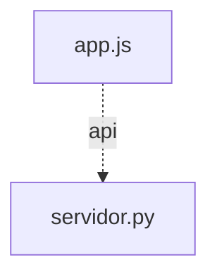

# Grafo de Código — portal

Generado automáticamente por `herramientas/grafo.mjs`.

## Resumen

- **Nodos:** 30 (funciones y métodos)
- **Aristas totales:** 88
  - **Resueltas:** 45
  - **Dudosas:** 0 (0.0%)
  - **Externas (nativas/DOM/D3):** 43

## Diagrama de Módulos

## Módulos y Funciones

### `app.js`

| Función / Método | Archivo:Línea | Llamada por | Llama a |
|---|---|---|---|
| `construirRutaApp` | `app.js:18` | `configurarTarjetas` (app.js) (L55) `configurarTarjetas` (app.js) (L56) | — |
| `guardarCookieUsuario` | `app.js:23` | `seleccionarUsuario` (app.js) (L129) | — |
| `consultarEstadoServidores` | `app.js:29` | `refrescarEstadoServidores` (app.js) (L80) | `ManejadorPortal.manejar_get_estado` (servidor.py) (L30) *(API GET /api/estado)* |
| `cargarListaUsuarios` | `app.js:38` | `iniciarPortal` (app.js) (L187) | `ManejadorPortal.manejar_get_usuarios` (servidor.py) (L39) *(API GET /api/usuarios)* |
| `cargarUsuarioActivo` | `app.js:46` | `seleccionarUsuario` (app.js) (L131) `iniciarPortal` (app.js) (L188) | `ManejadorPortal.manejar_get_yo` (servidor.py) (L47) *(API GET /api/yo)* |
| `configurarTarjetas` | `app.js:54` | `iniciarPortal` (app.js) (L173) | `construirRutaApp` (app.js) (L55) `construirRutaApp` (app.js) (L56) |
| `actualizarInsigniaEstado` | `app.js:65` | `refrescarEstadoServidores` (app.js) (L81) `refrescarEstadoServidores` (app.js) (L82) `refrescarEstadoServidores` (app.js) (L84) `refrescarEstadoServidores` (app.js) (L85) | — |
| `refrescarEstadoServidores` | `app.js:78` | `iniciarPortal` (app.js) (L189) `iniciarPortal` (app.js) (L198) | `consultarEstadoServidores` (app.js) (L80) `actualizarInsigniaEstado` (app.js) (L81) `actualizarInsigniaEstado` (app.js) (L82) `actualizarInsigniaEstado` (app.js) (L84) `actualizarInsigniaEstado` (app.js) (L85) |
| `renderizarUsuario` | `app.js:90` | `seleccionarUsuario` (app.js) (L133) `iniciarPortal` (app.js) (L178) `iniciarPortal` (app.js) (L183) `iniciarPortal` (app.js) (L195) | `seleccionarUsuario` (app.js) (L122) |
| `seleccionarUsuario` | `app.js:128` | `renderizarUsuario` (app.js) (L122) | `guardarCookieUsuario` (app.js) (L129) `cargarUsuarioActivo` (app.js) (L131) `renderizarUsuario` (app.js) (L133) |
| `conectarTema` | `app.js:137` | `iniciarPortal` (app.js) (L174) | `aplicarTema` (app.js) (L150) `aplicarTema` (app.js) (L154) |
| `iniciarPortal` | `app.js:159` | — | `configurarTarjetas` (app.js) (L173) `conectarTema` (app.js) (L174) `renderizarUsuario` (app.js) (L178) `renderizarUsuario` (app.js) (L183) `cargarListaUsuarios` (app.js) (L187) `cargarUsuarioActivo` (app.js) (L188) `refrescarEstadoServidores` (app.js) (L189) `renderizarUsuario` (app.js) (L195) `refrescarEstadoServidores` (app.js) (L198) |
| `aplicarTema` | `app.js:142` | `conectarTema` (app.js) (L150) `conectarTema` (app.js) (L154) | — |

### `servidor.py`

| Función / Método | Archivo:Línea | Llamada por | Llama a |
|---|---|---|---|
| `generar_id_usuario` | `servidor.py:41` | — | — |
| `validar_usuarios` | `servidor.py:55` | `cargar_usuarios_compartidos` (servidor.py) (L120) | — |
| `cargar_usuarios_compartidos` | `servidor.py:103` | `quien_es` (servidor.py) (L136) `ManejadorPortal.manejar_get_usuarios` (servidor.py) (L359) | `validar_usuarios` (servidor.py) (L120) |
| `quien_es` | `servidor.py:127` | `ManejadorPortal.manejar_get_yo` (servidor.py) (L372) | `cargar_usuarios_compartidos` (servidor.py) (L136) |
| `host_consulta_local` | `servidor.py:168` | `verificar_servicio_en_linea` (servidor.py) (L177) `ManejadorPortal.reenviar_a_app` (servidor.py) (L291) | — |
| `verificar_servicio_en_linea` | `servidor.py:175` | `ManejadorPortal.manejar_get_estado` (servidor.py) (L345) `ManejadorPortal.manejar_get_estado` (servidor.py) (L346) | `host_consulta_local` (servidor.py) (L177) |
| `ManejadorPortal.__init__` | `servidor.py:199` | — | — |
| `ManejadorPortal.log_message` | `servidor.py:202` | — | — |
| `ManejadorPortal.enviar_json` | `servidor.py:205` | `ManejadorPortal.do_POST` (servidor.py) (L240) `ManejadorPortal.reenviar_a_app` (servidor.py) (L298) `ManejadorPortal.manejar_get_estado` (servidor.py) (L347) `ManejadorPortal.manejar_get_usuarios` (servidor.py) (L369) `ManejadorPortal.manejar_get_yo` (servidor.py) (L373) | — |
| `ManejadorPortal.do_GET` | `servidor.py:214` | — | `ManejadorPortal.manejar_get_estado` (servidor.py) (L218) `ManejadorPortal.manejar_get_usuarios` (servidor.py) (L222) `ManejadorPortal.manejar_get_yo` (servidor.py) (L226) `ManejadorPortal.reenviar_a_app` (servidor.py) (L229) |
| `ManejadorPortal.do_HEAD` | `servidor.py:234` | — | `ManejadorPortal.reenviar_a_app` (servidor.py) (L235) |
| `ManejadorPortal.do_POST` | `servidor.py:238` | — | `ManejadorPortal.reenviar_a_app` (servidor.py) (L239) `ManejadorPortal.enviar_json` (servidor.py) (L240) |
| `ManejadorPortal.app_de_ruta` | `servidor.py:244` | `ManejadorPortal.reenviar_a_app` (servidor.py) (L256) | — |
| `ManejadorPortal.reenviar_a_app` | `servidor.py:251` | `ManejadorPortal.do_GET` (servidor.py) (L229) `ManejadorPortal.do_HEAD` (servidor.py) (L235) `ManejadorPortal.do_POST` (servidor.py) (L239) | `ManejadorPortal.app_de_ruta` (servidor.py) (L256) `host_consulta_local` (servidor.py) (L291) `ManejadorPortal.enviar_json` (servidor.py) (L298) |
| `ManejadorPortal.manejar_get_estado` | `servidor.py:344` | `ManejadorPortal.do_GET` (servidor.py) (L218) `consultarEstadoServidores` (app.js) (L30) | `verificar_servicio_en_linea` (servidor.py) (L345) `verificar_servicio_en_linea` (servidor.py) (L346) `ManejadorPortal.enviar_json` (servidor.py) (L347) |
| `ManejadorPortal.manejar_get_usuarios` | `servidor.py:358` | `ManejadorPortal.do_GET` (servidor.py) (L222) `cargarListaUsuarios` (app.js) (L39) | `cargar_usuarios_compartidos` (servidor.py) (L359) `ManejadorPortal.enviar_json` (servidor.py) (L369) |
| `ManejadorPortal.manejar_get_yo` | `servidor.py:371` | `ManejadorPortal.do_GET` (servidor.py) (L226) `cargarUsuarioActivo` (app.js) (L47) | `quien_es` (servidor.py) (L372) `ManejadorPortal.enviar_json` (servidor.py) (L373) |

