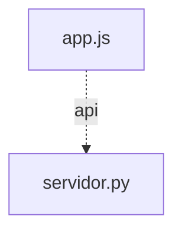

# Grafo de Código — portal

Generado automáticamente por `herramientas/grafo.mjs`.

## Resumen

- **Nodos:** 32 (funciones y métodos)
- **Aristas totales:** 92
  - **Resueltas:** 49
  - **Dudosas:** 0 (0.0%)
  - **Externas (nativas/DOM/D3):** 43

## Diagrama de Módulos

## Módulos y Funciones

### `app.js`

| Función / Método | Archivo:Línea | Llamada por | Llama a |
|---|---|---|---|
| `construirRutaApp` | `app.js:18` | `configurarTarjetas` (app.js) (L55) `configurarTarjetas` (app.js) (L56) | — |
| `guardarCookieUsuario` | `app.js:23` | `seleccionarUsuario` (app.js) (L129) | — |
| `consultarEstadoServidores` | `app.js:29` | `refrescarEstadoServidores` (app.js) (L80) | `ManejadorPortal.manejar_get_estado` (servidor.py) (L30) *(API GET /api/estado)* |
| `cargarListaUsuarios` | `app.js:38` | `iniciarPortal` (app.js) (L187) | `ManejadorPortal.manejar_get_usuarios` (servidor.py) (L39) *(API GET /api/usuarios)* |
| `cargarUsuarioActivo` | `app.js:46` | `seleccionarUsuario` (app.js) (L131) `iniciarPortal` (app.js) (L188) | `ManejadorPortal.manejar_get_yo` (servidor.py) (L47) *(API GET /api/yo)* |
| `configurarTarjetas` | `app.js:54` | `iniciarPortal` (app.js) (L173) | `construirRutaApp` (app.js) (L55) `construirRutaApp` (app.js) (L56) |
| `actualizarInsigniaEstado` | `app.js:65` | `refrescarEstadoServidores` (app.js) (L81) `refrescarEstadoServidores` (app.js) (L82) `refrescarEstadoServidores` (app.js) (L84) `refrescarEstadoServidores` (app.js) (L85) | — |
| `refrescarEstadoServidores` | `app.js:78` | `iniciarPortal` (app.js) (L189) `iniciarPortal` (app.js) (L198) | `consultarEstadoServidores` (app.js) (L80) `actualizarInsigniaEstado` (app.js) (L81) `actualizarInsigniaEstado` (app.js) (L82) `actualizarInsigniaEstado` (app.js) (L84) `actualizarInsigniaEstado` (app.js) (L85) |
| `renderizarUsuario` | `app.js:90` | `seleccionarUsuario` (app.js) (L133) `iniciarPortal` (app.js) (L178) `iniciarPortal` (app.js) (L183) `iniciarPortal` (app.js) (L195) | `seleccionarUsuario` (app.js) (L122) |
| `seleccionarUsuario` | `app.js:128` | `renderizarUsuario` (app.js) (L122) | `guardarCookieUsuario` (app.js) (L129) `cargarUsuarioActivo` (app.js) (L131) `renderizarUsuario` (app.js) (L133) |
| `conectarTema` | `app.js:137` | `iniciarPortal` (app.js) (L174) | `aplicarTema` (app.js) (L150) `aplicarTema` (app.js) (L154) |
| `iniciarPortal` | `app.js:159` | — | `configurarTarjetas` (app.js) (L173) `conectarTema` (app.js) (L174) `renderizarUsuario` (app.js) (L178) `renderizarUsuario` (app.js) (L183) `cargarListaUsuarios` (app.js) (L187) `cargarUsuarioActivo` (app.js) (L188) `refrescarEstadoServidores` (app.js) (L189) `renderizarUsuario` (app.js) (L195) `refrescarEstadoServidores` (app.js) (L198) |
| `aplicarTema` | `app.js:142` | `conectarTema` (app.js) (L150) `conectarTema` (app.js) (L154) | — |

### `servidor.py`

| Función / Método | Archivo:Línea | Llamada por | Llama a |
|---|---|---|---|
| `generar_id_usuario` | `servidor.py:43` | — | — |
| `validar_usuarios` | `servidor.py:57` | `cargar_usuarios_compartidos` (servidor.py) (L122) | — |
| `cargar_usuarios_compartidos` | `servidor.py:105` | `registrar_usuario_automatico` (servidor.py) (L148) `quien_es` (servidor.py) (L185) `ManejadorPortal.manejar_get_usuarios` (servidor.py) (L409) | `validar_usuarios` (servidor.py) (L122) |
| `id_desde_correo` | `servidor.py:132` | `registrar_usuario_automatico` (servidor.py) (L153) | — |
| `registrar_usuario_automatico` | `servidor.py:138` | `quien_es` (servidor.py) (L200) | `cargar_usuarios_compartidos` (servidor.py) (L148) `id_desde_correo` (servidor.py) (L153) |
| `quien_es` | `servidor.py:176` | `ManejadorPortal.manejar_get_usuarios` (servidor.py) (L421) `ManejadorPortal.manejar_get_yo` (servidor.py) (L428) | `cargar_usuarios_compartidos` (servidor.py) (L185) `registrar_usuario_automatico` (servidor.py) (L200) |
| `host_consulta_local` | `servidor.py:218` | `verificar_servicio_en_linea` (servidor.py) (L227) `ManejadorPortal.reenviar_a_app` (servidor.py) (L341) | — |
| `verificar_servicio_en_linea` | `servidor.py:225` | `ManejadorPortal.manejar_get_estado` (servidor.py) (L395) `ManejadorPortal.manejar_get_estado` (servidor.py) (L396) | `host_consulta_local` (servidor.py) (L227) |
| `ManejadorPortal.__init__` | `servidor.py:249` | — | — |
| `ManejadorPortal.log_message` | `servidor.py:252` | — | — |
| `ManejadorPortal.enviar_json` | `servidor.py:255` | `ManejadorPortal.do_POST` (servidor.py) (L290) `ManejadorPortal.reenviar_a_app` (servidor.py) (L348) `ManejadorPortal.manejar_get_estado` (servidor.py) (L397) `ManejadorPortal.manejar_get_usuarios` (servidor.py) (L425) `ManejadorPortal.manejar_get_yo` (servidor.py) (L429) | — |
| `ManejadorPortal.do_GET` | `servidor.py:264` | — | `ManejadorPortal.manejar_get_estado` (servidor.py) (L268) `ManejadorPortal.manejar_get_usuarios` (servidor.py) (L272) `ManejadorPortal.manejar_get_yo` (servidor.py) (L276) `ManejadorPortal.reenviar_a_app` (servidor.py) (L279) |
| `ManejadorPortal.do_HEAD` | `servidor.py:284` | — | `ManejadorPortal.reenviar_a_app` (servidor.py) (L285) |
| `ManejadorPortal.do_POST` | `servidor.py:288` | — | `ManejadorPortal.reenviar_a_app` (servidor.py) (L289) `ManejadorPortal.enviar_json` (servidor.py) (L290) |
| `ManejadorPortal.app_de_ruta` | `servidor.py:294` | `ManejadorPortal.reenviar_a_app` (servidor.py) (L306) | — |
| `ManejadorPortal.reenviar_a_app` | `servidor.py:301` | `ManejadorPortal.do_GET` (servidor.py) (L279) `ManejadorPortal.do_HEAD` (servidor.py) (L285) `ManejadorPortal.do_POST` (servidor.py) (L289) | `ManejadorPortal.app_de_ruta` (servidor.py) (L306) `host_consulta_local` (servidor.py) (L341) `ManejadorPortal.enviar_json` (servidor.py) (L348) |
| `ManejadorPortal.manejar_get_estado` | `servidor.py:394` | `ManejadorPortal.do_GET` (servidor.py) (L268) `consultarEstadoServidores` (app.js) (L30) | `verificar_servicio_en_linea` (servidor.py) (L395) `verificar_servicio_en_linea` (servidor.py) (L396) `ManejadorPortal.enviar_json` (servidor.py) (L397) |
| `ManejadorPortal.manejar_get_usuarios` | `servidor.py:408` | `ManejadorPortal.do_GET` (servidor.py) (L272) `cargarListaUsuarios` (app.js) (L39) | `cargar_usuarios_compartidos` (servidor.py) (L409) `quien_es` (servidor.py) (L421) `ManejadorPortal.enviar_json` (servidor.py) (L425) |
| `ManejadorPortal.manejar_get_yo` | `servidor.py:427` | `ManejadorPortal.do_GET` (servidor.py) (L276) `cargarUsuarioActivo` (app.js) (L47) | `quien_es` (servidor.py) (L428) `ManejadorPortal.enviar_json` (servidor.py) (L429) |

