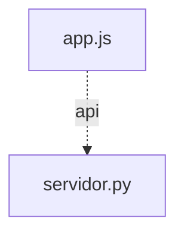

# Grafo de Código — portal

Generado automáticamente por `herramientas/grafo.mjs`.

## Resumen

- **Nodos:** 26 (funciones y métodos)
- **Aristas totales:** 81
  - **Resueltas:** 38
  - **Dudosas:** 0 (0.0%)
  - **Externas (nativas/DOM/D3):** 43

## Diagrama de Módulos

## Módulos y Funciones

### `app.js`

| Función / Método | Archivo:Línea | Llamada por | Llama a |
|---|---|---|---|
| `construirUrlApp` | `app.js:17` | `configurarTarjetas` (app.js) (L56) `configurarTarjetas` (app.js) (L57) | — |
| `guardarCookieUsuario` | `app.js:24` | `seleccionarUsuario` (app.js) (L130) | — |
| `consultarEstadoServidores` | `app.js:30` | `refrescarEstadoServidores` (app.js) (L81) | `ManejadorPortal.manejar_get_estado` (servidor.py) (L31) *(API GET /api/estado)* |
| `cargarListaUsuarios` | `app.js:39` | `iniciarPortal` (app.js) (L188) | `ManejadorPortal.manejar_get_usuarios` (servidor.py) (L40) *(API GET /api/usuarios)* |
| `cargarUsuarioActivo` | `app.js:47` | `seleccionarUsuario` (app.js) (L132) `iniciarPortal` (app.js) (L189) | `ManejadorPortal.manejar_get_yo` (servidor.py) (L48) *(API GET /api/yo)* |
| `configurarTarjetas` | `app.js:55` | `iniciarPortal` (app.js) (L174) | `construirUrlApp` (app.js) (L56) `construirUrlApp` (app.js) (L57) |
| `actualizarInsigniaEstado` | `app.js:66` | `refrescarEstadoServidores` (app.js) (L82) `refrescarEstadoServidores` (app.js) (L83) `refrescarEstadoServidores` (app.js) (L85) `refrescarEstadoServidores` (app.js) (L86) | — |
| `refrescarEstadoServidores` | `app.js:79` | `iniciarPortal` (app.js) (L190) `iniciarPortal` (app.js) (L199) | `consultarEstadoServidores` (app.js) (L81) `actualizarInsigniaEstado` (app.js) (L82) `actualizarInsigniaEstado` (app.js) (L83) `actualizarInsigniaEstado` (app.js) (L85) `actualizarInsigniaEstado` (app.js) (L86) |
| `renderizarUsuario` | `app.js:91` | `seleccionarUsuario` (app.js) (L134) `iniciarPortal` (app.js) (L179) `iniciarPortal` (app.js) (L184) `iniciarPortal` (app.js) (L196) | `seleccionarUsuario` (app.js) (L123) |
| `seleccionarUsuario` | `app.js:129` | `renderizarUsuario` (app.js) (L123) | `guardarCookieUsuario` (app.js) (L130) `cargarUsuarioActivo` (app.js) (L132) `renderizarUsuario` (app.js) (L134) |
| `conectarTema` | `app.js:138` | `iniciarPortal` (app.js) (L175) | `aplicarTema` (app.js) (L151) `aplicarTema` (app.js) (L155) |
| `iniciarPortal` | `app.js:160` | — | `configurarTarjetas` (app.js) (L174) `conectarTema` (app.js) (L175) `renderizarUsuario` (app.js) (L179) `renderizarUsuario` (app.js) (L184) `cargarListaUsuarios` (app.js) (L188) `cargarUsuarioActivo` (app.js) (L189) `refrescarEstadoServidores` (app.js) (L190) `renderizarUsuario` (app.js) (L196) `refrescarEstadoServidores` (app.js) (L199) |
| `aplicarTema` | `app.js:143` | `conectarTema` (app.js) (L151) `conectarTema` (app.js) (L155) | — |

### `servidor.py`

| Función / Método | Archivo:Línea | Llamada por | Llama a |
|---|---|---|---|
| `generar_id_usuario` | `servidor.py:26` | — | — |
| `validar_usuarios` | `servidor.py:40` | `cargar_usuarios_compartidos` (servidor.py) (L105) | — |
| `cargar_usuarios_compartidos` | `servidor.py:88` | `quien_es` (servidor.py) (L121) `ManejadorPortal.manejar_get_usuarios` (servidor.py) (L230) | `validar_usuarios` (servidor.py) (L105) |
| `quien_es` | `servidor.py:112` | `ManejadorPortal.manejar_get_yo` (servidor.py) (L243) | `cargar_usuarios_compartidos` (servidor.py) (L121) |
| `host_consulta_local` | `servidor.py:153` | `verificar_servicio_en_linea` (servidor.py) (L162) | — |
| `verificar_servicio_en_linea` | `servidor.py:160` | `ManejadorPortal.manejar_get_estado` (servidor.py) (L216) `ManejadorPortal.manejar_get_estado` (servidor.py) (L217) | `host_consulta_local` (servidor.py) (L162) |
| `ManejadorPortal.__init__` | `servidor.py:183` | — | — |
| `ManejadorPortal.log_message` | `servidor.py:186` | — | — |
| `ManejadorPortal.enviar_json` | `servidor.py:189` | `ManejadorPortal.manejar_get_estado` (servidor.py) (L218) `ManejadorPortal.manejar_get_usuarios` (servidor.py) (L240) `ManejadorPortal.manejar_get_yo` (servidor.py) (L244) | — |
| `ManejadorPortal.do_GET` | `servidor.py:198` | — | `ManejadorPortal.manejar_get_estado` (servidor.py) (L202) `ManejadorPortal.manejar_get_usuarios` (servidor.py) (L206) `ManejadorPortal.manejar_get_yo` (servidor.py) (L210) |
| `ManejadorPortal.manejar_get_estado` | `servidor.py:215` | `ManejadorPortal.do_GET` (servidor.py) (L202) `consultarEstadoServidores` (app.js) (L31) | `verificar_servicio_en_linea` (servidor.py) (L216) `verificar_servicio_en_linea` (servidor.py) (L217) `ManejadorPortal.enviar_json` (servidor.py) (L218) |
| `ManejadorPortal.manejar_get_usuarios` | `servidor.py:229` | `ManejadorPortal.do_GET` (servidor.py) (L206) `cargarListaUsuarios` (app.js) (L40) | `cargar_usuarios_compartidos` (servidor.py) (L230) `ManejadorPortal.enviar_json` (servidor.py) (L240) |
| `ManejadorPortal.manejar_get_yo` | `servidor.py:242` | `ManejadorPortal.do_GET` (servidor.py) (L210) `cargarUsuarioActivo` (app.js) (L48) | `quien_es` (servidor.py) (L243) `ManejadorPortal.enviar_json` (servidor.py) (L244) |

