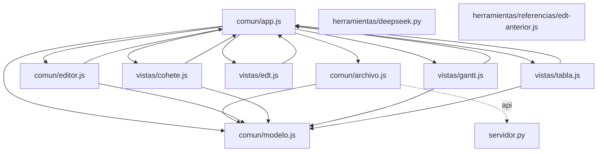

# Grafo de Código — project-organizer

Generado automáticamente por `herramientas/grafo.mjs`.

## Resumen

- **Nodos:** 266 (funciones y métodos)
- **Aristas totales:** 2720
  - **Resueltas:** 879
  - **Dudosas:** 68 (7.2%)
  - **Externas (nativas/DOM/D3):** 1773

## Diagrama de Módulos

## Módulos y Funciones

### `comun/app.js`

| Función / Método | Archivo:Línea | Llamada por | Llama a |
|---|---|---|---|
| `inicializar` | `comun/app.js:53` | — | `cargarInicial` (comun/app.js) (L71) |
| `mostrarAviso` | `comun/app.js:75` | `cargarInicial` (comun/app.js) (L107) `mostrarPantallaInicio` (comun/app.js) (L237) `mostrarPantallaInicio` (comun/app.js) (L255) `guardarInmediato` (comun/app.js) (L837) `guardarInmediato` (comun/app.js) (L842) `guardarInmediato` (comun/app.js) (L866) `guardarInmediato` (comun/app.js) (L884) `guardarInmediato` (comun/app.js) (L891) `aplicar` (comun/app.js) (L1094) `guardarComo` (comun/app.js) (L1155) `guardarComo` (comun/app.js) (L1158) `abrirArchivoLocal` (comun/app.js) (L1175) `abrirArchivo` (comun/app.js) (L1247) `abrirArchivo` (comun/app.js) (L1249) | — |
| `cargarInicial` | `comun/app.js:86` | `inicializar` (comun/app.js) (L71) | `cargarDesdeServidor` (comun/archivo.js) (L89) `cargarUsuarioActual` (comun/archivo.js) (L90) `cargarUsuariosCompartidos` (comun/archivo.js) (L91) `establecerDatos` (comun/app.js) (L96) `mostrarPantallaInicio` (comun/app.js) (L105) `mostrarAviso` (comun/app.js) (L107) `mostrarPantallaInicio` (comun/app.js) (L108) |
| `establecerDatos` | `comun/app.js:117` | `cargarInicial` (comun/app.js) (L96) `mostrarPantallaInicio` (comun/app.js) (L248) `mostrarPantallaInicio` (comun/app.js) (L281) `abrirArchivoLocal` (comun/app.js) (L1167) `abrirArchivo` (comun/app.js) (L1241) | `construir` (comun/modelo.js) (L137) `guardarBorrador` (comun/archivo.js) (L140) `borrarBorrador` (comun/archivo.js) (L142) `mostrarPantallaPrincipal` (comun/app.js) (L145) `conectarEventosServidor` (comun/app.js) (L147) `programarAutoguardado` (comun/app.js) (L149) |
| `mostrarPantallaInicio` | `comun/app.js:155` | `cargarInicial` (comun/app.js) (L105) `cargarInicial` (comun/app.js) (L108) `mostrarPantallaPrincipal` (comun/app.js) (L337) | `desconectarEventosServidor` (comun/app.js) (L158) `vista.destruir` (L161) *(dudosa)* `mostrarAviso` (comun/app.js) (L237) `proyectoDesdePlantilla` (comun/modelo.js) (L247) `establecerDatos` (comun/app.js) (L248) `mostrarAviso` (comun/app.js) (L255) `abrirArchivo` (comun/app.js) (L264) `leerBorrador` (comun/archivo.js) (L270) `establecerDatos` (comun/app.js) (L281) `borrarBorrador` (comun/archivo.js) (L292) `mostrarPantallaInicio` (L293) *(dudosa)* |
| `mostrarPantallaPrincipal` | `comun/app.js:303` | `establecerDatos` (comun/app.js) (L145) | `vista.destruir` (L309) *(dudosa)* `crearBoton` (comun/app.js) (L328) `crearBoton` (comun/app.js) (L329) `crearBoton` (comun/app.js) (L330) `crearBoton` (comun/app.js) (L331) `crearBoton` (comun/app.js) (L332) `crearBoton` (comun/app.js) (L333) `abrirArchivo` (comun/app.js) (L334) `crearBoton` (comun/app.js) (L336) `confirmarSiHayCambios` (comun/app.js) (L337) `mostrarPantallaInicio` (comun/app.js) (L337) `cambiarPestana` (comun/app.js) (L367) `aplicarFiltros` (comun/app.js) (L385) `aplicarFiltros` (comun/app.js) (L393) `aplicarFiltros` (comun/app.js) (L415) `aplicarFiltros` (comun/app.js) (L435) `aplicarFiltros` (comun/app.js) (L453) `aplicarFiltros` (comun/app.js) (L463) `crearBoton` (comun/app.js) (L466) `sincronizarOpcionesResponsable` (comun/app.js) (L478) `crearEditor` (comun/editor.js) (L492) `crearVistaActual` (comun/app.js) (L500) `mostrar` (comun/editor.js) (L501) `refrescarUI` (comun/app.js) (L504) |
| `abrirEquipo` | `comun/app.js:511` | — | `crearBoton` (comun/app.js) (L541) `agregarFila` (comun/app.js) (L541) `crearBoton` (comun/app.js) (L544) `crearBoton` (comun/app.js) (L545) `aplicar` (comun/app.js) (L550) `actualizarEquipo` (comun/modelo.js) (L550) |
| `crearBoton` | `comun/app.js:563` | `mostrarPantallaPrincipal` (comun/app.js) (L328) `mostrarPantallaPrincipal` (comun/app.js) (L329) `mostrarPantallaPrincipal` (comun/app.js) (L330) `mostrarPantallaPrincipal` (comun/app.js) (L331) `mostrarPantallaPrincipal` (comun/app.js) (L332) `mostrarPantallaPrincipal` (comun/app.js) (L333) `mostrarPantallaPrincipal` (comun/app.js) (L336) `mostrarPantallaPrincipal` (comun/app.js) (L466) `agregarFila` (comun/app.js) (L532) `abrirEquipo` (comun/app.js) (L541) `abrirEquipo` (comun/app.js) (L544) `abrirEquipo` (comun/app.js) (L545) `mostrarBannerConflicto` (comun/app.js) (L920) `mostrarBannerConflicto` (comun/app.js) (L931) `abrirArchivo` (comun/app.js) (L1259) `abrirArchivo` (comun/app.js) (L1268) | — |
| `cambiarPestana` | `comun/app.js:573` | `mostrarPantallaPrincipal` (comun/app.js) (L367) | `vista.destruir` (L583) *(dudosa)* `crearVistaActual` (comun/app.js) (L589) `actualizarVistaYEditor` (comun/app.js) (L590) `refrescarUI` (comun/app.js) (L591) |
| `obtenerModeloFiltrado` | `comun/app.js:595` | `aplicarFiltros` (comun/app.js) (L647) `crearVistaActual` (comun/app.js) (L698) `actualizarVistaYEditor` (comun/app.js) (L710) | `filtrarModelo` (comun/modelo.js) (L597) |
| `sincronizarOpcionesResponsable` | `comun/app.js:601` | `mostrarPantallaPrincipal` (comun/app.js) (L478) `refrescarUI` (comun/app.js) (L755) | — |
| `aplicarFiltros` | `comun/app.js:645` | `mostrarPantallaPrincipal` (comun/app.js) (L385) `mostrarPantallaPrincipal` (comun/app.js) (L393) `mostrarPantallaPrincipal` (comun/app.js) (L415) `mostrarPantallaPrincipal` (comun/app.js) (L435) `mostrarPantallaPrincipal` (comun/app.js) (L453) `mostrarPantallaPrincipal` (comun/app.js) (L463) `limpiarFiltros` (comun/app.js) (L666) `cambiarFiltroFechaDesdeVista` (comun/app.js) (L679) | `vista.mostrar` (L647) *(dudosa)* `obtenerModeloFiltrado` (comun/app.js) (L647) `refrescarUI` (comun/app.js) (L649) |
| `limpiarFiltros` | `comun/app.js:653` | — | `aplicarFiltros` (comun/app.js) (L666) |
| `cambiarFiltroFechaDesdeVista` | `comun/app.js:670` | `aplicarCambioFecha` (vistas/cohete.js) (L689) | `aplicarFiltros` (comun/app.js) (L679) |
| `crearVistaActual` | `comun/app.js:683` | `mostrarPantallaPrincipal` (comun/app.js) (L500) `cambiarPestana` (comun/app.js) (L589) | `creador` (L692) *(dudosa)* `vista.mostrar` (L698) *(dudosa)* `obtenerModeloFiltrado` (comun/app.js) (L698) |
| `manejarSeleccion` | `comun/app.js:702` | `dibujarVacio` (comun/editor.js) (L229) `dibujarVacio` (comun/editor.js) (L245) `dibujarActividad` (comun/editor.js) (L474) `dibujarActividad` (comun/editor.js) (L488) `agregarActividadEnSeccion` (vistas/cohete.js) (L734) `renderizarItemEdt` (vistas/cohete.js) (L835) `seleccionarParte` (vistas/cohete.js) (L1010) `crearVista` (vistas/edt.js) (L70) `dibujar` (vistas/edt.js) (L440) `buscar` (vistas/edt.js) (L563) `crearVista` (vistas/gantt.js) (L910) `crearVista` (vistas/gantt.js) (L918) `crearVista` (vistas/gantt.js) (L928) `crearVista` (vistas/tabla.js) (L263) `crearVista` (vistas/tabla.js) (L301) | `actualizarVistaYEditor` (comun/app.js) (L704) |
| `actualizarVistaYEditor` | `comun/app.js:708` | `cambiarPestana` (comun/app.js) (L590) `manejarSeleccion` (comun/app.js) (L704) `aplicarRecargaDesdeServidor` (comun/app.js) (L1062) `aplicar` (comun/app.js) (L1090) `deshacer` (comun/app.js) (L1114) `rehacer` (comun/app.js) (L1135) | `vista.mostrar` (L710) *(dudosa)* `obtenerModeloFiltrado` (comun/app.js) (L710) `mostrar` (comun/editor.js) (L713) |
| `actualizarEstadoGuardado` | `comun/app.js:718` | `refrescarUI` (comun/app.js) (L747) `refrescarUI` (comun/app.js) (L749) `refrescarUI` (comun/app.js) (L751) `guardarInmediato` (comun/app.js) (L826) `guardarInmediato` (comun/app.js) (L836) `guardarInmediato` (comun/app.js) (L841) `guardarInmediato` (comun/app.js) (L849) `guardarInmediato` (comun/app.js) (L854) `guardarInmediato` (comun/app.js) (L859) `guardarInmediato` (comun/app.js) (L865) `guardarInmediato` (comun/app.js) (L872) `guardarInmediato` (comun/app.js) (L882) `guardarInmediato` (comun/app.js) (L889) `aplicarRecargaDesdeServidor` (comun/app.js) (L1054) `aplicarRecargaDesdeServidor` (comun/app.js) (L1058) `aplicar` (comun/app.js) (L1089) `deshacer` (comun/app.js) (L1113) `rehacer` (comun/app.js) (L1134) `guardarComo` (comun/app.js) (L1154) | — |
| `refrescarUI` | `comun/app.js:737` | `mostrarPantallaPrincipal` (comun/app.js) (L504) `cambiarPestana` (comun/app.js) (L591) `aplicarFiltros` (comun/app.js) (L649) `guardarInmediato` (comun/app.js) (L829) `guardarInmediato` (comun/app.js) (L838) `guardarInmediato` (comun/app.js) (L867) `guardarInmediato` (comun/app.js) (L886) `aplicarRecargaDesdeServidor` (comun/app.js) (L1063) `aplicar` (comun/app.js) (L1091) `deshacer` (comun/app.js) (L1115) `rehacer` (comun/app.js) (L1136) `guardarComo` (comun/app.js) (L1156) | `actualizarEstadoGuardado` (comun/app.js) (L747) `actualizarEstadoGuardado` (comun/app.js) (L749) `actualizarEstadoGuardado` (comun/app.js) (L751) `sincronizarOpcionesResponsable` (comun/app.js) (L755) |
| `estaEditandoCampo` | `comun/app.js:778` | `alTerminarEdicionCampo` (comun/app.js) (L798) `manejarCambioExterno` (comun/app.js) (L999) | — |
| `alTerminarEdicionCampo` | `comun/app.js:796` | `restaurarTitulo` (comun/app.js) (L1327) `conectarEdicionTexto` (comun/editor.js) (L46) `conectarEdicionTexto` (comun/editor.js) (L57) | `estaEditandoCampo` (comun/app.js) (L798) `aplicarRecargaDesdeServidor` (comun/app.js) (L802) |
| `programarAutoguardado` | `comun/app.js:806` | `establecerDatos` (comun/app.js) (L149) `aplicarRecargaDesdeServidor` (comun/app.js) (L1055) `aplicar` (comun/app.js) (L1092) `deshacer` (comun/app.js) (L1116) `rehacer` (comun/app.js) (L1137) | `guardarInmediato` (comun/app.js) (L810) |
| `guardarInmediato` | `comun/app.js:815` | `programarAutoguardado` (comun/app.js) (L810) `mostrarBannerConflicto` (comun/app.js) (L943) `guardar` (comun/app.js) (L1142) | `actualizarEstadoGuardado` (comun/app.js) (L826) `guardar` (comun/archivo.js) (L827) `refrescarUI` (comun/app.js) (L829) `borrarBorrador` (comun/archivo.js) (L835) `actualizarEstadoGuardado` (comun/app.js) (L836) `mostrarAviso` (comun/app.js) (L837) `refrescarUI` (comun/app.js) (L838) `actualizarEstadoGuardado` (comun/app.js) (L841) `mostrarAviso` (comun/app.js) (L842) `actualizarEstadoGuardado` (comun/app.js) (L849) `guardarEnServidor` (comun/archivo.js) (L850) `actualizarEstadoGuardado` (comun/app.js) (L854) `guardarComo` (comun/archivo.js) (L857) `actualizarEstadoGuardado` (comun/app.js) (L859) `borrarBorrador` (comun/archivo.js) (L864) `actualizarEstadoGuardado` (comun/app.js) (L865) `mostrarAviso` (comun/app.js) (L866) `refrescarUI` (comun/app.js) (L867) `actualizarEstadoGuardado` (comun/app.js) (L872) `mostrarBannerConflicto` (comun/app.js) (L873) `borrarBorrador` (comun/archivo.js) (L880) `ocultarBannerConflicto` (comun/app.js) (L881) `actualizarEstadoGuardado` (comun/app.js) (L882) `mostrarAviso` (comun/app.js) (L884) `refrescarUI` (comun/app.js) (L886) `actualizarEstadoGuardado` (comun/app.js) (L889) `mostrarAviso` (comun/app.js) (L891) |
| `ocultarBannerConflicto` | `comun/app.js:898` | `guardarInmediato` (comun/app.js) (L881) `mostrarBannerConflicto` (comun/app.js) (L921) `mostrarBannerConflicto` (comun/app.js) (L932) | — |
| `mostrarBannerConflicto` | `comun/app.js:905` | `guardarInmediato` (comun/app.js) (L873) | `crearBoton` (comun/app.js) (L920) `ocultarBannerConflicto` (comun/app.js) (L921) `aplicarRecargaDesdeServidor` (comun/app.js) (L926) `borrarBorrador` (comun/archivo.js) (L927) `crearBoton` (comun/app.js) (L931) `ocultarBannerConflicto` (comun/app.js) (L932) `consultarDesdeServidor` (comun/archivo.js) (L935) `establecerUltimoEtag` (comun/archivo.js) (L941) `guardarInmediato` (comun/app.js) (L943) |
| `desconectarEventosServidor` | `comun/app.js:953` | `mostrarPantallaInicio` (comun/app.js) (L158) `conectarEventosServidor` (comun/app.js) (L962) | — |
| `conectarEventosServidor` | `comun/app.js:961` | `establecerDatos` (comun/app.js) (L147) | `desconectarEventosServidor` (comun/app.js) (L962) `manejarCambioExterno` (comun/app.js) (L972) `consultarDesdeServidor` (comun/archivo.js) (L980) `esEcoPropio` (comun/modelo.js) (L981) `obtenerUltimoEtag` (comun/archivo.js) (L981) `manejarCambioExterno` (comun/app.js) (L982) |
| `manejarCambioExterno` | `comun/app.js:995` | `conectarEventosServidor` (comun/app.js) (L972) `conectarEventosServidor` (comun/app.js) (L982) | `esEcoPropio` (comun/modelo.js) (L996) `obtenerUltimoEtag` (comun/archivo.js) (L996) `estaEditandoCampo` (comun/app.js) (L999) `aplicarRecargaDesdeServidor` (comun/app.js) (L1006) |
| `aplicarRecargaDesdeServidor` | `comun/app.js:1013` | `alTerminarEdicionCampo` (comun/app.js) (L802) `mostrarBannerConflicto` (comun/app.js) (L926) `manejarCambioExterno` (comun/app.js) (L1006) | `consultarDesdeServidor` (comun/archivo.js) (L1018) `esEcoPropio` (comun/modelo.js) (L1024) `obtenerUltimoEtag` (comun/archivo.js) (L1024) `establecerUltimoEtag` (comun/archivo.js) (L1029) `fn` (L1035) *(dudosa)* `construir` (comun/modelo.js) (L1040) `guardarBorrador` (comun/archivo.js) (L1053) `actualizarEstadoGuardado` (comun/app.js) (L1054) `programarAutoguardado` (comun/app.js) (L1055) `actualizarEstadoGuardado` (comun/app.js) (L1058) `actualizarVistaYEditor` (comun/app.js) (L1062) `refrescarUI` (comun/app.js) (L1063) |
| `aplicar` | `comun/app.js:1068` | `abrirEquipo` (comun/app.js) (L550) `aplicarTitulo` (comun/app.js) (L1313) `dibujarVacio` (comun/editor.js) (L223) `dibujarVacio` (comun/editor.js) (L239) `dibujarActividad` (comun/editor.js) (L274) `dibujarActividad` (comun/editor.js) (L312) `dibujarActividad` (comun/editor.js) (L321) `dibujarActividad` (comun/editor.js) (L324) `dibujarActividad` (comun/editor.js) (L342) `dibujarActividad` (comun/editor.js) (L366) `dibujarActividad` (comun/editor.js) (L388) `dibujarActividad` (comun/editor.js) (L394) `dibujarActividad` (comun/editor.js) (L407) `dibujarActividad` (comun/editor.js) (L413) `dibujarActividad` (comun/editor.js) (L430) `dibujarActividad` (comun/editor.js) (L441) `dibujarActividad` (comun/editor.js) (L468) `dibujarActividad` (comun/editor.js) (L482) `dibujarActividad` (comun/editor.js) (L500) `dibujarHito` (comun/editor.js) (L528) `dibujarHito` (comun/editor.js) (L555) `dibujarHito` (comun/editor.js) (L575) `dibujarHito` (comun/editor.js) (L594) `dibujarHito` (comun/editor.js) (L610) `alternarTareaEdt` (vistas/cohete.js) (L698) `eliminarTareaEdt` (vistas/cohete.js) (L703) `agregarActividadEnSeccion` (vistas/cohete.js) (L711) `restaurarEntregablesBaseEnModelo` (vistas/cohete.js) (L740) | `f` (L1070) *(dudosa)* `construir` (comun/modelo.js) (L1080) `guardarBorrador` (comun/archivo.js) (L1088) `actualizarEstadoGuardado` (comun/app.js) (L1089) `actualizarVistaYEditor` (comun/app.js) (L1090) `refrescarUI` (comun/app.js) (L1091) `programarAutoguardado` (comun/app.js) (L1092) `mostrarAviso` (comun/app.js) (L1094) |
| `deshacer` | `comun/app.js:1099` | — | `construir` (comun/modelo.js) (L1105) `guardarBorrador` (comun/archivo.js) (L1112) `actualizarEstadoGuardado` (comun/app.js) (L1113) `actualizarVistaYEditor` (comun/app.js) (L1114) `refrescarUI` (comun/app.js) (L1115) `programarAutoguardado` (comun/app.js) (L1116) |
| `rehacer` | `comun/app.js:1120` | — | `construir` (comun/modelo.js) (L1126) `guardarBorrador` (comun/archivo.js) (L1133) `actualizarEstadoGuardado` (comun/app.js) (L1134) `actualizarVistaYEditor` (comun/app.js) (L1135) `refrescarUI` (comun/app.js) (L1136) `programarAutoguardado` (comun/app.js) (L1137) |
| `guardar` | `comun/app.js:1141` | — | `guardarInmediato` (comun/app.js) (L1142) |
| `guardarComo` | `comun/app.js:1146` | — | `guardarComo` (comun/archivo.js) (L1149) `borrarBorrador` (comun/archivo.js) (L1153) `actualizarEstadoGuardado` (comun/app.js) (L1154) `mostrarAviso` (comun/app.js) (L1155) `refrescarUI` (comun/app.js) (L1156) `mostrarAviso` (comun/app.js) (L1158) |
| `abrirArchivoLocal` | `comun/app.js:1163` | `abrirArchivo` (comun/app.js) (L1189) `abrirArchivo` (comun/app.js) (L1261) | `abrirArchivo` (comun/archivo.js) (L1165) `establecerDatos` (comun/app.js) (L1167) `mostrarAviso` (comun/app.js) (L1175) |
| `abrirArchivo` | `comun/app.js:1183` | `mostrarPantallaInicio` (comun/app.js) (L264) `mostrarPantallaPrincipal` (comun/app.js) (L334) | `confirmarSiHayCambios` (comun/app.js) (L1184) `listarGuardadosServidor` (comun/archivo.js) (L1186) `abrirArchivoLocal` (comun/app.js) (L1189) `cargarGuardadoServidor` (comun/archivo.js) (L1239) `establecerDatos` (comun/app.js) (L1241) `mostrarAviso` (comun/app.js) (L1247) `mostrarAviso` (comun/app.js) (L1249) `crearBoton` (comun/app.js) (L1259) `abrirArchivoLocal` (comun/app.js) (L1261) `crearBoton` (comun/app.js) (L1268) |
| `confirmarSiHayCambios` | `comun/app.js:1278` | `mostrarPantallaPrincipal` (comun/app.js) (L337) `abrirArchivo` (comun/app.js) (L1184) | — |
| `editarTitulo` | `comun/app.js:1286` | — | `aplicarTitulo` (comun/app.js) (L1295) `restaurarTitulo` (comun/app.js) (L1297) `aplicarTitulo` (comun/app.js) (L1300) `tituloProyecto.replaceWith` (L1301) *(dudosa)* |
| `aplicarTitulo` | `comun/app.js:1307` | `editarTitulo` (comun/app.js) (L1295) `editarTitulo` (comun/app.js) (L1300) | `restaurarTitulo` (comun/app.js) (L1310) `aplicar` (comun/app.js) (L1313) `editarProyecto` (comun/modelo.js) (L1313) `restaurarTitulo` (comun/app.js) (L1314) |
| `restaurarTitulo` | `comun/app.js:1318` | `editarTitulo` (comun/app.js) (L1297) `aplicarTitulo` (comun/app.js) (L1310) `aplicarTitulo` (comun/app.js) (L1314) | `input.replaceWith` (L1325) *(dudosa)* `alTerminarEdicionCampo` (comun/app.js) (L1327) |
| `agregarFila` | `comun/app.js:522` | `abrirEquipo` (comun/app.js) (L541) | `crearBoton` (comun/app.js) (L532) |

### `comun/archivo.js`

| Función / Método | Archivo:Línea | Llamada por | Llama a |
|---|---|---|---|
| `obtenerUltimoEtag` | `comun/archivo.js:12` | `conectarEventosServidor` (comun/app.js) (L981) `manejarCambioExterno` (comun/app.js) (L996) `aplicarRecargaDesdeServidor` (comun/app.js) (L1024) | — |
| `establecerUltimoEtag` | `comun/archivo.js:17` | `mostrarBannerConflicto` (comun/app.js) (L941) `aplicarRecargaDesdeServidor` (comun/app.js) (L1029) | — |
| `texto` | `comun/archivo.js:24` | `guardarEnServidor` (comun/archivo.js) (L189) `escribirEnManejador` (comun/archivo.js) (L273) `descargarArchivo` (comun/archivo.js) (L280) | — |
| `puedeGuardarDirecto` | `comun/archivo.js:29` | `abrirArchivo` (comun/archivo.js) (L80) `guardarComo` (comun/archivo.js) (L244) | — |
| `consultarDesdeServidor` | `comun/archivo.js:37` | `mostrarBannerConflicto` (comun/app.js) (L935) `conectarEventosServidor` (comun/app.js) (L980) `aplicarRecargaDesdeServidor` (comun/app.js) (L1018) `cargarDesdeServidor` (comun/archivo.js) (L65) | `validar` (comun/modelo.js) (L48) |
| `cargarDesdeServidor` | `comun/archivo.js:64` | `cargarInicial` (comun/app.js) (L89) | `consultarDesdeServidor` (comun/archivo.js) (L65) |
| `abrirArchivo` | `comun/archivo.js:79` | `abrirArchivoLocal` (comun/app.js) (L1165) | `puedeGuardarDirecto` (comun/archivo.js) (L80) `leerManejador` (comun/archivo.js) (L87) `abrirConInput` (comun/archivo.js) (L93) |
| `leerManejador` | `comun/archivo.js:98` | `abrirArchivo` (comun/archivo.js) (L87) | `manejador.getFile` (L99) *(dudosa)* `procesarContenido` (comun/archivo.js) (L101) |
| `procesarContenido` | `comun/archivo.js:105` | `leerManejador` (comun/archivo.js) (L101) `abrirConInput` (comun/archivo.js) (L130) `cargarGuardadoServidor` (comun/archivo.js) (L172) | `validar` (comun/modelo.js) (L112) |
| `abrirConInput` | `comun/archivo.js:120` | `abrirArchivo` (comun/archivo.js) (L93) | `resolver` (L128) *(dudosa)* `resolver` (L130) *(dudosa)* `procesarContenido` (comun/archivo.js) (L130) `rechazar` (L132) *(dudosa)* `resolver` (L135) *(dudosa)* |
| `listarGuardadosServidor` | `comun/archivo.js:146` | `abrirArchivo` (comun/app.js) (L1186) | `ManejadorProjectOrganizer.do_GET` (servidor.py) (L148) *(API GET /api/guardados)* |
| `cargarGuardadoServidor` | `comun/archivo.js:162` | `abrirArchivo` (comun/app.js) (L1239) | `ManejadorProjectOrganizer.do_GET` (servidor.py) (L163) *(API GET /api/guardados/${encodeURIComponent(nombre)})* `procesarContenido` (comun/archivo.js) (L172) |
| `guardarEnServidor` | `comun/archivo.js:181` | `guardarInmediato` (comun/app.js) (L850) `guardar` (comun/archivo.js) (L230) | `ManejadorProjectOrganizer.manejar_post_guardar` (servidor.py) (L183) *(API POST /api/guardar)* `texto` (comun/archivo.js) (L189) |
| `guardar` | `comun/archivo.js:229` | `guardarInmediato` (comun/app.js) (L827) | `guardarEnServidor` (comun/archivo.js) (L230) `escribirEnManejador` (comun/archivo.js) (L234) `guardarComo` (comun/archivo.js) (L236) |
| `guardarComo` | `comun/archivo.js:243` | `guardarInmediato` (comun/app.js) (L857) `guardarComo` (comun/app.js) (L1149) `guardar` (comun/archivo.js) (L236) | `puedeGuardarDirecto` (comun/archivo.js) (L244) `escribirEnManejador` (comun/archivo.js) (L250) `descargarArchivo` (comun/archivo.js) (L258) |
| `escribirEnManejador` | `comun/archivo.js:263` | `guardar` (comun/archivo.js) (L234) `guardarComo` (comun/archivo.js) (L250) | `manejador.queryPermission` (L265) *(dudosa)* `manejador.requestPermission` (L267) *(dudosa)* `manejador.createWritable` (L272) *(dudosa)* `escribible.write` (L273) *(dudosa)* `texto` (comun/archivo.js) (L273) |
| `descargarArchivo` | `comun/archivo.js:279` | `guardarComo` (comun/archivo.js) (L258) | `texto` (comun/archivo.js) (L280) |
| `guardarBorrador` | `comun/archivo.js:294` | `establecerDatos` (comun/app.js) (L140) `aplicarRecargaDesdeServidor` (comun/app.js) (L1053) `aplicar` (comun/app.js) (L1088) `deshacer` (comun/app.js) (L1112) `rehacer` (comun/app.js) (L1133) | — |
| `leerBorrador` | `comun/archivo.js:304` | `mostrarPantallaInicio` (comun/app.js) (L270) | — |
| `borrarBorrador` | `comun/archivo.js:315` | `establecerDatos` (comun/app.js) (L142) `mostrarPantallaInicio` (comun/app.js) (L292) `guardarInmediato` (comun/app.js) (L835) `guardarInmediato` (comun/app.js) (L864) `guardarInmediato` (comun/app.js) (L880) `mostrarBannerConflicto` (comun/app.js) (L927) `guardarComo` (comun/app.js) (L1153) | — |
| `cargarUsuarioActual` | `comun/archivo.js:327` | `cargarInicial` (comun/app.js) (L90) | `ManejadorProjectOrganizer.manejar_get_yo` (servidor.py) (L329) *(API GET /api/yo)* |
| `cargarUsuariosCompartidos` | `comun/archivo.js:342` | `cargarInicial` (comun/app.js) (L91) | `ManejadorProjectOrganizer.manejar_get_usuarios` (servidor.py) (L344) *(API GET /api/usuarios)* |

### `comun/editor.js`

| Función / Método | Archivo:Línea | Llamada por | Llama a |
|---|---|---|---|
| `crearEditor` | `comun/editor.js:11` | `mostrarPantallaPrincipal` (comun/app.js) (L492) | `estaEscribiendo` (comun/editor.js) (L19) `conectarEdicionTexto` (comun/editor.js) (L30) `obtenerListaResponsables` (comun/editor.js) (L62) `esActividad` (comun/editor.js) (L81) `esHito` (comun/editor.js) (L85) `nodoDe` (comun/editor.js) (L89) `hitoDe` (comun/editor.js) (L93) `serializarSeleccion` (comun/editor.js) (L97) `mostrar` (comun/editor.js) (L128) `renderizar` (comun/editor.js) (L146) `crearElemento` (comun/editor.js) (L160) `crearCampo` (comun/editor.js) (L167) `crearBoton` (comun/editor.js) (L175) `fechaHoyLocal` (comun/editor.js) (L181) `posicionFinal` (comun/editor.js) (L189) `contarDescendientesModelo` (comun/editor.js) (L194) `enfocarNombre` (comun/editor.js) (L207) `dibujarVacio` (comun/editor.js) (L214) `dibujarActividad` (comun/editor.js) (L255) `dibujarHito` (comun/editor.js) (L510) |
| `estaEscribiendo` | `comun/editor.js:19` | `crearEditor` (comun/editor.js) (L19) `mostrar` (comun/editor.js) (L133) | — |
| `conectarEdicionTexto` | `comun/editor.js:30` | `crearEditor` (comun/editor.js) (L30) `dibujarActividad` (comun/editor.js) (L276) `dibujarActividad` (comun/editor.js) (L443) `dibujarHito` (comun/editor.js) (L530) | `queueMicrotask` (L44) *(dudosa)* `alTerminarEdicionCampo` (comun/app.js) (L46) `alTerminarEdicionCampo` (comun/app.js) (L57) |
| `obtenerListaResponsables` | `comun/editor.js:62` | `crearEditor` (comun/editor.js) (L62) `dibujarActividad` (comun/editor.js) (L335) `dibujarHito` (comun/editor.js) (L587) | — |
| `esActividad` | `comun/editor.js:81` | `crearEditor` (comun/editor.js) (L81) `renderizar` (comun/editor.js) (L151) | — |
| `esHito` | `comun/editor.js:85` | `crearEditor` (comun/editor.js) (L85) `renderizar` (comun/editor.js) (L153) | — |
| `nodoDe` | `comun/editor.js:89` | `crearEditor` (comun/editor.js) (L89) `serializarSeleccion` (comun/editor.js) (L99) `contarDescendientesModelo` (comun/editor.js) (L195) `dibujarActividad` (comun/editor.js) (L256) | — |
| `hitoDe` | `comun/editor.js:93` | `crearEditor` (comun/editor.js) (L93) `serializarSeleccion` (comun/editor.js) (L115) `dibujarHito` (comun/editor.js) (L511) | — |
| `serializarSeleccion` | `comun/editor.js:97` | `crearEditor` (comun/editor.js) (L97) `mostrar` (comun/editor.js) (L137) | `nodoDe` (comun/editor.js) (L99) `esEntregable` (comun/modelo.js) (L103) `hitoDe` (comun/editor.js) (L115) |
| `mostrar` | `comun/editor.js:128` | `mostrarPantallaPrincipal` (comun/app.js) (L501) `actualizarVistaYEditor` (comun/app.js) (L713) `crearEditor` (comun/editor.js) (L128) | `estaEscribiendo` (comun/editor.js) (L133) `serializarSeleccion` (comun/editor.js) (L137) `renderizar` (comun/editor.js) (L143) |
| `renderizar` | `comun/editor.js:146` | `mostrar` (comun/editor.js) (L143) `crearEditor` (comun/editor.js) (L146) | `dibujarVacio` (comun/editor.js) (L150) `esActividad` (comun/editor.js) (L151) `dibujarActividad` (comun/editor.js) (L152) `esHito` (comun/editor.js) (L153) `dibujarHito` (comun/editor.js) (L154) `dibujarVacio` (comun/editor.js) (L156) |
| `crearElemento` | `comun/editor.js:160` | `crearEditor` (comun/editor.js) (L160) `crearCampo` (comun/editor.js) (L168) `crearCampo` (comun/editor.js) (L169) `crearBoton` (comun/editor.js) (L176) `dibujarVacio` (comun/editor.js) (L215) `dibujarVacio` (comun/editor.js) (L216) `dibujarVacio` (comun/editor.js) (L218) `dibujarActividad` (comun/editor.js) (L259) `dibujarActividad` (comun/editor.js) (L262) `dibujarActividad` (comun/editor.js) (L263) `dibujarActividad` (comun/editor.js) (L264) `dibujarActividad` (comun/editor.js) (L269) `dibujarActividad` (comun/editor.js) (L288) `dibujarActividad` (comun/editor.js) (L291) `dibujarActividad` (comun/editor.js) (L303) `dibujarActividad` (comun/editor.js) (L318) `dibujarActividad` (comun/editor.js) (L330) `dibujarActividad` (comun/editor.js) (L332) `dibujarActividad` (comun/editor.js) (L336) `dibujarActividad` (comun/editor.js) (L356) `dibujarActividad` (comun/editor.js) (L358) `dibujarActividad` (comun/editor.js) (L360) `dibujarActividad` (comun/editor.js) (L379) `dibujarActividad` (comun/editor.js) (L381) `dibujarActividad` (comun/editor.js) (L400) `dibujarActividad` (comun/editor.js) (L421) `dibujarActividad` (comun/editor.js) (L424) `dibujarActividad` (comun/editor.js) (L437) `dibujarActividad` (comun/editor.js) (L455) `dibujarActividad` (comun/editor.js) (L464) `dibujarHito` (comun/editor.js) (L514) `dibujarHito` (comun/editor.js) (L517) `dibujarHito` (comun/editor.js) (L518) `dibujarHito` (comun/editor.js) (L523) `dibujarHito` (comun/editor.js) (L542) `dibujarHito` (comun/editor.js) (L562) `dibujarHito` (comun/editor.js) (L582) `dibujarHito` (comun/editor.js) (L584) `dibujarHito` (comun/editor.js) (L588) `dibujarHito` (comun/editor.js) (L606) | — |
| `crearCampo` | `comun/editor.js:167` | `crearEditor` (comun/editor.js) (L167) `dibujarActividad` (comun/editor.js) (L268) `dibujarActividad` (comun/editor.js) (L287) `dibujarActividad` (comun/editor.js) (L329) `dibujarActividad` (comun/editor.js) (L355) `dibujarActividad` (comun/editor.js) (L380) `dibujarActividad` (comun/editor.js) (L399) `dibujarActividad` (comun/editor.js) (L420) `dibujarActividad` (comun/editor.js) (L436) `dibujarHito` (comun/editor.js) (L522) `dibujarHito` (comun/editor.js) (L541) `dibujarHito` (comun/editor.js) (L561) `dibujarHito` (comun/editor.js) (L581) | `crearElemento` (comun/editor.js) (L168) `crearElemento` (comun/editor.js) (L169) |
| `crearBoton` | `comun/editor.js:175` | `crearEditor` (comun/editor.js) (L175) `dibujarVacio` (comun/editor.js) (L220) `dibujarVacio` (comun/editor.js) (L235) `dibujarActividad` (comun/editor.js) (L319) `dibujarActividad` (comun/editor.js) (L322) `dibujarActividad` (comun/editor.js) (L465) `dibujarActividad` (comun/editor.js) (L479) `dibujarActividad` (comun/editor.js) (L493) `dibujarHito` (comun/editor.js) (L607) | `crearElemento` (comun/editor.js) (L176) |
| `fechaHoyLocal` | `comun/editor.js:181` | `crearEditor` (comun/editor.js) (L181) `dibujarVacio` (comun/editor.js) (L237) | — |
| `posicionFinal` | `comun/editor.js:189` | `crearEditor` (comun/editor.js) (L189) `dibujarActividad` (comun/editor.js) (L311) | — |
| `contarDescendientesModelo` | `comun/editor.js:194` | `crearEditor` (comun/editor.js) (L194) `dibujarActividad` (comun/editor.js) (L495) | `nodoDe` (comun/editor.js) (L195) `visitar` (comun/editor.js) (L198) |
| `visitar` | `comun/editor.js:198` | `contarDescendientesModelo` (comun/editor.js) (L198) | `visitar` (L201) *(dudosa)* |
| `enfocarNombre` | `comun/editor.js:207` | `crearEditor` (comun/editor.js) (L207) `dibujarVacio` (comun/editor.js) (L230) `dibujarVacio` (comun/editor.js) (L246) `dibujarActividad` (comun/editor.js) (L475) `dibujarActividad` (comun/editor.js) (L489) | — |
| `dibujarVacio` | `comun/editor.js:214` | `renderizar` (comun/editor.js) (L150) `renderizar` (comun/editor.js) (L156) `crearEditor` (comun/editor.js) (L214) | `crearElemento` (comun/editor.js) (L215) `crearElemento` (comun/editor.js) (L216) `crearElemento` (comun/editor.js) (L218) `crearBoton` (comun/editor.js) (L220) `aplicar` (comun/app.js) (L223) `agregarActividad` (comun/modelo.js) (L224) `manejarSeleccion` (comun/app.js) (L229) `enfocarNombre` (comun/editor.js) (L230) `crearBoton` (comun/editor.js) (L235) `fechaHoyLocal` (comun/editor.js) (L237) `aplicar` (comun/app.js) (L239) `agregarHito` (comun/modelo.js) (L240) `manejarSeleccion` (comun/app.js) (L245) `enfocarNombre` (comun/editor.js) (L246) |
| `dibujarActividad` | `comun/editor.js:255` | `renderizar` (comun/editor.js) (L152) `crearEditor` (comun/editor.js) (L255) | `nodoDe` (comun/editor.js) (L256) `crearElemento` (comun/editor.js) (L259) `crearElemento` (comun/editor.js) (L262) `crearElemento` (comun/editor.js) (L263) `crearElemento` (comun/editor.js) (L264) `crearCampo` (comun/editor.js) (L268) `crearElemento` (comun/editor.js) (L269) `aplicar` (comun/app.js) (L274) `editarActividad` (comun/modelo.js) (L274) `conectarEdicionTexto` (comun/editor.js) (L276) `crearCampo` (comun/editor.js) (L287) `crearElemento` (comun/editor.js) (L288) `crearElemento` (comun/editor.js) (L291) `recolectar` (comun/editor.js) (L296) `crearElemento` (comun/editor.js) (L303) `posicionFinal` (comun/editor.js) (L311) `aplicar` (comun/app.js) (L312) `moverActividad` (comun/modelo.js) (L312) `crearElemento` (comun/editor.js) (L318) `crearBoton` (comun/editor.js) (L319) `aplicar` (comun/app.js) (L321) `subir` (comun/modelo.js) (L321) `crearBoton` (comun/editor.js) (L322) `aplicar` (comun/app.js) (L324) `bajar` (comun/modelo.js) (L324) `crearCampo` (comun/editor.js) (L329) `crearElemento` (comun/editor.js) (L330) `crearElemento` (comun/editor.js) (L332) `obtenerListaResponsables` (comun/editor.js) (L335) `crearElemento` (comun/editor.js) (L336) `aplicar` (comun/app.js) (L342) `editarActividad` (comun/modelo.js) (L347) `crearCampo` (comun/editor.js) (L355) `crearElemento` (comun/editor.js) (L356) `crearElemento` (comun/editor.js) (L358) `crearElemento` (comun/editor.js) (L360) `esEntregable` (comun/modelo.js) (L363) `aplicar` (comun/app.js) (L366) `editarActividad` (comun/modelo.js) (L372) `crearElemento` (comun/editor.js) (L379) `crearCampo` (comun/editor.js) (L380) `crearElemento` (comun/editor.js) (L381) `aplicar` (comun/app.js) (L388) `editarActividad` (comun/modelo.js) (L388) `aplicar` (comun/app.js) (L394) `editarActividad` (comun/modelo.js) (L394) `crearCampo` (comun/editor.js) (L399) `crearElemento` (comun/editor.js) (L400) `aplicar` (comun/app.js) (L407) `editarActividad` (comun/modelo.js) (L407) `aplicar` (comun/app.js) (L413) `editarActividad` (comun/modelo.js) (L413) `crearCampo` (comun/editor.js) (L420) `crearElemento` (comun/editor.js) (L421) `crearElemento` (comun/editor.js) (L424) `aplicar` (comun/app.js) (L430) `editarActividad` (comun/modelo.js) (L430) `crearCampo` (comun/editor.js) (L436) `crearElemento` (comun/editor.js) (L437) `aplicar` (comun/app.js) (L441) `editarActividad` (comun/modelo.js) (L441) `conectarEdicionTexto` (comun/editor.js) (L443) `crearElemento` (comun/editor.js) (L455) `crearElemento` (comun/editor.js) (L464) `crearBoton` (comun/editor.js) (L465) `aplicar` (comun/app.js) (L468) `agregarActividad` (comun/modelo.js) (L469) `manejarSeleccion` (comun/app.js) (L474) `enfocarNombre` (comun/editor.js) (L475) `crearBoton` (comun/editor.js) (L479) `aplicar` (comun/app.js) (L482) `agregarActividad` (comun/modelo.js) (L483) `manejarSeleccion` (comun/app.js) (L488) `enfocarNombre` (comun/editor.js) (L489) `crearBoton` (comun/editor.js) (L493) `contarDescendientesModelo` (comun/editor.js) (L495) `aplicar` (comun/app.js) (L500) `eliminarActividad` (comun/modelo.js) (L500) |
| `recolectar` | `comun/editor.js:296` | `dibujarActividad` (comun/editor.js) (L296) | — |
| `dibujarHito` | `comun/editor.js:510` | `renderizar` (comun/editor.js) (L154) `crearEditor` (comun/editor.js) (L510) | `hitoDe` (comun/editor.js) (L511) `crearElemento` (comun/editor.js) (L514) `crearElemento` (comun/editor.js) (L517) `crearElemento` (comun/editor.js) (L518) `crearCampo` (comun/editor.js) (L522) `crearElemento` (comun/editor.js) (L523) `aplicar` (comun/app.js) (L528) `editarHito` (comun/modelo.js) (L528) `conectarEdicionTexto` (comun/editor.js) (L530) `crearCampo` (comun/editor.js) (L541) `crearElemento` (comun/editor.js) (L542) `aplicar` (comun/app.js) (L555) `editarHito` (comun/modelo.js) (L555) `crearCampo` (comun/editor.js) (L561) `crearElemento` (comun/editor.js) (L562) `aplicar` (comun/app.js) (L575) `editarHito` (comun/modelo.js) (L575) `crearCampo` (comun/editor.js) (L581) `crearElemento` (comun/editor.js) (L582) `crearElemento` (comun/editor.js) (L584) `obtenerListaResponsables` (comun/editor.js) (L587) `crearElemento` (comun/editor.js) (L588) `aplicar` (comun/app.js) (L594) `editarHito` (comun/modelo.js) (L599) `crearElemento` (comun/editor.js) (L606) `crearBoton` (comun/editor.js) (L607) `aplicar` (comun/app.js) (L610) `eliminarHito` (comun/modelo.js) (L610) |

### `comun/modelo.js`

| Función / Método | Archivo:Línea | Llamada por | Llama a |
|---|---|---|---|
| `esEntregable` | `comun/modelo.js:9` | `serializarSeleccion` (comun/editor.js) (L103) `dibujarActividad` (comun/editor.js) (L363) `coincideDirecto` (comun/modelo.js) (L1129) `recolectar` (vistas/cohete.js) (L196) `recolectar` (vistas/cohete.js) (L198) `renderizarItemEdt` (vistas/cohete.js) (L806) `renderizarItemEdt` (vistas/cohete.js) (L841) `crearFilaActividad` (vistas/tabla.js) (L167) | — |
| `esFecha` | `comun/modelo.js:18` | `validar` (comun/modelo.js) (L286) `validar` (comun/modelo.js) (L287) `validar` (comun/modelo.js) (L288) `validar` (comun/modelo.js) (L374) `validar` (comun/modelo.js) (L375) `validar` (comun/modelo.js) (L376) `editarActividad` (comun/modelo.js) (L693) `editarActividad` (comun/modelo.js) (L694) `agregarHito` (comun/modelo.js) (L910) `agregarHito` (comun/modelo.js) (L911) `editarHito` (comun/modelo.js) (L950) `editarHito` (comun/modelo.js) (L951) | — |
| `diasEntre` | `comun/modelo.js:31` | `dibujarConFechas` (vistas/gantt.js) (L554) `dias` (vistas/tabla.js) (L113) `exportarCSV` (vistas/tabla.js) (L336) | — |
| `sumarDias` | `comun/modelo.js:39` | `dibujarConFechas` (vistas/gantt.js) (L498) | — |
| `clonar` | `comun/modelo.js:52` | `agregarActividad` (comun/modelo.js) (L586) `editarActividad` (comun/modelo.js) (L653) `moverActividad` (comun/modelo.js) (L745) `subir` (comun/modelo.js) (L808) `bajar` (comun/modelo.js) (L831) `eliminarActividad` (comun/modelo.js) (L854) `agregarHito` (comun/modelo.js) (L904) `editarHito` (comun/modelo.js) (L934) `eliminarHito` (comun/modelo.js) (L974) `editarProyecto` (comun/modelo.js) (L987) `editarEquipo` (comun/modelo.js) (L1008) `actualizarEquipo` (comun/modelo.js) (L1052) | — |
| `buscarActividad` | `comun/modelo.js:56` | `establecerOrden` (comun/modelo.js) (L81) `agregarActividad` (comun/modelo.js) (L595) `agregarActividad` (comun/modelo.js) (L603) `agregarActividad` (comun/modelo.js) (L610) `editarActividad` (comun/modelo.js) (L654) `moverActividad` (comun/modelo.js) (L746) `moverActividad` (comun/modelo.js) (L752) `moverActividad` (comun/modelo.js) (L770) `subir` (comun/modelo.js) (L809) `bajar` (comun/modelo.js) (L832) `eliminarActividad` (comun/modelo.js) (L855) `contarDescendientes` (comun/modelo.js) (L887) | — |
| `buscarHito` | `comun/modelo.js:60` | `editarHito` (comun/modelo.js) (L935) `eliminarHito` (comun/modelo.js) (L975) | — |
| `tieneHijos` | `comun/modelo.js:64` | `agregarActividad` (comun/modelo.js) (L611) `editarActividad` (comun/modelo.js) (L657) `moverActividad` (comun/modelo.js) (L771) | — |
| `obtenerHijosIdsOrdenados` | `comun/modelo.js:68` | `agregarActividad` (comun/modelo.js) (L618) `moverActividad` (comun/modelo.js) (L781) `moverActividad` (comun/modelo.js) (L784) `moverActividad` (comun/modelo.js) (L792) `subir` (comun/modelo.js) (L813) `bajar` (comun/modelo.js) (L836) `eliminarActividad` (comun/modelo.js) (L874) `eliminarActividad` (comun/modelo.js) (L877) | — |
| `establecerOrden` | `comun/modelo.js:79` | `agregarActividad` (comun/modelo.js) (L645) `moverActividad` (comun/modelo.js) (L782) `moverActividad` (comun/modelo.js) (L785) `moverActividad` (comun/modelo.js) (L800) `subir` (comun/modelo.js) (L823) `bajar` (comun/modelo.js) (L846) `eliminarActividad` (comun/modelo.js) (L875) `eliminarActividad` (comun/modelo.js) (L878) | `buscarActividad` (comun/modelo.js) (L81) |
| `esDescendiente` | `comun/modelo.js:86` | `moverActividad` (comun/modelo.js) (L762) | `esDescendiente` (L90) *(dudosa)* |
| `proyectoVacio` | `comun/modelo.js:99` | `proyectoDesdePlantilla` (comun/modelo.js) (L134) | `validar` (comun/modelo.js) (L124) |
| `proyectoDesdePlantilla` | `comun/modelo.js:129` | `mostrarPantallaInicio` (comun/app.js) (L247) | `proyectoVacio` (comun/modelo.js) (L134) `agregarActividad` (comun/modelo.js) (L138) |
| `validar` | `comun/modelo.js:149` | `consultarDesdeServidor` (comun/archivo.js) (L48) `procesarContenido` (comun/archivo.js) (L112) `proyectoVacio` (comun/modelo.js) (L124) `agregarActividad` (comun/modelo.js) (L647) `editarActividad` (comun/modelo.js) (L739) `moverActividad` (comun/modelo.js) (L802) `subir` (comun/modelo.js) (L817) `subir` (comun/modelo.js) (L825) `bajar` (comun/modelo.js) (L840) `bajar` (comun/modelo.js) (L848) `eliminarActividad` (comun/modelo.js) (L881) `agregarHito` (comun/modelo.js) (L928) `editarHito` (comun/modelo.js) (L968) `eliminarHito` (comun/modelo.js) (L981) `editarProyecto` (comun/modelo.js) (L1002) `editarEquipo` (comun/modelo.js) (L1040) | `esFecha` (comun/modelo.js) (L286) `esFecha` (comun/modelo.js) (L287) `esFecha` (comun/modelo.js) (L288) `dfs` (comun/modelo.js) (L340) `dfs` (comun/modelo.js) (L352) `esFecha` (comun/modelo.js) (L374) `esFecha` (comun/modelo.js) (L375) `esFecha` (comun/modelo.js) (L376) |
| `dfs` | `comun/modelo.js:340` | `validar` (comun/modelo.js) (L340) `validar` (comun/modelo.js) (L352) | `dfs` (L346) *(dudosa)* |
| `construir` | `comun/modelo.js:396` | `establecerDatos` (comun/app.js) (L137) `aplicarRecargaDesdeServidor` (comun/app.js) (L1040) `aplicar` (comun/app.js) (L1080) `deshacer` (comun/app.js) (L1105) `rehacer` (comun/app.js) (L1126) `agregarActividadEnSeccion` (vistas/cohete.js) (L712) `restaurarEntregablesBaseEnModelo` (vistas/cohete.js) (L745) `restaurarEntregablesBaseEnModelo` (vistas/cohete.js) (L753) | `recorrer` (comun/modelo.js) (L467) `recorrer` (comun/modelo.js) (L482) `calcularAvance` (comun/modelo.js) (L486) `calcularFechas` (comun/modelo.js) (L504) `calcularAvance` (comun/modelo.js) (L519) `calcularFechas` (comun/modelo.js) (L520) |
| `recorrer` | `comun/modelo.js:467` | `construir` (comun/modelo.js) (L467) `construir` (comun/modelo.js) (L482) | `recorrer` (L475) *(dudosa)* |
| `calcularAvance` | `comun/modelo.js:486` | `construir` (comun/modelo.js) (L486) `construir` (comun/modelo.js) (L519) | `calcularAvance` (L494) *(dudosa)* |
| `calcularFechas` | `comun/modelo.js:504` | `construir` (comun/modelo.js) (L504) `construir` (comun/modelo.js) (L520) | `calcularFechas` (L509) *(dudosa)* |
| `nuevoId` | `comun/modelo.js:558` | `agregarActividad` (comun/modelo.js) (L627) `agregarHito` (comun/modelo.js) (L919) | — |
| `agregarActividad` | `comun/modelo.js:585` | `dibujarVacio` (comun/editor.js) (L224) `dibujarActividad` (comun/editor.js) (L469) `dibujarActividad` (comun/editor.js) (L483) `proyectoDesdePlantilla` (comun/modelo.js) (L138) `agregarActividadEnSeccion` (vistas/cohete.js) (L717) `agregarActividadEnSeccion` (vistas/cohete.js) (L723) `restaurarEntregablesBaseEnModelo` (vistas/cohete.js) (L749) `restaurarEntregablesBaseEnModelo` (vistas/cohete.js) (L764) | `clonar` (comun/modelo.js) (L586) `buscarActividad` (comun/modelo.js) (L595) `buscarActividad` (comun/modelo.js) (L603) `buscarActividad` (comun/modelo.js) (L610) `tieneHijos` (comun/modelo.js) (L611) `obtenerHijosIdsOrdenados` (comun/modelo.js) (L618) `nuevoId` (comun/modelo.js) (L627) `establecerOrden` (comun/modelo.js) (L645) `validar` (comun/modelo.js) (L647) |
| `editarActividad` | `comun/modelo.js:652` | `dibujarActividad` (comun/editor.js) (L274) `dibujarActividad` (comun/editor.js) (L347) `dibujarActividad` (comun/editor.js) (L372) `dibujarActividad` (comun/editor.js) (L388) `dibujarActividad` (comun/editor.js) (L394) `dibujarActividad` (comun/editor.js) (L407) `dibujarActividad` (comun/editor.js) (L413) `dibujarActividad` (comun/editor.js) (L430) `dibujarActividad` (comun/editor.js) (L441) `alternarTareaEdt` (vistas/cohete.js) (L698) | `clonar` (comun/modelo.js) (L653) `buscarActividad` (comun/modelo.js) (L654) `tieneHijos` (comun/modelo.js) (L657) `esFecha` (comun/modelo.js) (L693) `esFecha` (comun/modelo.js) (L694) `validar` (comun/modelo.js) (L739) |
| `moverActividad` | `comun/modelo.js:744` | `dibujarActividad` (comun/editor.js) (L312) | `clonar` (comun/modelo.js) (L745) `buscarActividad` (comun/modelo.js) (L746) `buscarActividad` (comun/modelo.js) (L752) `esDescendiente` (comun/modelo.js) (L762) `buscarActividad` (comun/modelo.js) (L770) `tieneHijos` (comun/modelo.js) (L771) `obtenerHijosIdsOrdenados` (comun/modelo.js) (L781) `establecerOrden` (comun/modelo.js) (L782) `obtenerHijosIdsOrdenados` (comun/modelo.js) (L784) `establecerOrden` (comun/modelo.js) (L785) `obtenerHijosIdsOrdenados` (comun/modelo.js) (L792) `establecerOrden` (comun/modelo.js) (L800) `validar` (comun/modelo.js) (L802) |
| `subir` | `comun/modelo.js:807` | `dibujarActividad` (comun/editor.js) (L321) | `clonar` (comun/modelo.js) (L808) `buscarActividad` (comun/modelo.js) (L809) `obtenerHijosIdsOrdenados` (comun/modelo.js) (L813) `validar` (comun/modelo.js) (L817) `establecerOrden` (comun/modelo.js) (L823) `validar` (comun/modelo.js) (L825) |
| `bajar` | `comun/modelo.js:830` | `dibujarActividad` (comun/editor.js) (L324) | `clonar` (comun/modelo.js) (L831) `buscarActividad` (comun/modelo.js) (L832) `obtenerHijosIdsOrdenados` (comun/modelo.js) (L836) `validar` (comun/modelo.js) (L840) `establecerOrden` (comun/modelo.js) (L846) `validar` (comun/modelo.js) (L848) |
| `eliminarActividad` | `comun/modelo.js:853` | `dibujarActividad` (comun/editor.js) (L500) `eliminarTareaEdt` (vistas/cohete.js) (L703) | `clonar` (comun/modelo.js) (L854) `buscarActividad` (comun/modelo.js) (L855) `recolectar` (comun/modelo.js) (L859) `recolectar` (comun/modelo.js) (L868) `obtenerHijosIdsOrdenados` (comun/modelo.js) (L874) `establecerOrden` (comun/modelo.js) (L875) `obtenerHijosIdsOrdenados` (comun/modelo.js) (L877) `establecerOrden` (comun/modelo.js) (L878) `validar` (comun/modelo.js) (L881) |
| `recolectar` | `comun/modelo.js:859` | `eliminarActividad` (comun/modelo.js) (L859) `eliminarActividad` (comun/modelo.js) (L868) | `recolectar` (L863) *(dudosa)* |
| `contarDescendientes` | `comun/modelo.js:886` | — | `buscarActividad` (comun/modelo.js) (L887) `rec` (comun/modelo.js) (L891) `rec` (comun/modelo.js) (L900) |
| `rec` | `comun/modelo.js:891` | `contarDescendientes` (comun/modelo.js) (L891) `contarDescendientes` (comun/modelo.js) (L900) | `rec` (L895) *(dudosa)* |
| `agregarHito` | `comun/modelo.js:903` | `dibujarVacio` (comun/editor.js) (L240) | `clonar` (comun/modelo.js) (L904) `esFecha` (comun/modelo.js) (L910) `esFecha` (comun/modelo.js) (L911) `nuevoId` (comun/modelo.js) (L919) `validar` (comun/modelo.js) (L928) |
| `editarHito` | `comun/modelo.js:933` | `dibujarHito` (comun/editor.js) (L528) `dibujarHito` (comun/editor.js) (L555) `dibujarHito` (comun/editor.js) (L575) `dibujarHito` (comun/editor.js) (L599) | `clonar` (comun/modelo.js) (L934) `buscarHito` (comun/modelo.js) (L935) `esFecha` (comun/modelo.js) (L950) `esFecha` (comun/modelo.js) (L951) `validar` (comun/modelo.js) (L968) |
| `eliminarHito` | `comun/modelo.js:973` | `dibujarHito` (comun/editor.js) (L610) | `clonar` (comun/modelo.js) (L974) `buscarHito` (comun/modelo.js) (L975) `validar` (comun/modelo.js) (L981) |
| `editarProyecto` | `comun/modelo.js:986` | `aplicarTitulo` (comun/app.js) (L1313) | `clonar` (comun/modelo.js) (L987) `validar` (comun/modelo.js) (L1002) |
| `editarEquipo` | `comun/modelo.js:1007` | `actualizarEquipo` (comun/modelo.js) (L1064) | `clonar` (comun/modelo.js) (L1008) `validar` (comun/modelo.js) (L1040) |
| `actualizarEquipo` | `comun/modelo.js:1050` | `abrirEquipo` (comun/app.js) (L550) | `clonar` (comun/modelo.js) (L1052) `editarEquipo` (comun/modelo.js) (L1064) |
| `esEcoPropio` | `comun/modelo.js:1075` | `conectarEventosServidor` (comun/app.js) (L981) `manejarCambioExterno` (comun/app.js) (L996) `aplicarRecargaDesdeServidor` (comun/app.js) (L1024) | `normalizar` (comun/modelo.js) (L1078) `normalizar` (comun/modelo.js) (L1079) |
| `filtrarModelo` | `comun/modelo.js:1095` | `obtenerModeloFiltrado` (comun/app.js) (L597) | `coincideDirecto` (comun/modelo.js) (L1113) `clonarSubarbolFiltrado` (comun/modelo.js) (L1151) `clonarSubarbolFiltrado` (comun/modelo.js) (L1182) `registrarPreorden` (comun/modelo.js) (L1187) `registrarPreorden` (comun/modelo.js) (L1199) |
| `coincideDirecto` | `comun/modelo.js:1113` | `filtrarModelo` (comun/modelo.js) (L1113) `clonarSubarbolFiltrado` (comun/modelo.js) (L1161) | `esEntregable` (comun/modelo.js) (L1129) |
| `clonarSubarbolFiltrado` | `comun/modelo.js:1151` | `filtrarModelo` (comun/modelo.js) (L1151) `filtrarModelo` (comun/modelo.js) (L1182) | `clonarSubarbolFiltrado` (L1154) *(dudosa)* `coincideDirecto` (comun/modelo.js) (L1161) |
| `registrarPreorden` | `comun/modelo.js:1187` | `filtrarModelo` (comun/modelo.js) (L1187) `filtrarModelo` (comun/modelo.js) (L1199) | `registrarPreorden` (L1196) *(dudosa)* |
| `normalizar` | `comun/modelo.js:1077` | `esEcoPropio` (comun/modelo.js) (L1078) `esEcoPropio` (comun/modelo.js) (L1079) | — |

### `herramientas/deepseek.py`

| Función / Método | Archivo:Línea | Llamada por | Llama a |
|---|---|---|---|
| `saldo` | `herramientas/deepseek.py:23` | `main` (herramientas/deepseek.py) (L57) `main` (herramientas/deepseek.py) (L102) | — |
| `main` | `herramientas/deepseek.py:33` | — | `saldo` (herramientas/deepseek.py) (L57) `saldo` (herramientas/deepseek.py) (L102) |

### `herramientas/referencias/edt-anterior.js`

| Función / Método | Archivo:Línea | Llamada por | Llama a |
|---|---|---|---|
| `loadTree` | `herramientas/referencias/edt-anterior.js:47` | — | `initializeTree` (herramientas/referencias/edt-anterior.js) (L55) |
| `initializeTree` | `herramientas/referencias/edt-anterior.js:67` | `loadTree` (herramientas/referencias/edt-anterior.js) (L55) | `updateStats` (herramientas/referencias/edt-anterior.js) (L76) `update` (herramientas/referencias/edt-anterior.js) (L77) `centerTree` (herramientas/referencias/edt-anterior.js) (L78) |
| `collapseFromDepthOne` | `herramientas/referencias/edt-anterior.js:81` | — | — |
| `collapseAll` | `herramientas/referencias/edt-anterior.js:89` | `collapseBranch` (herramientas/referencias/edt-anterior.js) (L118) | — |
| `expandAll` | `herramientas/referencias/edt-anterior.js:97` | `expandBranch` (herramientas/referencias/edt-anterior.js) (L110) | — |
| `expandBranch` | `herramientas/referencias/edt-anterior.js:108` | — | `expandAll` (herramientas/referencias/edt-anterior.js) (L110) `update` (herramientas/referencias/edt-anterior.js) (L111) `selectNode` (herramientas/referencias/edt-anterior.js) (L112) `centerOnNode` (herramientas/referencias/edt-anterior.js) (L113) |
| `collapseBranch` | `herramientas/referencias/edt-anterior.js:116` | — | `collapseAll` (herramientas/referencias/edt-anterior.js) (L118) `update` (herramientas/referencias/edt-anterior.js) (L119) `selectNode` (herramientas/referencias/edt-anterior.js) (L120) `centerOnNode` (herramientas/referencias/edt-anterior.js) (L121) |
| `centerOnNode` | `herramientas/referencias/edt-anterior.js:124` | `expandBranch` (herramientas/referencias/edt-anterior.js) (L113) `collapseBranch` (herramientas/referencias/edt-anterior.js) (L121) `searchNode` (herramientas/referencias/edt-anterior.js) (L162) | — |
| `searchNode` | `herramientas/referencias/edt-anterior.js:134` | — | `searchRecursive` (herramientas/referencias/edt-anterior.js) (L138) `searchRecursive` (herramientas/referencias/edt-anterior.js) (L150) `update` (herramientas/referencias/edt-anterior.js) (L160) `selectNode` (herramientas/referencias/edt-anterior.js) (L161) `centerOnNode` (herramientas/referencias/edt-anterior.js) (L162) |
| `searchRecursive` | `herramientas/referencias/edt-anterior.js:138` | `searchNode` (herramientas/referencias/edt-anterior.js) (L138) `searchNode` (herramientas/referencias/edt-anterior.js) (L150) | `searchRecursive` (L144) *(dudosa)* `searchRecursive` (L146) *(dudosa)* |
| `update` | `herramientas/referencias/edt-anterior.js:170` | `initializeTree` (herramientas/referencias/edt-anterior.js) (L77) `expandBranch` (herramientas/referencias/edt-anterior.js) (L111) `collapseBranch` (herramientas/referencias/edt-anterior.js) (L119) `searchNode` (herramientas/referencias/edt-anterior.js) (L160) `toggleNode` (herramientas/referencias/edt-anterior.js) (L352) | `layoutColumnsDynamic` (herramientas/referencias/edt-anterior.js) (L175) `crypto.randomUUID` (L182) *(dudosa)* `selectNode` (herramientas/referencias/edt-anterior.js) (L189) `toggleNode` (herramientas/referencias/edt-anterior.js) (L191) `colorByDepth` (herramientas/referencias/edt-anterior.js) (L200) `wrapText` (herramientas/referencias/edt-anterior.js) (L206) `nodeEnter.merge` (L209) *(dudosa)* `branchConnector` (herramientas/referencias/edt-anterior.js) (L234) `merge` (L236) *(dudosa)* `branchConnector` (herramientas/referencias/edt-anterior.js) (L247) `updateStats` (herramientas/referencias/edt-anterior.js) (L256) |
| `layoutColumnsDynamic` | `herramientas/referencias/edt-anterior.js:260` | `update` (herramientas/referencias/edt-anterior.js) (L175) | `getMaxDepth` (herramientas/referencias/edt-anterior.js) (L268) `getMaxDepth` (herramientas/referencias/edt-anterior.js) (L280) `layoutBranch` (herramientas/referencias/edt-anterior.js) (L304) |
| `getMaxDepth` | `herramientas/referencias/edt-anterior.js:268` | `layoutColumnsDynamic` (herramientas/referencias/edt-anterior.js) (L268) `layoutColumnsDynamic` (herramientas/referencias/edt-anterior.js) (L280) | `getMaxDepth` (L272) *(dudosa)* |
| `layoutBranch` | `herramientas/referencias/edt-anterior.js:309` | `layoutColumnsDynamic` (herramientas/referencias/edt-anterior.js) (L304) | `layoutBranch` (L318) *(dudosa)* |
| `branchConnector` | `herramientas/referencias/edt-anterior.js:325` | `update` (herramientas/referencias/edt-anterior.js) (L234) `update` (herramientas/referencias/edt-anterior.js) (L247) | — |
| `toggleNode` | `herramientas/referencias/edt-anterior.js:343` | `update` (herramientas/referencias/edt-anterior.js) (L191) | `update` (herramientas/referencias/edt-anterior.js) (L352) `selectNode` (herramientas/referencias/edt-anterior.js) (L353) |
| `selectNode` | `herramientas/referencias/edt-anterior.js:356` | `expandBranch` (herramientas/referencias/edt-anterior.js) (L112) `collapseBranch` (herramientas/referencias/edt-anterior.js) (L120) `searchNode` (herramientas/referencias/edt-anterior.js) (L161) `update` (herramientas/referencias/edt-anterior.js) (L189) `toggleNode` (herramientas/referencias/edt-anterior.js) (L353) | `node.ancestors` (L377) *(dudosa)* |
| `updateStats` | `herramientas/referencias/edt-anterior.js:382` | `initializeTree` (herramientas/referencias/edt-anterior.js) (L76) `update` (herramientas/referencias/edt-anterior.js) (L256) | — |
| `centerTree` | `herramientas/referencias/edt-anterior.js:387` | `initializeTree` (herramientas/referencias/edt-anterior.js) (L78) | — |
| `colorByDepth` | `herramientas/referencias/edt-anterior.js:411` | `update` (herramientas/referencias/edt-anterior.js) (L200) | — |
| `wrapText` | `herramientas/referencias/edt-anterior.js:420` | `update` (herramientas/referencias/edt-anterior.js) (L206) | — |

### `servidor.py`

| Función / Método | Archivo:Línea | Llamada por | Llama a |
|---|---|---|---|
| `configurar_rutas` | `servidor.py:46` | `main` (servidor.py) (L438) | — |
| `obtener_etag` | `servidor.py:56` | `ManejadorProjectOrganizer.enviar_archivo_json` (servidor.py) (L268) `ManejadorProjectOrganizer.manejar_eventos_sse` (servidor.py) (L357) `ManejadorProjectOrganizer.manejar_eventos_sse` (servidor.py) (L364) `ManejadorProjectOrganizer.manejar_post_guardar` (servidor.py) (L385) `ManejadorProjectOrganizer.manejar_post_guardar` (servidor.py) (L418) | — |
| `cargar_usuarios_compartidos` | `servidor.py:64` | `quien_es` (servidor.py) (L86) `ManejadorProjectOrganizer.manejar_get_usuarios` (servidor.py) (L344) | — |
| `quien_es` | `servidor.py:78` | `ManejadorProjectOrganizer.manejar_get_yo` (servidor.py) (L340) | `cargar_usuarios_compartidos` (servidor.py) (L86) |
| `listar_archivos_guardados` | `servidor.py:115` | `asegurar_archivo_actual` (servidor.py) (L136) `obtener_lista_versiones` (servidor.py) (L182) | — |
| `asegurar_archivo_actual` | `servidor.py:130` | `obtener_lista_versiones` (servidor.py) (L173) `resolver_archivo_mas_reciente` (servidor.py) (L194) `guardar_nueva_version` (servidor.py) (L232) `ManejadorProjectOrganizer.do_GET` (servidor.py) (L307) `ManejadorProjectOrganizer.manejar_eventos_sse` (servidor.py) (L349) `ManejadorProjectOrganizer.manejar_post_guardar` (servidor.py) (L384) `main` (servidor.py) (L441) | `listar_archivos_guardados` (servidor.py) (L136) |
| `info_archivo` | `servidor.py:152` | `obtener_lista_versiones` (servidor.py) (L177) `obtener_lista_versiones` (servidor.py) (L180) `obtener_lista_versiones` (servidor.py) (L183) `obtener_lista_versiones` (servidor.py) (L187) | — |
| `obtener_lista_versiones` | `servidor.py:171` | `ManejadorProjectOrganizer.do_GET` (servidor.py) (L301) | `asegurar_archivo_actual` (servidor.py) (L173) `info_archivo` (servidor.py) (L177) `info_archivo` (servidor.py) (L180) `listar_archivos_guardados` (servidor.py) (L182) `info_archivo` (servidor.py) (L183) `info_archivo` (servidor.py) (L187) |
| `resolver_archivo_mas_reciente` | `servidor.py:192` | `ManejadorProjectOrganizer.manejar_get_datos` (servidor.py) (L333) | `asegurar_archivo_actual` (servidor.py) (L194) |
| `actualizar_respaldo_si_corresponde` | `servidor.py:197` | `guardar_nueva_version` (servidor.py) (L234) | — |
| `guardar_nueva_version` | `servidor.py:220` | `ManejadorProjectOrganizer.manejar_post_guardar` (servidor.py) (L417) | `asegurar_archivo_actual` (servidor.py) (L232) `actualizar_respaldo_si_corresponde` (servidor.py) (L234) |
| `ManejadorProjectOrganizer.__init__` | `servidor.py:251` | — | — |
| `ManejadorProjectOrganizer.enviar_json` | `servidor.py:254` | `ManejadorProjectOrganizer.do_GET` (servidor.py) (L301) `ManejadorProjectOrganizer.do_GET` (servidor.py) (L322) `ManejadorProjectOrganizer.do_GET` (servidor.py) (L327) `ManejadorProjectOrganizer.manejar_get_datos` (servidor.py) (L335) `ManejadorProjectOrganizer.manejar_get_yo` (servidor.py) (L341) `ManejadorProjectOrganizer.manejar_get_usuarios` (servidor.py) (L345) `ManejadorProjectOrganizer.do_POST` (servidor.py) (L381) `ManejadorProjectOrganizer.manejar_post_guardar` (servidor.py) (L389) `ManejadorProjectOrganizer.manejar_post_guardar` (servidor.py) (L396) `ManejadorProjectOrganizer.manejar_post_guardar` (servidor.py) (L412) `ManejadorProjectOrganizer.manejar_post_guardar` (servidor.py) (L419) `ManejadorProjectOrganizer.manejar_post_guardar` (servidor.py) (L425) `ManejadorProjectOrganizer.manejar_post_guardar` (servidor.py) (L427) | — |
| `ManejadorProjectOrganizer.enviar_archivo_json` | `servidor.py:266` | `ManejadorProjectOrganizer.do_GET` (servidor.py) (L309) `ManejadorProjectOrganizer.do_GET` (servidor.py) (L312) `ManejadorProjectOrganizer.do_GET` (servidor.py) (L315) `ManejadorProjectOrganizer.do_GET` (servidor.py) (L320) `ManejadorProjectOrganizer.manejar_get_datos` (servidor.py) (L337) | `obtener_etag` (servidor.py) (L268) |
| `ManejadorProjectOrganizer.do_GET` | `servidor.py:279` | `listarGuardadosServidor` (comun/archivo.js) (L148) `cargarGuardadoServidor` (comun/archivo.js) (L163) | `ManejadorProjectOrganizer.manejar_get_yo` (servidor.py) (L283) `ManejadorProjectOrganizer.manejar_get_usuarios` (servidor.py) (L287) `ManejadorProjectOrganizer.manejar_eventos_sse` (servidor.py) (L291) `ManejadorProjectOrganizer.manejar_get_datos` (servidor.py) (L296) `ManejadorProjectOrganizer.enviar_json` (servidor.py) (L301) `obtener_lista_versiones` (servidor.py) (L301) `asegurar_archivo_actual` (servidor.py) (L307) `ManejadorProjectOrganizer.enviar_archivo_json` (servidor.py) (L309) `ManejadorProjectOrganizer.enviar_archivo_json` (servidor.py) (L312) `ManejadorProjectOrganizer.enviar_archivo_json` (servidor.py) (L315) `ManejadorProjectOrganizer.enviar_archivo_json` (servidor.py) (L320) `ManejadorProjectOrganizer.enviar_json` (servidor.py) (L322) `ManejadorProjectOrganizer.enviar_json` (servidor.py) (L327) |
| `ManejadorProjectOrganizer.manejar_get_datos` | `servidor.py:332` | `ManejadorProjectOrganizer.do_GET` (servidor.py) (L296) | `resolver_archivo_mas_reciente` (servidor.py) (L333) `ManejadorProjectOrganizer.enviar_json` (servidor.py) (L335) `ManejadorProjectOrganizer.enviar_archivo_json` (servidor.py) (L337) |
| `ManejadorProjectOrganizer.manejar_get_yo` | `servidor.py:339` | `ManejadorProjectOrganizer.do_GET` (servidor.py) (L283) `cargarUsuarioActual` (comun/archivo.js) (L329) | `quien_es` (servidor.py) (L340) `ManejadorProjectOrganizer.enviar_json` (servidor.py) (L341) |
| `ManejadorProjectOrganizer.manejar_get_usuarios` | `servidor.py:343` | `ManejadorProjectOrganizer.do_GET` (servidor.py) (L287) `cargarUsuariosCompartidos` (comun/archivo.js) (L344) | `cargar_usuarios_compartidos` (servidor.py) (L344) `ManejadorProjectOrganizer.enviar_json` (servidor.py) (L345) |
| `ManejadorProjectOrganizer.manejar_eventos_sse` | `servidor.py:347` | `ManejadorProjectOrganizer.do_GET` (servidor.py) (L291) | `asegurar_archivo_actual` (servidor.py) (L349) `obtener_etag` (servidor.py) (L357) `obtener_etag` (servidor.py) (L364) |
| `ManejadorProjectOrganizer.do_POST` | `servidor.py:376` | — | `ManejadorProjectOrganizer.manejar_post_guardar` (servidor.py) (L379) `ManejadorProjectOrganizer.enviar_json` (servidor.py) (L381) |
| `ManejadorProjectOrganizer.manejar_post_guardar` | `servidor.py:383` | `ManejadorProjectOrganizer.do_POST` (servidor.py) (L379) `guardarEnServidor` (comun/archivo.js) (L183) | `asegurar_archivo_actual` (servidor.py) (L384) `obtener_etag` (servidor.py) (L385) `ManejadorProjectOrganizer.enviar_json` (servidor.py) (L389) `ManejadorProjectOrganizer.enviar_json` (servidor.py) (L396) `ManejadorProjectOrganizer.enviar_json` (servidor.py) (L412) `guardar_nueva_version` (servidor.py) (L417) `obtener_etag` (servidor.py) (L418) `ManejadorProjectOrganizer.enviar_json` (servidor.py) (L419) `ManejadorProjectOrganizer.enviar_json` (servidor.py) (L425) `ManejadorProjectOrganizer.enviar_json` (servidor.py) (L427) |
| `main` | `servidor.py:430` | — | `configurar_rutas` (servidor.py) (L438) `asegurar_archivo_actual` (servidor.py) (L441) |
| `manejador_senal` | `servidor.py:443` | — | — |

### `vistas/cohete.js`

| Función / Método | Archivo:Línea | Llamada por | Llama a |
|---|---|---|---|
| `normalizarTexto` | `vistas/cohete.js:124` | `encontrarNodoSeccion` (vistas/cohete.js) (L140) `encontrarNodoSeccion` (vistas/cohete.js) (L143) `encontrarNodoSeccion` (vistas/cohete.js) (L160) `restaurarEntregablesBaseEnModelo` (vistas/cohete.js) (L757) | `normalize` (L127) *(dudosa)* |
| `encontrarNodoSeccion` | `vistas/cohete.js:135` | `obtenerTareasSeccion` (vistas/cohete.js) (L185) `determinarParteDeActividad` (vistas/cohete.js) (L217) `agregarActividadEnSeccion` (vistas/cohete.js) (L713) `restaurarEntregablesBaseEnModelo` (vistas/cohete.js) (L746) `seleccionarParte` (vistas/cohete.js) (L1008) | `normalizarTexto` (vistas/cohete.js) (L140) `normalizarTexto` (vistas/cohete.js) (L143) `normalizarTexto` (vistas/cohete.js) (L160) |
| `coincideConFecha` | `vistas/cohete.js:169` | `recolectar` (vistas/cohete.js) (L192) | — |
| `obtenerTareasSeccion` | `vistas/cohete.js:184` | `obtenerItemsParteActual` (vistas/cohete.js) (L660) `restaurarEntregablesBaseEnModelo` (vistas/cohete.js) (L754) | `encontrarNodoSeccion` (vistas/cohete.js) (L185) `recolectar` (vistas/cohete.js) (L188) `recolectar` (vistas/cohete.js) (L207) |
| `recolectar` | `vistas/cohete.js:188` | `obtenerTareasSeccion` (vistas/cohete.js) (L188) `obtenerTareasSeccion` (vistas/cohete.js) (L207) | `coincideConFecha` (vistas/cohete.js) (L192) `esEntregable` (comun/modelo.js) (L196) `esEntregable` (comun/modelo.js) (L198) `recolectar` (L203) *(dudosa)* |
| `determinarParteDeActividad` | `vistas/cohete.js:214` | `crearVista` (vistas/cohete.js) (L1097) | `encontrarNodoSeccion` (vistas/cohete.js) (L217) |
| `construirSvgDiagrama` | `vistas/cohete.js:229` | `crearVista` (vistas/cohete.js) (L532) | — |
| `crearVista` | `vistas/cohete.js:424` | — | `AbortController` (L432) *(dudosa)* `construirSvgDiagrama` (vistas/cohete.js) (L532) `obtenerInfoParte` (vistas/cohete.js) (L654) `obtenerItemsParteActual` (vistas/cohete.js) (L658) `calcularConteosParte` (vistas/cohete.js) (L663) `calcularTotalesActuales` (vistas/cohete.js) (L669) `aplicarCambioFecha` (vistas/cohete.js) (L680) `alternarTareaEdt` (vistas/cohete.js) (L695) `eliminarTareaEdt` (vistas/cohete.js) (L701) `agregarActividadEnSeccion` (vistas/cohete.js) (L706) `restaurarEntregablesBaseEnModelo` (vistas/cohete.js) (L738) `renderizarItemEdt` (vistas/cohete.js) (L780) `renderizarListaSeccionOCompleta` (vistas/cohete.js) (L852) `renderizarPanel` (vistas/cohete.js) (L908) `seleccionarParte` (vistas/cohete.js) (L998) `seleccionarParte` (vistas/cohete.js) (L1020) `seleccionarParte` (vistas/cohete.js) (L1026) `renderizarPanel` (vistas/cohete.js) (L1032) `renderizarPanel` (vistas/cohete.js) (L1037) `aplicarCambioFecha` (vistas/cohete.js) (L1041) `aplicarCambioFecha` (vistas/cohete.js) (L1046) `aplicarCambioFecha` (vistas/cohete.js) (L1052) `renderizarPanel` (vistas/cohete.js) (L1054) `aplicarCambioFecha` (vistas/cohete.js) (L1062) `obtenerInfoParte` (vistas/cohete.js) (L1077) `agregarActividadEnSeccion` (vistas/cohete.js) (L1081) `restaurarEntregablesBaseEnModelo` (vistas/cohete.js) (L1085) `mostrar` (L1089) *(dudosa)* `determinarParteDeActividad` (vistas/cohete.js) (L1097) `renderizarPanel` (vistas/cohete.js) (L1102) `destruir` (L1104) *(dudosa)* `control.abort` (L1105) *(dudosa)* |
| `obtenerInfoParte` | `vistas/cohete.js:654` | `crearVista` (vistas/cohete.js) (L654) `renderizarListaSeccionOCompleta` (vistas/cohete.js) (L854) `renderizarPanel` (vistas/cohete.js) (L911) `renderizarPanel` (vistas/cohete.js) (L952) `seleccionarParte` (vistas/cohete.js) (L1007) `crearVista` (vistas/cohete.js) (L1077) | — |
| `obtenerItemsParteActual` | `vistas/cohete.js:658` | `crearVista` (vistas/cohete.js) (L658) `calcularConteosParte` (vistas/cohete.js) (L664) `renderizarListaSeccionOCompleta` (vistas/cohete.js) (L855) `renderizarListaSeccionOCompleta` (vistas/cohete.js) (L872) | `obtenerTareasSeccion` (vistas/cohete.js) (L660) |
| `calcularConteosParte` | `vistas/cohete.js:663` | `crearVista` (vistas/cohete.js) (L663) `calcularTotalesActuales` (vistas/cohete.js) (L673) `renderizarPanel` (vistas/cohete.js) (L953) `renderizarPanel` (vistas/cohete.js) (L971) | `obtenerItemsParteActual` (vistas/cohete.js) (L664) |
| `calcularTotalesActuales` | `vistas/cohete.js:669` | `crearVista` (vistas/cohete.js) (L669) `renderizarPanel` (vistas/cohete.js) (L937) | `calcularConteosParte` (vistas/cohete.js) (L673) |
| `aplicarCambioFecha` | `vistas/cohete.js:680` | `crearVista` (vistas/cohete.js) (L680) `crearVista` (vistas/cohete.js) (L1041) `crearVista` (vistas/cohete.js) (L1046) `crearVista` (vistas/cohete.js) (L1052) `crearVista` (vistas/cohete.js) (L1062) | `cambiarFiltroFechaDesdeVista` (comun/app.js) (L689) `renderizarPanel` (vistas/cohete.js) (L691) |
| `alternarTareaEdt` | `vistas/cohete.js:695` | `crearVista` (vistas/cohete.js) (L695) `renderizarItemEdt` (vistas/cohete.js) (L793) | `aplicar` (comun/app.js) (L698) `editarActividad` (comun/modelo.js) (L698) |
| `eliminarTareaEdt` | `vistas/cohete.js:701` | `crearVista` (vistas/cohete.js) (L701) `renderizarItemEdt` (vistas/cohete.js) (L845) | `aplicar` (comun/app.js) (L703) `eliminarActividad` (comun/modelo.js) (L703) |
| `agregarActividadEnSeccion` | `vistas/cohete.js:706` | `crearVista` (vistas/cohete.js) (L706) `crearVista` (vistas/cohete.js) (L1081) | `aplicar` (comun/app.js) (L711) `construir` (comun/modelo.js) (L712) `encontrarNodoSeccion` (vistas/cohete.js) (L713) `agregarActividad` (comun/modelo.js) (L717) `agregarActividad` (comun/modelo.js) (L723) `manejarSeleccion` (comun/app.js) (L734) |
| `restaurarEntregablesBaseEnModelo` | `vistas/cohete.js:738` | `crearVista` (vistas/cohete.js) (L738) `crearVista` (vistas/cohete.js) (L1085) | `aplicar` (comun/app.js) (L740) `construir` (comun/modelo.js) (L745) `encontrarNodoSeccion` (vistas/cohete.js) (L746) `agregarActividad` (comun/modelo.js) (L749) `construir` (comun/modelo.js) (L753) `obtenerTareasSeccion` (vistas/cohete.js) (L754) `normalizarTexto` (vistas/cohete.js) (L757) `agregarActividad` (comun/modelo.js) (L764) |
| `renderizarItemEdt` | `vistas/cohete.js:780` | `crearVista` (vistas/cohete.js) (L780) `renderizarListaSeccionOCompleta` (vistas/cohete.js) (L863) `renderizarListaSeccionOCompleta` (vistas/cohete.js) (L896) | `alternarTareaEdt` (vistas/cohete.js) (L793) `esEntregable` (comun/modelo.js) (L806) `manejarSeleccion` (comun/app.js) (L835) `esEntregable` (comun/modelo.js) (L841) `eliminarTareaEdt` (vistas/cohete.js) (L845) |
| `renderizarListaSeccionOCompleta` | `vistas/cohete.js:852` | `crearVista` (vistas/cohete.js) (L852) `renderizarPanel` (vistas/cohete.js) (L994) | `obtenerInfoParte` (vistas/cohete.js) (L854) `obtenerItemsParteActual` (vistas/cohete.js) (L855) `renderizarItemEdt` (vistas/cohete.js) (L863) `obtenerItemsParteActual` (vistas/cohete.js) (L872) `seleccionarParte` (vistas/cohete.js) (L891) `renderizarItemEdt` (vistas/cohete.js) (L896) |
| `renderizarPanel` | `vistas/cohete.js:908` | `aplicarCambioFecha` (vistas/cohete.js) (L691) `crearVista` (vistas/cohete.js) (L908) `seleccionarParte` (vistas/cohete.js) (L1001) `seleccionarParte` (vistas/cohete.js) (L1014) `crearVista` (vistas/cohete.js) (L1032) `crearVista` (vistas/cohete.js) (L1037) `crearVista` (vistas/cohete.js) (L1054) `crearVista` (vistas/cohete.js) (L1102) | `obtenerInfoParte` (vistas/cohete.js) (L911) `calcularTotalesActuales` (vistas/cohete.js) (L937) `obtenerInfoParte` (vistas/cohete.js) (L952) `calcularConteosParte` (vistas/cohete.js) (L953) `calcularConteosParte` (vistas/cohete.js) (L971) `renderizarListaSeccionOCompleta` (vistas/cohete.js) (L994) |
| `seleccionarParte` | `vistas/cohete.js:998` | `renderizarListaSeccionOCompleta` (vistas/cohete.js) (L891) `crearVista` (vistas/cohete.js) (L998) `crearVista` (vistas/cohete.js) (L1020) `crearVista` (vistas/cohete.js) (L1026) | `renderizarPanel` (vistas/cohete.js) (L1001) `obtenerInfoParte` (vistas/cohete.js) (L1007) `encontrarNodoSeccion` (vistas/cohete.js) (L1008) `manejarSeleccion` (comun/app.js) (L1010) `renderizarPanel` (vistas/cohete.js) (L1014) |

### `vistas/edt.js`

| Función / Método | Archivo:Línea | Llamada por | Llama a |
|---|---|---|---|
| `crearVista` | `vistas/edt.js:30` | — | `manejarSeleccion` (comun/app.js) (L70) `scaleExtent` (L79) *(dudosa)* `construirJerarquia` (vistas/edt.js) (L96) `calcularLayout` (vistas/edt.js) (L131) `posicionarSubarbol` (vistas/edt.js) (L170) `connectorPath` (vistas/edt.js) (L184) `wrapText` (vistas/edt.js) (L200) `colorPorNivel` (vistas/edt.js) (L245) `colorEstado` (vistas/edt.js) (L252) `dibujarContenidoNodo` (vistas/edt.js) (L264) `alternarNodo` (vistas/edt.js) (L379) `dibujar` (vistas/edt.js) (L394) `aplicarEstilos` (vistas/edt.js) (L463) `centrarVista` (vistas/edt.js) (L483) `centrarEnNodo` (vistas/edt.js) (L511) `expandirTodo` (vistas/edt.js) (L525) `plegarANivel1` (vistas/edt.js) (L533) `buscar` (vistas/edt.js) (L542) `exportarPNG` (vistas/edt.js) (L570) `aplicarEstilos` (vistas/edt.js) (L648) `buscar` (vistas/edt.js) (L651) `mostrar` (vistas/edt.js) (L655) `destruir` (vistas/edt.js) (L668) |
| `construirJerarquia` | `vistas/edt.js:96` | `crearVista` (vistas/edt.js) (L96) `expandirTodo` (vistas/edt.js) (L528) `plegarANivel1` (vistas/edt.js) (L537) `buscar` (vistas/edt.js) (L564) `mostrar` (vistas/edt.js) (L658) | `aplicarExpansion` (vistas/edt.js) (L126) |
| `calcularLayout` | `vistas/edt.js:131` | `crearVista` (vistas/edt.js) (L131) `dibujar` (vistas/edt.js) (L397) | `maxProfundidad` (vistas/edt.js) (L139) `maxProfundidad` (vistas/edt.js) (L148) `posicionarSubarbol` (vistas/edt.js) (L165) |
| `maxProfundidad` | `vistas/edt.js:139` | `calcularLayout` (vistas/edt.js) (L139) `calcularLayout` (vistas/edt.js) (L148) | `maxProfundidad` (L143) *(dudosa)* |
| `posicionarSubarbol` | `vistas/edt.js:170` | `calcularLayout` (vistas/edt.js) (L165) `crearVista` (vistas/edt.js) (L170) | `posicionarSubarbol` (L177) *(dudosa)* |
| `connectorPath` | `vistas/edt.js:184` | `crearVista` (vistas/edt.js) (L184) | — |
| `wrapText` | `vistas/edt.js:200` | `crearVista` (vistas/edt.js) (L200) `dibujarContenidoNodo` (vistas/edt.js) (L316) | — |
| `colorPorNivel` | `vistas/edt.js:245` | `crearVista` (vistas/edt.js) (L245) `dibujarContenidoNodo` (vistas/edt.js) (L267) `dibujar` (vistas/edt.js) (L410) | — |
| `colorEstado` | `vistas/edt.js:252` | `crearVista` (vistas/edt.js) (L252) `dibujarContenidoNodo` (vistas/edt.js) (L325) | — |
| `dibujarContenidoNodo` | `vistas/edt.js:264` | `crearVista` (vistas/edt.js) (L264) `dibujar` (vistas/edt.js) (L452) | `colorPorNivel` (vistas/edt.js) (L267) `wrapText` (vistas/edt.js) (L316) `colorEstado` (vistas/edt.js) (L325) `alternarNodo` (vistas/edt.js) (L347) |
| `alternarNodo` | `vistas/edt.js:379` | `dibujarContenidoNodo` (vistas/edt.js) (L347) `crearVista` (vistas/edt.js) (L379) `dibujar` (vistas/edt.js) (L445) | `dibujar` (vistas/edt.js) (L390) |
| `dibujar` | `vistas/edt.js:394` | `alternarNodo` (vistas/edt.js) (L390) `crearVista` (vistas/edt.js) (L394) `expandirTodo` (vistas/edt.js) (L529) `plegarANivel1` (vistas/edt.js) (L538) `buscar` (vistas/edt.js) (L565) `mostrar` (vistas/edt.js) (L659) | `calcularLayout` (vistas/edt.js) (L397) `colorPorNivel` (vistas/edt.js) (L410) `manejarSeleccion` (comun/app.js) (L440) `aplicarEstilos` (vistas/edt.js) (L441) `alternarNodo` (vistas/edt.js) (L445) `nodeEnter.merge` (L449) *(dudosa)* `dibujarContenidoNodo` (vistas/edt.js) (L452) `aplicarEstilos` (vistas/edt.js) (L459) |
| `aplicarEstilos` | `vistas/edt.js:463` | `dibujar` (vistas/edt.js) (L441) `dibujar` (vistas/edt.js) (L459) `crearVista` (vistas/edt.js) (L463) `crearVista` (vistas/edt.js) (L648) | — |
| `centrarVista` | `vistas/edt.js:483` | `crearVista` (vistas/edt.js) (L483) `mostrar` (vistas/edt.js) (L662) | — |
| `centrarEnNodo` | `vistas/edt.js:511` | `crearVista` (vistas/edt.js) (L511) `buscar` (vistas/edt.js) (L566) | — |
| `expandirTodo` | `vistas/edt.js:525` | `crearVista` (vistas/edt.js) (L525) | `construirJerarquia` (vistas/edt.js) (L528) `dibujar` (vistas/edt.js) (L529) |
| `plegarANivel1` | `vistas/edt.js:533` | `crearVista` (vistas/edt.js) (L533) | `construirJerarquia` (vistas/edt.js) (L537) `dibujar` (vistas/edt.js) (L538) |
| `buscar` | `vistas/edt.js:542` | `crearVista` (vistas/edt.js) (L542) `crearVista` (vistas/edt.js) (L651) | `manejarSeleccion` (comun/app.js) (L563) `construirJerarquia` (vistas/edt.js) (L564) `dibujar` (vistas/edt.js) (L565) `centrarEnNodo` (vistas/edt.js) (L566) |
| `exportarPNG` | `vistas/edt.js:570` | `crearVista` (vistas/edt.js) (L570) | `XMLSerializer` (L612) *(dudosa)* `serializer.serializeToString` (L613) *(dudosa)* `Image` (L617) *(dudosa)* |
| `mostrar` | `vistas/edt.js:655` | `crearVista` (vistas/edt.js) (L655) | `construirJerarquia` (vistas/edt.js) (L658) `dibujar` (vistas/edt.js) (L659) `centrarVista` (vistas/edt.js) (L662) |
| `destruir` | `vistas/edt.js:668` | `crearVista` (vistas/edt.js) (L668) | — |
| `aplicarExpansion` | `vistas/edt.js:114` | `construirJerarquia` (vistas/edt.js) (L126) | — |

### `vistas/gantt.js`

| Función / Método | Archivo:Línea | Llamada por | Llama a |
|---|---|---|---|
| `contarActividades` | `vistas/gantt.js:45` | `dibujarEtiqueta` (vistas/gantt.js) (L252) | — |
| `crearVista` | `vistas/gantt.js:56` | — | `temaColores` (vistas/gantt.js) (L128) `colorResponsable` (vistas/gantt.js) (L142) `solapaConRango` (vistas/gantt.js) (L147) `construirFilas` (vistas/gantt.js) (L157) `calcularLabelW` (vistas/gantt.js) (L177) `dibujarEtiqueta` (vistas/gantt.js) (L199) `dibujarLeyendaExportar` (vistas/gantt.js) (L259) `dibujarCanvas` (vistas/gantt.js) (L294) `dibujarConFechas` (vistas/gantt.js) (L333) `dibujarSinFechas` (vistas/gantt.js) (L616) `nombreMes` (vistas/gantt.js) (L689) `llenarMeses` (vistas/gantt.js) (L694) `actualizarBotonPlegar` (vistas/gantt.js) (L726) `actualizarLeyenda` (vistas/gantt.js) (L739) `redibujar` (vistas/gantt.js) (L795) `exportarPNG` (vistas/gantt.js) (L813) `redibujar` (vistas/gantt.js) (L837) `redibujar` (vistas/gantt.js) (L846) `clave` (vistas/gantt.js) (L852) `redibujar` (vistas/gantt.js) (L856) `redibujar` (vistas/gantt.js) (L864) `redibujar` (vistas/gantt.js) (L872) `manejarSeleccion` (comun/app.js) (L910) `manejarSeleccion` (comun/app.js) (L918) `redibujar` (vistas/gantt.js) (L925) `manejarSeleccion` (comun/app.js) (L928) `redibujar` (vistas/gantt.js) (L932) `mostrar` (L943) *(dudosa)* `llenarMeses` (vistas/gantt.js) (L950) `actualizarLeyenda` (vistas/gantt.js) (L951) `actualizarBotonPlegar` (vistas/gantt.js) (L952) `llenarMeses` (vistas/gantt.js) (L962) `redibujar` (vistas/gantt.js) (L963) `destruir` (L966) *(dudosa)* |
| `temaColores` | `vistas/gantt.js:128` | `crearVista` (vistas/gantt.js) (L128) `dibujarCanvas` (vistas/gantt.js) (L296) `actualizarLeyenda` (vistas/gantt.js) (L746) | `cssVar` (vistas/gantt.js) (L130) `cssVar` (vistas/gantt.js) (L131) `cssVar` (vistas/gantt.js) (L132) `cssVar` (vistas/gantt.js) (L133) `cssVar` (vistas/gantt.js) (L134) `cssVar` (vistas/gantt.js) (L135) `cssVar` (vistas/gantt.js) (L136) `cssVar` (vistas/gantt.js) (L137) `cssVar` (vistas/gantt.js) (L138) |
| `colorResponsable` | `vistas/gantt.js:142` | `crearVista` (vistas/gantt.js) (L142) `dibujarLeyendaExportar` (vistas/gantt.js) (L265) `dibujarConFechas` (vistas/gantt.js) (L553) `actualizarLeyenda` (vistas/gantt.js) (L757) | — |
| `solapaConRango` | `vistas/gantt.js:147` | `crearVista` (vistas/gantt.js) (L147) `construirFilas` (vistas/gantt.js) (L166) `construirFilas` (vistas/gantt.js) (L167) | `aTs` (vistas/gantt.js) (L150) `aTs` (vistas/gantt.js) (L151) |
| `construirFilas` | `vistas/gantt.js:157` | `crearVista` (vistas/gantt.js) (L157) `redibujar` (vistas/gantt.js) (L806) | `solapaConRango` (vistas/gantt.js) (L166) `solapaConRango` (vistas/gantt.js) (L167) |
| `calcularLabelW` | `vistas/gantt.js:177` | `crearVista` (vistas/gantt.js) (L177) `dibujarCanvas` (vistas/gantt.js) (L322) | `F` (vistas/gantt.js) (L181) `F` (vistas/gantt.js) (L186) `FMono` (vistas/gantt.js) (L190) |
| `dibujarEtiqueta` | `vistas/gantt.js:199` | `crearVista` (vistas/gantt.js) (L199) `dibujarConFechas` (vistas/gantt.js) (L488) `dibujarSinFechas` (vistas/gantt.js) (L658) | `F` (vistas/gantt.js) (L202) `F` (vistas/gantt.js) (L209) `recortar` (vistas/gantt.js) (L210) `F` (vistas/gantt.js) (L212) `recortar` (vistas/gantt.js) (L214) `FMono` (vistas/gantt.js) (L238) `F` (vistas/gantt.js) (L244) `recortar` (vistas/gantt.js) (L248) `F` (vistas/gantt.js) (L251) `contarActividades` (vistas/gantt.js) (L252) `recortar` (vistas/gantt.js) (L256) |
| `dibujarLeyendaExportar` | `vistas/gantt.js:259` | `crearVista` (vistas/gantt.js) (L259) `dibujarConFechas` (vistas/gantt.js) (L610) `dibujarSinFechas` (vistas/gantt.js) (L683) | `F` (vistas/gantt.js) (L261) `colorResponsable` (vistas/gantt.js) (L265) `rombo` (vistas/gantt.js) (L274) |
| `dibujarCanvas` | `vistas/gantt.js:294` | `crearVista` (vistas/gantt.js) (L294) `redibujar` (vistas/gantt.js) (L809) `exportarPNG` (vistas/gantt.js) (L816) | `temaColores` (vistas/gantt.js) (L296) `F` (vistas/gantt.js) (L310) `calcularLabelW` (vistas/gantt.js) (L322) `dibujarConFechas` (vistas/gantt.js) (L327) `dibujarSinFechas` (vistas/gantt.js) (L329) |
| `dibujarConFechas` | `vistas/gantt.js:333` | `dibujarCanvas` (vistas/gantt.js) (L327) `crearVista` (vistas/gantt.js) (L333) | `aTs` (vistas/gantt.js) (L342) `aTs` (vistas/gantt.js) (L343) `F` (vistas/gantt.js) (L404) `fmt` (vistas/gantt.js) (L415) `F` (vistas/gantt.js) (L425) `F` (vistas/gantt.js) (L458) `x` (vistas/gantt.js) (L463) `dibujarEtiqueta` (vistas/gantt.js) (L488) `F` (vistas/gantt.js) (L492) `x` (vistas/gantt.js) (L497) `aTs` (vistas/gantt.js) (L497) `x` (vistas/gantt.js) (L498) `aTs` (vistas/gantt.js) (L498) `sumarDias` (comun/modelo.js) (L498) `rombo` (vistas/gantt.js) (L510) `F` (vistas/gantt.js) (L517) `fmt` (vistas/gantt.js) (L518) `aTs` (vistas/gantt.js) (L518) `F` (vistas/gantt.js) (L530) `fmt` (vistas/gantt.js) (L531) `aTs` (vistas/gantt.js) (L531) `colorResponsable` (vistas/gantt.js) (L553) `diasEntre` (comun/modelo.js) (L554) `recortar` (vistas/gantt.js) (L557) `F` (vistas/gantt.js) (L569) `F` (vistas/gantt.js) (L585) `F` (vistas/gantt.js) (L599) `F` (vistas/gantt.js) (L602) `nombreMes` (vistas/gantt.js) (L604) `dibujarLeyendaExportar` (vistas/gantt.js) (L610) |
| `dibujarSinFechas` | `vistas/gantt.js:616` | `dibujarCanvas` (vistas/gantt.js) (L329) `crearVista` (vistas/gantt.js) (L616) | `dibujarEtiqueta` (vistas/gantt.js) (L658) `F` (vistas/gantt.js) (L661) `F` (vistas/gantt.js) (L675) `F` (vistas/gantt.js) (L678) `dibujarLeyendaExportar` (vistas/gantt.js) (L683) |
| `nombreMes` | `vistas/gantt.js:689` | `dibujarConFechas` (vistas/gantt.js) (L604) `crearVista` (vistas/gantt.js) (L689) | — |
| `llenarMeses` | `vistas/gantt.js:694` | `crearVista` (vistas/gantt.js) (L694) `redibujar` (vistas/gantt.js) (L799) `crearVista` (vistas/gantt.js) (L950) `crearVista` (vistas/gantt.js) (L962) | `vaciar` (vistas/gantt.js) (L697) `vaciar` (vistas/gantt.js) (L698) `clave` (vistas/gantt.js) (L704) `aTs` (vistas/gantt.js) (L704) `clave` (vistas/gantt.js) (L705) `aTs` (vistas/gantt.js) (L705) `clave` (vistas/gantt.js) (L707) `clave` (vistas/gantt.js) (L708) `opciones` (vistas/gantt.js) (L717) `opciones` (vistas/gantt.js) (L718) |
| `actualizarBotonPlegar` | `vistas/gantt.js:726` | `crearVista` (vistas/gantt.js) (L726) `redibujar` (vistas/gantt.js) (L801) `redibujar` (vistas/gantt.js) (L807) `crearVista` (vistas/gantt.js) (L952) | — |
| `actualizarLeyenda` | `vistas/gantt.js:739` | `crearVista` (vistas/gantt.js) (L739) `redibujar` (vistas/gantt.js) (L800) `redibujar` (vistas/gantt.js) (L810) `crearVista` (vistas/gantt.js) (L951) | `esOscuro` (vistas/gantt.js) (L745) `temaColores` (vistas/gantt.js) (L746) `colorResponsable` (vistas/gantt.js) (L757) |
| `redibujar` | `vistas/gantt.js:795` | `crearVista` (vistas/gantt.js) (L795) `crearVista` (vistas/gantt.js) (L837) `crearVista` (vistas/gantt.js) (L846) `crearVista` (vistas/gantt.js) (L856) `crearVista` (vistas/gantt.js) (L864) `crearVista` (vistas/gantt.js) (L872) `crearVista` (vistas/gantt.js) (L925) `crearVista` (vistas/gantt.js) (L932) `onDarkChange` (vistas/gantt.js) (L938) `crearVista` (vistas/gantt.js) (L963) | `llenarMeses` (vistas/gantt.js) (L799) `actualizarLeyenda` (vistas/gantt.js) (L800) `actualizarBotonPlegar` (vistas/gantt.js) (L801) `construirFilas` (vistas/gantt.js) (L806) `actualizarBotonPlegar` (vistas/gantt.js) (L807) `dibujarCanvas` (vistas/gantt.js) (L809) `esOscuro` (vistas/gantt.js) (L809) `actualizarLeyenda` (vistas/gantt.js) (L810) |
| `exportarPNG` | `vistas/gantt.js:813` | `crearVista` (vistas/gantt.js) (L813) | `dibujarCanvas` (vistas/gantt.js) (L816) |
| `cssVar` | `vistas/gantt.js:17` | `temaColores` (vistas/gantt.js) (L130) `temaColores` (vistas/gantt.js) (L131) `temaColores` (vistas/gantt.js) (L132) `temaColores` (vistas/gantt.js) (L133) `temaColores` (vistas/gantt.js) (L134) `temaColores` (vistas/gantt.js) (L135) `temaColores` (vistas/gantt.js) (L136) `temaColores` (vistas/gantt.js) (L137) `temaColores` (vistas/gantt.js) (L138) | `getComputedStyle` (L17) *(dudosa)* `getPropertyValue` (L17) *(dudosa)* |
| `esOscuro` | `vistas/gantt.js:18` | `actualizarLeyenda` (vistas/gantt.js) (L745) `redibujar` (vistas/gantt.js) (L809) | — |
| `aTs` | `vistas/gantt.js:22` | `solapaConRango` (vistas/gantt.js) (L150) `solapaConRango` (vistas/gantt.js) (L151) `dibujarConFechas` (vistas/gantt.js) (L342) `dibujarConFechas` (vistas/gantt.js) (L343) `dibujarConFechas` (vistas/gantt.js) (L497) `dibujarConFechas` (vistas/gantt.js) (L498) `dibujarConFechas` (vistas/gantt.js) (L518) `dibujarConFechas` (vistas/gantt.js) (L531) `llenarMeses` (vistas/gantt.js) (L704) `llenarMeses` (vistas/gantt.js) (L705) | — |
| `fmt` | `vistas/gantt.js:26` | `dibujarConFechas` (vistas/gantt.js) (L415) `dibujarConFechas` (vistas/gantt.js) (L518) `dibujarConFechas` (vistas/gantt.js) (L531) | — |
| `clave` | `vistas/gantt.js:30` | `llenarMeses` (vistas/gantt.js) (L704) `llenarMeses` (vistas/gantt.js) (L705) `llenarMeses` (vistas/gantt.js) (L707) `llenarMeses` (vistas/gantt.js) (L708) `crearVista` (vistas/gantt.js) (L852) | — |
| `recortar` | `vistas/gantt.js:31` | `dibujarEtiqueta` (vistas/gantt.js) (L210) `dibujarEtiqueta` (vistas/gantt.js) (L214) `dibujarEtiqueta` (vistas/gantt.js) (L248) `dibujarEtiqueta` (vistas/gantt.js) (L256) `dibujarConFechas` (vistas/gantt.js) (L557) | — |
| `rombo` | `vistas/gantt.js:36` | `dibujarLeyendaExportar` (vistas/gantt.js) (L274) `dibujarConFechas` (vistas/gantt.js) (L510) | — |
| `F` | `vistas/gantt.js:42` | `calcularLabelW` (vistas/gantt.js) (L181) `calcularLabelW` (vistas/gantt.js) (L186) `dibujarEtiqueta` (vistas/gantt.js) (L202) `dibujarEtiqueta` (vistas/gantt.js) (L209) `dibujarEtiqueta` (vistas/gantt.js) (L212) `dibujarEtiqueta` (vistas/gantt.js) (L244) `dibujarEtiqueta` (vistas/gantt.js) (L251) `dibujarLeyendaExportar` (vistas/gantt.js) (L261) `dibujarCanvas` (vistas/gantt.js) (L310) `dibujarConFechas` (vistas/gantt.js) (L404) `dibujarConFechas` (vistas/gantt.js) (L425) `dibujarConFechas` (vistas/gantt.js) (L458) `dibujarConFechas` (vistas/gantt.js) (L492) `dibujarConFechas` (vistas/gantt.js) (L517) `dibujarConFechas` (vistas/gantt.js) (L530) `dibujarConFechas` (vistas/gantt.js) (L569) `dibujarConFechas` (vistas/gantt.js) (L585) `dibujarConFechas` (vistas/gantt.js) (L599) `dibujarConFechas` (vistas/gantt.js) (L602) `dibujarSinFechas` (vistas/gantt.js) (L661) `dibujarSinFechas` (vistas/gantt.js) (L675) `dibujarSinFechas` (vistas/gantt.js) (L678) | — |
| `FMono` | `vistas/gantt.js:43` | `calcularLabelW` (vistas/gantt.js) (L190) `dibujarEtiqueta` (vistas/gantt.js) (L238) | — |
| `visitar` | `vistas/gantt.js:160` | — | — |
| `x` | `vistas/gantt.js:367` | `dibujarConFechas` (vistas/gantt.js) (L463) `dibujarConFechas` (vistas/gantt.js) (L497) `dibujarConFechas` (vistas/gantt.js) (L498) | — |
| `vaciar` | `vistas/gantt.js:695` | `llenarMeses` (vistas/gantt.js) (L697) `llenarMeses` (vistas/gantt.js) (L698) | — |
| `opciones` | `vistas/gantt.js:710` | `llenarMeses` (vistas/gantt.js) (L717) `llenarMeses` (vistas/gantt.js) (L718) | — |
| `onDarkChange` | `vistas/gantt.js:937` | — | `redibujar` (vistas/gantt.js) (L938) |

### `vistas/tabla.js`

| Función / Método | Archivo:Línea | Llamada por | Llama a |
|---|---|---|---|
| `crearVista` | `vistas/tabla.js:10` | — | `AbortController` (L19) *(dudosa)* `filtrarActividades` (vistas/tabla.js) (L115) `ordenarActividades` (vistas/tabla.js) (L121) `comparar` (vistas/tabla.js) (L133) `filtrarHitos` (vistas/tabla.js) (L147) `crearFilaActividad` (vistas/tabla.js) (L151) `crearFilaHito` (vistas/tabla.js) (L202) `actualizarSeleccionYScroll` (vistas/tabla.js) (L223) `actualizarCabeceras` (vistas/tabla.js) (L236) `renderTablas` (vistas/tabla.js) (L246) `manejarSeleccion` (comun/app.js) (L263) `renderTablas` (vistas/tabla.js) (L273) `exportarCSV` (vistas/tabla.js) (L276) `copiarDocs` (vistas/tabla.js) (L279) `renderTablas` (vistas/tabla.js) (L294) `manejarSeleccion` (comun/app.js) (L301) `renderTablas` (vistas/tabla.js) (L306) `exportarCSV` (vistas/tabla.js) (L310) `copiarDocs` (vistas/tabla.js) (L356) `escHtml` (vistas/tabla.js) (L387) `generarHTML` (vistas/tabla.js) (L391) `generarTexto` (vistas/tabla.js) (L431) `mostrar` (L463) *(dudosa)* `renderTablas` (vistas/tabla.js) (L466) `destruir` (L468) *(dudosa)* `control.abort` (L469) *(dudosa)* |
| `filtrarActividades` | `vistas/tabla.js:115` | `crearVista` (vistas/tabla.js) (L115) `renderTablas` (vistas/tabla.js) (L248) `exportarCSV` (vistas/tabla.js) (L311) `copiarDocs` (vistas/tabla.js) (L357) | `ordenarActividades` (vistas/tabla.js) (L118) |
| `ordenarActividades` | `vistas/tabla.js:121` | `filtrarActividades` (vistas/tabla.js) (L118) `crearVista` (vistas/tabla.js) (L121) | `dias` (vistas/tabla.js) (L125) `comparar` (vistas/tabla.js) (L129) |
| `comparar` | `vistas/tabla.js:133` | `ordenarActividades` (vistas/tabla.js) (L129) `crearVista` (vistas/tabla.js) (L133) | `dias` (vistas/tabla.js) (L140) |
| `filtrarHitos` | `vistas/tabla.js:147` | `crearVista` (vistas/tabla.js) (L147) `renderTablas` (vistas/tabla.js) (L249) `exportarCSV` (vistas/tabla.js) (L312) `copiarDocs` (vistas/tabla.js) (L358) | — |
| `crearFilaActividad` | `vistas/tabla.js:151` | `crearVista` (vistas/tabla.js) (L151) | `esEntregable` (comun/modelo.js) (L167) `dias` (vistas/tabla.js) (L187) |
| `crearFilaHito` | `vistas/tabla.js:202` | `crearVista` (vistas/tabla.js) (L202) | — |
| `actualizarSeleccionYScroll` | `vistas/tabla.js:223` | `crearVista` (vistas/tabla.js) (L223) `renderTablas` (vistas/tabla.js) (L256) | — |
| `actualizarCabeceras` | `vistas/tabla.js:236` | `crearVista` (vistas/tabla.js) (L236) `renderTablas` (vistas/tabla.js) (L255) | — |
| `renderTablas` | `vistas/tabla.js:246` | `crearVista` (vistas/tabla.js) (L246) `crearVista` (vistas/tabla.js) (L273) `crearVista` (vistas/tabla.js) (L294) `crearVista` (vistas/tabla.js) (L306) `crearVista` (vistas/tabla.js) (L466) | `filtrarActividades` (vistas/tabla.js) (L248) `filtrarHitos` (vistas/tabla.js) (L249) `actualizarCabeceras` (vistas/tabla.js) (L255) `actualizarSeleccionYScroll` (vistas/tabla.js) (L256) |
| `exportarCSV` | `vistas/tabla.js:310` | `crearVista` (vistas/tabla.js) (L276) `crearVista` (vistas/tabla.js) (L310) | `filtrarActividades` (vistas/tabla.js) (L311) `filtrarHitos` (vistas/tabla.js) (L312) `esc` (vistas/tabla.js) (L318) `esc` (vistas/tabla.js) (L319) `esc` (vistas/tabla.js) (L320) `dias` (vistas/tabla.js) (L323) `esc` (vistas/tabla.js) (L324) `esc` (vistas/tabla.js) (L332) `esc` (vistas/tabla.js) (L333) `diasEntre` (comun/modelo.js) (L336) |
| `copiarDocs` | `vistas/tabla.js:356` | `crearVista` (vistas/tabla.js) (L279) `crearVista` (vistas/tabla.js) (L356) | `filtrarActividades` (vistas/tabla.js) (L357) `filtrarHitos` (vistas/tabla.js) (L358) `generarHTML` (vistas/tabla.js) (L359) `generarTexto` (vistas/tabla.js) (L360) `clipboard.write` (L363) *(dudosa)* `ClipboardItem` (L364) *(dudosa)* `range.selectNodeContents` (L377) *(dudosa)* `getSelection` (L378) *(dudosa)* `sel.removeAllRanges` (L379) *(dudosa)* `sel.addRange` (L380) *(dudosa)* `sel.removeAllRanges` (L382) *(dudosa)* |
| `escHtml` | `vistas/tabla.js:387` | `crearVista` (vistas/tabla.js) (L387) `generarHTML` (vistas/tabla.js) (L402) `generarHTML` (vistas/tabla.js) (L403) `generarHTML` (vistas/tabla.js) (L404) `generarHTML` (vistas/tabla.js) (L405) `generarHTML` (vistas/tabla.js) (L406) `generarHTML` (vistas/tabla.js) (L408) `generarHTML` (vistas/tabla.js) (L420) `generarHTML` (vistas/tabla.js) (L421) `generarHTML` (vistas/tabla.js) (L422) `generarHTML` (vistas/tabla.js) (L423) | — |
| `generarHTML` | `vistas/tabla.js:391` | `copiarDocs` (vistas/tabla.js) (L359) `crearVista` (vistas/tabla.js) (L391) | `td` (vistas/tabla.js) (L402) `escHtml` (vistas/tabla.js) (L402) `td` (vistas/tabla.js) (L403) `escHtml` (vistas/tabla.js) (L403) `td` (vistas/tabla.js) (L404) `escHtml` (vistas/tabla.js) (L404) `td` (vistas/tabla.js) (L405) `escHtml` (vistas/tabla.js) (L405) `td` (vistas/tabla.js) (L406) `escHtml` (vistas/tabla.js) (L406) `td` (vistas/tabla.js) (L407) `dias` (vistas/tabla.js) (L407) `td` (vistas/tabla.js) (L408) `escHtml` (vistas/tabla.js) (L408) `td` (vistas/tabla.js) (L409) `td` (vistas/tabla.js) (L420) `escHtml` (vistas/tabla.js) (L420) `td` (vistas/tabla.js) (L421) `escHtml` (vistas/tabla.js) (L421) `td` (vistas/tabla.js) (L422) `escHtml` (vistas/tabla.js) (L422) `td` (vistas/tabla.js) (L423) `escHtml` (vistas/tabla.js) (L423) `td` (vistas/tabla.js) (L424) |
| `generarTexto` | `vistas/tabla.js:431` | `copiarDocs` (vistas/tabla.js) (L360) `crearVista` (vistas/tabla.js) (L431) | `dias` (vistas/tabla.js) (L440) |
| `dias` | `vistas/tabla.js:113` | `ordenarActividades` (vistas/tabla.js) (L125) `comparar` (vistas/tabla.js) (L140) `crearFilaActividad` (vistas/tabla.js) (L187) `exportarCSV` (vistas/tabla.js) (L323) `generarHTML` (vistas/tabla.js) (L407) `generarTexto` (vistas/tabla.js) (L440) | `diasEntre` (comun/modelo.js) (L113) |
| `esc` | `vistas/tabla.js:313` | `exportarCSV` (vistas/tabla.js) (L318) `exportarCSV` (vistas/tabla.js) (L319) `exportarCSV` (vistas/tabla.js) (L320) `exportarCSV` (vistas/tabla.js) (L324) `exportarCSV` (vistas/tabla.js) (L332) `exportarCSV` (vistas/tabla.js) (L333) | — |
| `td` | `vistas/tabla.js:393` | `generarHTML` (vistas/tabla.js) (L402) `generarHTML` (vistas/tabla.js) (L403) `generarHTML` (vistas/tabla.js) (L404) `generarHTML` (vistas/tabla.js) (L405) `generarHTML` (vistas/tabla.js) (L406) `generarHTML` (vistas/tabla.js) (L407) `generarHTML` (vistas/tabla.js) (L408) `generarHTML` (vistas/tabla.js) (L409) `generarHTML` (vistas/tabla.js) (L420) `generarHTML` (vistas/tabla.js) (L421) `generarHTML` (vistas/tabla.js) (L422) `generarHTML` (vistas/tabla.js) (L423) `generarHTML` (vistas/tabla.js) (L424) | — |

